# Learning the 2D Poisson solution operator on a Chebyshev grid

As of 2026-10-05. Status: **signed off** on 2026-10-05 by the author (AHA-HH);
amended 2026-10-08 after Phase 0 (decision 10) and for the Phase 1 toolkit (decision 12),
2026-10-09 after Phase 2 (decisions 14 and 15), 2026-10-09 for Phase 3 planning
(decision 16), 2026-10-09, 2026-10-10 and 2026-10-12 for the padding cost and the
Phase 3 close-out (decision 17), 2026-10-12 for Phase 4 planning (decision 18), and
2026-10-13 for the `poisson_plot` cells and the deferred display shading (decision 19), and
2026-10-14 for the padding sweep on cuda (decision 20) and the deferred flex run
(decision 21), and 2026-10-15 for `poisson_plot` on every stage and the worst sample
(decision 22) and the resolution study (decision 23), and 2026-10-15 for the Phase 4
close-out and the Phase 5/6 split (decision 24), and 2026-10-15 for the Phase 4s side
phase (decision 25), and 2026-10-26 for the research programme after Phase 4s, Phases
5–9 (decision 30, Section 13), amended the same day for Phase 5 planning. The decisions are recorded in Section 12.
This document is the specification for the phase plans.

This document designs the first 2D experiment of `sciml-rs` that uses data on a Chebyshev
grid. The experiment learns the solution operator f ↦ u of the Poisson equation on a square
with homogeneous Dirichlet conditions. Reference data come from a solver written in this
repository on RLST, and a Burn FNO is trained on them. `docs/CONVENTIONS.md` wins on any
conflict. This design proposes a new section for it (Section 8) and changes none of its
existing sections.

In one paragraph: forcings f are Gaussian random fields, sampled exactly at
Chebyshev–Gauss–Lobatto nodes from a truncated sine series. Reference solutions u are
computed in f64 by Chebyshev collocation, solved by fast diagonalisation on RLST's dense
eigendecomposition, and checked against the exact sine-series solution. A sparse, symmetric
second-order discretisation (Q1) solved by RLST's conjugate gradients serves as an
independent cross-check. Both fields
are interpolated barycentrically to a uniform grid, and the existing FNO is trained there
unchanged. Predictions are mapped back to the Chebyshev nodes with Floater–Hormann rational
interpolation. Solver, transfer and model errors are reported separately. Resolutions are
staged: 33² for tests, 65² for the first local training run, 129² for the first HPC run,
and 257² for the resolution study. Grid transfers are built in this repository; the
Chebyshev toolkit (nodes, differentiation matrices, Clenshaw–Curtis weights) wraps RLST's
FFTW-backed coefficient transforms (decision 12). RLST, and with it FFTW, sits behind an
optional cargo feature, so the default build and its licence are unchanged.

## 1. Assessment

### 1.1 Size of today's crate

Measured on `974f8db`. "Code" excludes blank and `//` lines.

| File | Lines | Code | Tests |
| --- | --- | --- | --- |
| `models/fno.rs` | 1562 | 1198 | 36 |
| `layers/spectral_convolution.rs` | 756 | 512 | 19 |
| `training/trainer.rs` | 556 | 402 | 6 |
| `data/transforms/normalizers.rs` | 507 | 371 | 13 |
| `losses/data_losses.rs` | 494 | 349 | 21 |
| `data/grids.rs` | 361 | 266 | 11 |
| `data/loaders/darcy.rs` | 312 | 216 | 6 |
| `data/device_batcher.rs` | 300 | 217 | 6 |
| `data/io/readers/mat.rs` | 226 | 178 | 7 |
| `data/loaders/burgers.rs` | 217 | 155 | 3 |
| other `src/` files | – | – | 20 |
| `tests/` (2 binaries) | 389 | 293 | 5 |
| **Total** | `src/` 6748 | – | 148 unit + 5 integration |

Baseline on this branch: `cargo test` passes all 162 tests (unit, integration and
doctests), and clippy, fmt and doc are clean (verified on `1ee3b69`; later commits changed documentation only).

### 1.2 The 2D pipeline today (Darcy)

**What it does.** `examples/train/darcy.rs` is the 2D entry point. It hardcodes n_train =
1000, n_test = 100 and a subsampling rate of 5 (:32–40). It reads
`datasets/piececonst_r421_N1024_smooth{1,2}.mat` (:42–44). The model is an FNO with modes
[12, 12], width 32, 4 layers and padding `Some(9)` (:57–71). Training runs 500 epochs at
batch 20, with lr 1e-3, weight decay 1e-4 and min_lr 1e-5 (:73–78).

`data/loaders/darcy.rs` reads the fields `coeff` and `sol` (:99–100) with `MatFileReader`,
as `[samples, s, s]`. The raw resolution is pinned to 421 (:37–39, checked at :141). x and
y are normalised pointwise with `UnitGaussianNormalizer`, and `y_test` stays in physical
units (:153–159, CONVENTIONS §10). The loader returns inputs `[n, s, s, 1]` and targets
`[n, s, s]`.

The batcher, `device_loader` and `trainers/darcy.rs` are generic apart from their names.
`trainer.rs` uses Adam with a cosine schedule. It trains and tests on
`LpLoss::rel` with p = 2 and `Reduction::Sum` (:305), so every grid point has equal
weight. Run artifacts go to `runs/<name>_<unix_secs>/`.

**What carries over.** All of the model, training, batching, normalisation and artifact
code. A Poisson loader is the Darcy loader with the field names, the file reader and the
resolution check parameterised.

**What is missing.**
- Anything Chebyshev, non-uniform, interpolating or Poisson. A case-insensitive grep for
  `chebyshev|cheb|non-uniform|interpol|poisson|laplac` over `src/`, `tests/` and
  `examples/` finds nothing.
- Reader dispatch by file format. The `.npz` reader (`data/io/readers/npz.rs`, fields by
  name) works, but no loader calls it.
- Quadrature-weighted errors on a non-uniform grid. `LpLoss::abs` assumes uniform
  spacing (CONVENTIONS §11).
- Non-uniform coordinates in the model. `FNO::grid_cl` always generates a uniform [0, 1]
  grid (CONVENTIONS §2). `data::grids::grid_from_axes` accepts arbitrary axes, but the
  model never sees them.

### 1.3 RLST

Checked on rlst 0.9.0, the latest release on crates.io.
Citations are to its sources.

- **Dense linear algebra.** It always depends on `blas` 0.23 and `lapack` 0.20
  (Cargo.toml:130, 152), but does not choose a provider: the final binary must add one. On
  macOS this is `blas-src`/`lapack-src` with `accelerate`; on Linux, OpenBLAS
  (`src/doc/getting_started.rs:68–87`). A program that uses no BLAS routine links without a
  provider; one that calls LAPACK fails to link (`_dgees_`, `_dtrsyl_` undefined).
- **Solvers for this problem.**
  - `solve_sylvester` solves A X ± X B = scale · C, through Schur forms and `trsyl`
    (`decompositions.rs:268–283`, `dense/linalg/lapack/sylvester.rs:94–99`). Callers
    must check `status()` and `scale()`.
  - LU, Cholesky, symmetric `eigh` and general `eig` are also available.
    `eig(EigMode::RightEigenvectors)` panics on every input in 0.9.0;
    `BothEigenvectors` works (Phase 0 T4, `spikes/solver/REPORT.md`).
  - Phase 0 T4 chose fast diagonalisation over `solve_sylvester`, which recomputes both
    Schur forms on every call and, even with reuse, is 9.8× slower per solve at n = 257
    (decision 10).
- **Sparse matrices and iterative solvers.**
  - `CsrMatrix::from_aij` assembles from triplets, summing duplicates
    (`sparse/csr_mat.rs:135–141`).
  - Two Krylov solvers: `CgIteration` (default tol 1e-6 relative, max 1000 iterations;
    `run()` returns the residual, not a converged flag) and `GmresIteration`
    (`operator/algorithms/{conjugate_gradients,gmres}.rs`).
  - There are **no preconditioners**. A custom `OperatorBase` can apply one, matrix-free
    (`traits/abstract_operator.rs:26–53`).
  - A sparse direct solve exists only in the separate, GPL `rlst-suitesparse`.
- **Chebyshev tools.** The `chebychev` module (values ↔ coefficients, derivatives) needs
  the `fftw` feature (`lib.rs:30–31`). It was not used at sign-off; since decision 12 the
  Phase 1 toolkit builds D, D² and the Clenshaw–Curtis weights from it. The `interpolation` module
  needs no FFTW (`lib.rs:39`). It has `chebychev_points`, **descending** on [−1, 1]
  (`interpolation.rs:90–116`), barycentric weights, and 1D/2D/3D barycentric evaluation.
  This design uses it only as an independent test oracle (Section 11). RLST has no
  differentiation matrices.
- **The `burn` feature** pulls `burn = "0.21"` from crates.io; our fork is
  `0.22.0-pre.4`. Not built, but inferred: the two versions' tensor types are distinct, so
  conversions would not type-check. Data cross the boundary as `Vec`/slices instead.
- **Build.** A program using CSR + CG, `solve_sylvester` and `eigh` on rlst 0.9.0 with
  Accelerate built (cold, 17 s) and ran on the development Mac (arm64). Ubuntu was not
  tried.

## 2. Requirements

| # | Requirement | How the design meets it | Change? |
| --- | --- | --- | --- |
| 1 | Learn f ↦ u for −Δu = f on Ω = [−1, 1]², u = 0 on ∂Ω, with data on a Chebyshev grid | §3, §6 | – |
| 2 | Reference solver in Rust, on RLST | Collocation solved by fast diagonalisation on RLST's `eig`; sparse SPD Q1 + `CgIteration` as validation oracle (§4) | new module |
| 3 | ~~No FFTW in the build~~ Superseded by decision 12: no FFTW in the default build | Transfers built in this crate; the Chebyshev toolkit uses RLST's `fftw` + `fftw_system`, only under `chebyshev` (§9) | `Cargo.toml` |
| 4 | Default build and licence unchanged | RLST and the BLAS provider behind an optional feature `chebyshev` (§9) | `Cargo.toml` |
| 5 | Existing FNO unchanged in the baseline | Interpolate to a uniform grid (§6) | none |
| 6 | Staged resolutions: 33² tests, 65² first local run, 129² first HPC run, 257² resolution study | §5.3 | – |
| 7 | Gaussian random field forcings | §3.3 | – |
| 8 | Solver, transfer and model errors separated | §7 | new evaluation code |
| 9 | Every fast path tested against a trusted slow one | §11 | – |
| 10 | Conventions stated before code relies on them | §8, Phase 0 | `CONVENTIONS.md` |

## 3. Problem

### 3.1 Equation and domain

```math
-\Delta u = f \ \text{in}\ \Omega = [-1, 1]^2, \qquad u = 0 \ \text{on}\ \partial\Omega
```

The square matches the natural interval of Chebyshev polynomials. The model's coordinate
channels on [0, 1] (CONVENTIONS §2) map to it by x = 2ξ − 1.

### 3.2 Chebyshev–Gauss–Lobatto nodes

With n nodes per axis (n = 2^k + 1), stored in **ascending** order:

```math
x_j = -\cos\Big(\frac{\pi j}{n - 1}\Big), \qquad j = 0, \dots, n - 1
```

Ascending order matches the uniform grid's orientation (CONVENTIONS §2), so a field and its
uniform interpolant share index direction. RLST's `chebychev_points` is descending, so the
test oracle reverses it. A field is stored as `F[i, j] = f(x_i, y_j)`: array axis 1 is x and
axis 2 is y, the 'ij' convention of `data::grids`. The boundary nodes j = 0 and j = n − 1
are included and carry u = 0.

### 3.3 Forcing family

Gaussian random fields with covariance (−Δ + τ²)^(−α), as in Li et al.'s Darcy data, are
sampled by their Karhunen–Loève expansion in the Dirichlet eigenfunctions of −Δ on Ω:

```math
f_K(x, y) = \frac{1}{\sqrt{S_K}} \sum_{k, l = 1}^{K} \xi_{kl}\, \lambda_{kl}^{1/2}
\sin\Big(\frac{k\pi(x+1)}{2}\Big) \sin\Big(\frac{l\pi(y+1)}{2}\Big)
```

```math
\lambda_{kl} = \big(\mu_{kl} + \tau^2\big)^{-\alpha}, \quad
\mu_{kl} = \frac{\pi^2}{4}(k^2 + l^2), \quad
S_K = \frac{1}{4}\sum_{k, l = 1}^{K} \lambda_{kl}, \quad \xi_{kl} \sim \mathcal{N}(0, 1)
```

- **Parameters:** τ = 3 and α = 2, Li et al.'s (−Δ + 9I)^−2.
- **Normalisation:** each sine factor has unit mean square on [−1, 1], so the expected
  mean square of the unnormalised sum over Ω is S_K. Dividing by √S_K makes the expected
  RMS of f_K equal to 1 for every K. Changing the truncation therefore does not change the
  amplitude of the samples.
- **Nested draws:** the ξ_kl of a sample are drawn from its seed in a fixed order over the
  largest K in use, and a smaller K keeps the leading block. So f_K at a small K is the
  truncation of the same sample at a larger K, apart from the normalisation factor.
- **Exact evaluation:** the series is evaluated at the nodes directly, with no FFT and
  no interpolation, at a cost of O(K² n²) per sample.
- **Explicit K override:** K(n) below is the default. A dataset may set K explicitly,
  recorded in its sidecar; this is used only for the K = 32 evaluation sets of §5.3, so
  that a model trained at 65² is tested on the same fields at finer grids.
- **Truncation scales with resolution:** K(n) = min((n − 1)/2, 64). That gives K = 16 at
  33², 32 at 65², and 64 at 129² and 257². K = 64 is the maximum production truncation,
  so the 129² and 257² datasets contain the same fields, which is what the resolution
  study needs.
- **Unresolved-mode energy:** the fraction of the full series' expected energy outside
  the truncation, computed by summing λ_kl to convergence (k, l ≤ 3000, plus an integral
  tail):

  | K | 16 | 32 | 64 | 128 |
  | --- | --- | --- | --- | --- |
  | ε_K | 1.9e-2 | 4.9e-3 | 1.3e-3 | 3.2e-4 |

  The documented tolerance is ε_K ≤ 5e-3 for every training and evaluation dataset
  (stages 2–4 of §5.3). Stage 1 (33², K = 16) is for tests and debugging only and is
  exempt; its ε_K is recorded in its sidecar. ε_K measures f; in u the tail is further
  damped by 1/μ_kl. Phase 0 T3 confirms the table and the tolerance.
- **Why sine and not cosine:** with the sine basis f = 0 on ∂Ω. If f is nonzero at a
  corner, u has an r² log r corner singularity, and the convergence of any Chebyshev
  method drops from spectral to algebraic. A cosine (Neumann) KL basis, as Li et al. use,
  would bring that singularity into every sample.

### 3.4 Norms and quadrature

Errors on the Chebyshev grid use Clenshaw–Curtis weights w_i (exact for polynomials of
degree n − 1), in tensor product:

```math
\lVert v \rVert_{L^2(\Omega)}^2 \approx \sum_{i, j} w_i\, w_j\, v(x_i, y_j)^2
```

Errors on the uniform grid use `LpLoss` (CONVENTIONS §11). Training keeps `LpLoss::rel`
with equal weights, as today.

## 4. Reference solver

### 4.1 Options

| Option | Matrix | RLST routine | Accuracy | Cost (n per axis) |
| --- | --- | --- | --- | --- |
| A. Chebyshev collocation, interior equations as a Sylvester equation | dense, non-symmetric, κ = O(n⁴) | `eig` (fast diagonalisation); `solve_sylvester` measured and ruled out | spectral | O(n³) setup, O(n³) per solve in four GEMMs |
| B. Collocation as one Kronecker-sum system | dense (n − 2)² square | LU `solve` | spectral | O(n⁶): only n ≤ 65 |
| C. Second-order finite volume or Q1 FEM on the CGL tensor mesh | sparse, **SPD**, 5 or 9 points | `CsrMatrix` + `CgIteration` | O(h_max²) | O(n² · iterations); no preconditioner, so about n iterations or more |
| D. Collocation solved by GMRES, preconditioned by C (Orszag 1980) | dense apply + sparse preconditioner | `GmresIteration` + custom `OperatorBase` | spectral | needs an inner solve with C at every iteration |
| E. Legendre–Galerkin (Shen 1994) | sparse banded, SPD | `CgIteration` | spectral | needs Legendre ↔ CGL transforms, not available here |

On the interior nodes, option A is the separable equation

```math
-D_{xx}\, U - U\, D_{yy}^{\mathsf T} = F
```

with D_xx and D_yy the interior blocks of the Chebyshev second-derivative matrices along x
and y, and U, F the interior values. They are equal when n_x = n_y, but kept separate so
that rectangular grids work. Boundary values are zero, so they drop out.

### 4.2 Decision

- **Authoritative training labels: A.** Spectral accuracy, f64, O(n³).
  - The equation is solved by fast diagonalisation (Phase 0 T4, decision 10): at setup,
    D_xx = V Λ V⁻¹ from rlst's `eig(BothEigenvectors)` (`RightEigenvectors` panics in
    rlst 0.9.0); V⁻¹ = diag(1 / u_jᵀ v_j) Uᵀ is formed from the left eigenvectors U,
    with no LU (decision 13); each solve is Ĝ = V_x⁻¹ F V_y⁻ᵀ, a pointwise division by
    −(λ_i + μ_j), and U = V_x Û V_yᵀ.
  - The Sylvester route is ruled out: `solve_sylvester` recomputes both Schur forms on
    every call, and even with the Schur forms reused (`trsyl` directly) it is 9.8× slower
    per solve at n = 257 and agrees with fast diagonalisation only to 1.2e-12.
  - The problem-specific wrapper lives in this crate, `pde::poisson::collocation`.
  - The eigendecomposition of D_xx and D_yy is computed once and reused for every sample.
    At 257² setup is 36 ms and a solve 0.6 ms, so 1200 samples take about 1.6 s with the
    GRF evaluation.
- **Independent validation oracle: C.**
  - A sparse SPD Q1 finite-element discretisation (consistent mass and load) on the CGL
    tensor mesh, solved with RLST's CG to relative residual 1e-6 (Phase 0 T4). It runs on
    selected cases (the manufactured solutions and a sample of the GRF forcings), not on
    every sample. Finite volume was equally second order and slightly faster and more
    accurate, but the T4 rule (fewest CG iterations) chose Q1; the margin is under 1.5%.
  - The two solutions are compared on a common grid: C's solution lives on the CGL nodes
    themselves, so no interpolation is needed. The difference must decrease at C's second
    order as n grows.
  - C never produces training labels. It is the discretisation that extends to 3D and
    distributed grids, where dense solves stop scaling, but not yet as it stands:
    unpreconditioned CG needs about 3× more iterations per doubling of n (2189–4731 at
    257² for tol 1e-13), so scaling needs a preconditioner first.
  - Q1 is hand-written: on the tensor CGL mesh the matrix is exactly K₁ ⊗ M₁ + M₁ ⊗ K₁
    from the 1D P1 stiffness and mass. The `nd` crates (ndelement, ndmesh,
    ndfunctionspace) are the intended finite-element layer once C needs unstructured, 3D
    or distributed meshes, but they cannot be used yet (decision 11).
- **Not now: B** (only as a test oracle at n ≤ 33), **D** (only if A's cost becomes a
  problem), and **E** (needs transforms we do not have).

### 4.3 Verification

- **Manufactured solutions.** u = sin(πx) sin(πy), with f = 2π² u; the polynomial
  u = (1 − x²)(1 − y²)(x + y²); and a non-symmetric one, u = (1 − x²)(1 − y²) e^(x + 2y).
- **Option A** reaches its f64 floor by n = 33 on the first two (T4: 1.1e-14 and
  1.2e-14). A convergence study over n = 9..129 must show spectral decay down to a stated
  floor.
- **Option A on GRF forcings** matches the exact sine-series solution of the truncated
  forcing, u = Σ c_kl / μ_kl · sin · sin with c_kl the forcing coefficients: T4 measured at
  most 7.4e-10 relative CC-L² at n = 65 and 1.9e-12 at n ≥ 129 (2.5e-7 at n = 33,
  stage 1). This is both a test oracle and a per-sample label check (§5.1).
- **Option C** must show order 2 on the same functions.
- **A against B** agree to round-off at n ≤ 33.
- **D^(2)** is checked against Trefethen's `cheb` formulas, and on polynomials, where it
  is exact.

## 5. Datasets

### 5.1 Generation

A new example, `generate_poisson` (feature `chebyshev`), writes for each resolution:

- one `.npz` per split, with fields `f` and `u`, `[N, n, n]`, f64;
- fields `x` and `y` holding the nodes;
- a JSON sidecar recording (K, τ, α), whether K was set explicitly (§3.3), the seeds, n,
  the git commit and the label check below.

**Label check.** For every sample the generator also evaluates the exact sine-series
solution of the truncated forcing (coefficients c_kl / μ_kl, §4.3) at the nodes and
computes the relative Clenshaw–Curtis L² discrepancy ‖u_A − u_series‖ / ‖u_series‖. The
maximum and mean per split go into the sidecar. For n ≥ 65 the generator aborts if any
sample exceeds 1e-8 (T4 observed at most 7.4e-10 at 65 and 1.9e-12 at n ≥ 129). Stage 1
(n = 33) records the value but does not check it.

Sample i of a split uses seed `base_seed + i`, and the train and test bases differ.
Reading uses the existing `.npz` reader. Writing uses `ndarray-npy` (already a
dependency).

### 5.2 Loader

A Poisson loader follows `loaders/darcy.rs`: inputs `[N, s, s, 1]`, targets `[N, s, s]`,
pointwise `UnitGaussianNormalizer` on x and y fitted on the training split, `y_test` left
raw (CONVENTIONS §10). It reads `.npz` and applies the Chebyshev → uniform transfer
(§6.2) at load time, in f64, before normalisation. Darcy's loader stays as it is.

### 5.3 Resolutions and sizes

| Stage | Chebyshev n | Uniform s (model grid) | Purpose | Where |
| --- | --- | --- | --- | --- |
| 1 | 33 | 32 | unit tests, manufactured solutions, debugging | local |
| 2 | 65 | 64 | first end-to-end FNO training run | local (flex, metal) |
| 3 | 129 | 128 | first production run: accuracy and performance | HPC, GPU |
| 4 | 257 | 256 | resolution generalisation and scaling, after profiling stage 3 | HPC, GPU |

Sizes: 1000 train / 200 test per resolution (as Li et al.), from the same seeds at every
resolution.

**K = 32 evaluation sets.** For the resolution study (§7), two extra test sets hold the
65² test fields (K = 32, explicit override, the 65² test seeds) at finer grids:

| Set | Chebyshev n | K | Samples | Purpose |
| --- | --- | --- | --- | --- |
| 3e | 129 | 32 | 200 test | evaluate a 65²-trained model at 129² |
| 4e | 257 | 32 | 200 test | evaluate a 65²-trained model at 257² |

The K = 64 sets of stages 3–4 stay for the 129 → 257 study. Generation is cheap (about
1.6 s for 1200 samples at 257², T4), so these sets can be made wherever Phase 4 needs them.

**Storage** (f64, f + u, 1200 samples): about 80 MB at 65², 320 MB at 129² and 1.27 GB
at 257². Each 200-sample K = 32 set is about 53 MB at 129² and 211 MB at 257².

**Note on the uniform sizes.** The FFT in this crate accepts any length (Bluestein,
CONVENTIONS §4), and padding already makes the extent non-power-of-two. A uniform grid of
n points (33, 65, …) with both endpoints has spacing 2/(n − 1), so its points are every
second node of a power-of-two dyadic grid. Using it would avoid one interpolation
mismatch. The table keeps the stated sizes; Phase 0 T3 also measures s = n, and the
sizes switch only if s = n is clearly better (decision 5).

## 6. Chebyshev data and the FNO

### 6.1 Options

| Option | Model change | Convention change | Transfer error | Notes |
| --- | --- | --- | --- | --- |
| 1. Interpolate to a uniform grid, unchanged FNO, interpolate back | none | new §12 only | yes, both ways | baseline; Geo-FNO reports learned maps about 2× better than interpolation (Li et al. 2023) |
| 2. θ-map: x = cos θ, so CGL nodes are uniform in θ; even extension then FFT (a DCT-I) | grid channels in θ; extension and crop around the spectral layers | §2, §5 (version bump) | none | 4× the points in 2D; evenness of the output only approximate |
| 3. Chebyshev/DCT spectral layer (SNO, Fanaskov & Oseledets; OPNO, Liu et al. 2022) | new spectral layer, new transform | §4, §5, §6 (version bump) | none | SNO reports 2.2e-2 vs FNO 2.7e-2 on a 2D elliptic problem |
| 4. Mesh-free operators (DeepONet, graph kernels) | new model | new | none | out of scope |

### 6.2 Recommendation and transfers

**Option 1 for every phase up to the HPC runs.** It needs no model change and no change to
CONVENTIONS §1–§6. Its errors are measured separately (§7).

- **Chebyshev → uniform:** barycentric polynomial interpolation, tensor-product, as one
  dense 1D matrix applied along each axis. It is forward stable on Chebyshev nodes
  (Higham 2004; Berrut & Trefethen 2004) and spectrally accurate for smooth fields.
- **Uniform → Chebyshev:** Floater–Hormann rational interpolation of degree d. Polynomial
  interpolation from uniform nodes is ill-conditioned (the Runge phenomenon); FH has no
  real poles and a logarithmically growing Lebesgue constant. d is chosen in Phase 0 from
  measured round-trip errors.
- Both transfers are fixed matrices per (n, s), built once, in f64.

**Option 2 as an optional later comparison (Phase 6, decision 24).** It does not block
completion and needs its own convention diff.

Decision 2.

## 7. Training and evaluation

- Training on the uniform grid as today: `LpLoss::rel` (p = 2), Adam with cosine
  schedule, FNO modes [12, 12], width 32, 4 layers. Padding `Some(p)` because the problem
  is not periodic; p is chosen in Phase 3 T2 by a full-length sweep over {0, 4, 8, 16}
  (Darcy uses 9 at s = 85; decision 16).
- **Errors reported**, over the test set (mean and maximum); 1–4 are relative L² errors:
  1. **solver:** A against manufactured solutions (§4.3), and A against C as h → 0;
  2. **transfer:** T_uc(T_cu u) − u on the Chebyshev grid, for the test u;
  3. **model:** prediction against T_cu u on the uniform grid (the training metric);
  4. **total:** T_uc(prediction) against u on the Chebyshev grid, with Clenshaw–Curtis
     weights (§3.4);
  5. **boundary:** T_uc(prediction) on the boundary nodes of the Chebyshev grid, where the
     exact value is 0, reported as max |û| / max |u| and as an RMS over ∂Ω.
- **Boundary condition.** The FNO does not enforce u = 0 on ∂Ω, so the Phase 3 baseline
  uses the unchanged FNO and measures the boundary error (error 5) separately. A
  hard-constraint ablation, the output multiplied by (1 − x²)(1 − y²) after
  denormalisation, is considered only if Phase 3 T3's boundary error is meaningful against
  the total error: the mean relative boundary RMS (error 5) is at least 10% of the mean
  error 4 (decision 16).
- **Expectation, to calibrate tests and not as a target:** FNO relative L² errors around
  1e-2 on smooth elliptic problems (Li et al. 2021, Darcy 0.0108 at 85²). Transfer errors
  sit well below that: Phase 0 T3 measured the round trip on u at most 3.6e-5 at 65²,
  4.4e-6 at 129² and 4.8e-7 at 257² (d = 2), so about 1e-5 against a model error of about
  1e-2.
- **Resolution study (stage 4), in two parts, on the same seeds throughout:**
  1. train at 65 (K = 32), evaluate on the K = 32 sets at 129 and 257 (§5.3);
  2. train at 129 (K = 64), evaluate at 257 (K = 64).

  Holding K fixed within each part means only the grid changes, not the fields.

## 8. Conventions diff

Append to `docs/CONVENTIONS.md`:

```markdown
## 12. Chebyshev grids and transfers

- Domain Ω = [−1, 1]². Model coordinates ξ ∈ [0, 1] (§2) map to it by x = 2ξ − 1.
- Chebyshev–Gauss–Lobatto nodes, n per axis, ascending: x_j = −cos(πj/(n − 1)),
  j = 0..n − 1, endpoints included.
- Fields are stored `F[i, j] = f(x_i, y_j)`: axis 1 is x, axis 2 is y.
- Chebyshev → uniform transfer: tensor-product barycentric interpolation. Uniform →
  Chebyshev: tensor-product Floater–Hormann of degree d (recorded here after Phase 0).
- Chebyshev-grid norms use tensor-product Clenshaw–Curtis weights.
- Reference data are f64 on the host; the model sees f32 (§8).
```

And extend §9: "§12 fixes how dataset files and transfers are laid out; a change to it bumps
`CONVENTION_VERSION`." The new section adds to and changes nothing in §1–§6, so no saved
checkpoint changes. Recommendation: add §12 at version 1 and bump only on a later change to
it. Decision 4.

## 9. Dependencies and platform

The feature `chebyshev` below was renamed `datagen` in Phase 4s T16 (§12, decision 27).

- **Optional feature `chebyshev`.**
  ```toml
  chebyshev = ["dep:rlst", "rlst/fftw", "rlst/fftw_system", "dep:blas-src", "dep:lapack-src",
               "dep:openblas-src"]
  rlst = { version = "0.9", optional = true, default-features = false }
  ```
  `blas-src`/`lapack-src` use `accelerate` on macOS and `openblas` (system) on Linux,
  selected by target. Without the feature, the crate builds exactly as today.
- **FFTW (decision 12):** RLST's `fftw` and `fftw_system` are enabled under `chebyshev`
  and link the system libfftw3 found by pkg-config (Homebrew `fftw` on macOS,
  `libfftw3-dev` on Linux). FFTW is GPL-2.0+, so `--features chebyshev` builds link GPL
  code; the default build does not.
- **Not enabled:** RLST's `fftw_source`, `fftw_mkl`, `burn` and `mpi` features, and
  `rlst-suitesparse` (GPL).
- **CI:**
  - the existing job is unchanged;
  - a new job runs `cargo clippy --features chebyshev --all-targets` and
    `cargo test --features chebyshev` on Ubuntu, after
    `apt-get install libopenblas-dev libfftw3-dev pkg-config`. The workflow already carries that step,
    commented out.
- **Precision:** the solver, transfers and dataset files are f64 on the host. The model is
  f32 (CONVENTIONS §8).
- **Backends:** the data side is CPU only. Training must hold on flex; metal locally and
  cuda on HPC are run and reported.
- **3D carry-over (noted only):** nodes, differentiation matrices, transfers and
  quadrature are 1D operators applied per axis. Fast diagonalisation, the route chosen for
  A, extends to 3D (one eigendecomposition per axis); the Sylvester form would not.
  Option C extends too, given a preconditioner (§4.2).

## 10. Phases and tasks

This section is the project roadmap. Each phase gets a `docs/phase<N>/README.md` and one
brief per task when it is planned; those briefs refine the rows below and do not change
their order.

**Wider aim.** This experiment is the first step toward a larger aim of the author's: to
show that a Rust-native chain, from mesh generation through reference solvers to neural
operators, is viable, and then to scale it to HPC-sized problems. Phases 0–4 answer the
narrower question of this design. Phase 5 serves the scaling half of the aim; Phase 6
returns to the Chebyshev question (decision 24).

**Revised roadmap (decision 30, 2026-10-26).** The Phase 5 and Phase 6 proposals of
decision 24, below, are superseded and kept as history. After Phase 4s the work follows
one research question in three scientific phases: Phase 5 (grid-decoupled operator
learning), Phase 6 (information content of the samples) and Phase 7 (training-set size
and sample efficiency). Then come an optional Phase 8 (the θ-map) and Phase 9 (HPC,
including multi-GPU training), which is kept apart from the scientific results. Section
13 specifies them. The short Phase 5–9 entries at the end of this section give the task
rows.

**Task numbering.** From Phase 1 on, task numbers are execution order: T<k> depends only
on tasks with a lower number in the same phase, or on earlier phases. Tasks that can run
in parallel get consecutive numbers and say so in "Depends on". Phase 0 is the one
exception: it keeps the numbers it was signed off with and runs T2, then T3 and T4, then
T1 (decision 9).

```mermaid
flowchart LR
  subgraph P0["Phase 0: conventions and feasibility"]
    P0T2["T2 rlst feature"] --> P0T3["T3 transfer spike"]
    P0T2 --> P0T4["T4 solver spike"]
    P0T3 --> P0T1["T1 CONVENTIONS §12"]
    P0T4 --> P0T1
  end
  subgraph P1["Phase 1: verified reference solver"]
    P1T1["T1 nodes, D, Clenshaw–Curtis"] --> P1T2["T2 collocation (A)"] --> P1T3["T3 sparse Q1 + CG (C)"]
  end
  subgraph P2["Phase 2: datasets and transfers"]
    P2T1["T1 transfers"] --> P2T2["T2 GRF + generate_poisson"] --> P2T3["T3 Poisson loader"]
  end
  subgraph P3["Phase 3: training and evaluation, local"]
    P3T1["T1 ungated CC weights"] --> P3T3["T3 predict_poisson"]
    P3T2["T2 train_poisson, 65²"] --> P3T3
  end
  subgraph P4["Phase 4: HPC"]
    P4T1["T1 poisson_plot"] --> P4T2["T2 padding sweep, flex run"] --> P4T3["T3 129² on GPU"] --> P4T4["T4 resolution study"]
  end
  subgraph P4S["Phase 4s (side phase): repository health"]
    P4ST1["T1 CI, manifest"] --> P4SA["T2–T7 cleanups, Learner, train_fno"]
    P4ST1 --> P4ST8["T8 Chebyshev owners"]
    P4SA --> P4ST9["T9 loader tail"] --> P4ST10["T10 RunDir"] --> P4ST11["T11 one batcher"] --> P4ST13["T13 evaluate"]
    P4ST10 --> P4ST12["T12 epoch observer"]
    P4ST8 --> P4ST14["T14 ungated generator ⚑"] --> P4ST15["T15 closed-form D ⚑"] --> P4ST16["T16 ungate, rename feature"]
    P4ST13 --> P4SD["T17–T18 normaliser contract ⚑"]
    P4ST10 --> P4ST19["T19 sidecar, Poisson evaluate"]
    P4ST8 --> P4ST19
    P4ST19 --> P4SE["T20–T24 decomposition, docs"]
  end
  subgraph P5["Phase 5: grid-decoupled learning (decision 30)"]
    P5T1["T1 reference check, transfer-only error"] --> P5T2["T2 restriction, prolongation"] --> P5T3["T3 resolution-aware loader"] --> P5T4["T4 run metadata, costs"] --> P5T5["T5 training matrix"] --> P5T6["T6 evaluation, comparison"] --> P5T7["T7 baseline for Phase 7"]
  end
  subgraph P6["Phase 6: information content (SVD/POD)"]
    P6T1["T1 snapshot SVD, f and u"] --> P6T2["T2 rank vs learning grid"]
  end
  subgraph P7["Phase 7: sample efficiency"]
    P7T1["T1 nested subsets"] --> P7T2["T2 training matrix"] --> P7T3["T3 error and cost vs N"]
  end
  subgraph P8["Phase 8 (optional): θ-map"]
    P8T1["T1 θ-map model"] --> P8T2["T2 comparison with the Phase 5 baseline"]
    P8W["W&B export (optional task)"]
  end
  subgraph P9["Phase 9: HPC (systems track)"]
    P9T1["T1 profiling"] --> P9T3["T3 multi-GPU training"]
    P9T2["T2 checkpoint / resume"]
    P9F["flex run, plot shading, CI smoke (supplementary)"]
  end
  P0T1 --> P1T1
  P1T1 --> P2T1
  P1T2 --> P2T2
  P2T3 --> P3T2
  P3T3 --> P4T1
  P4T4 -.-> P4ST1
  P4SE --> P5T1
  P5T2 -.-> P6T2
  P5T7 --> P7T1
  P5T7 --> P8T1
  P4ST16 --> P8T1
  P5T4 -.-> P8W
  P4ST12 --> P9T2
  P4SE -.-> P9T1
```



The Phase 5 and Phase 6 subgraphs of decision 24 (old Phase 5 HPC, old Phase 6
Chebyshev-native) are replaced in this chart by decision 30. Their text stays below as
history. Phase 6 may start beside Phase 5; only its T2 needs Phase 5's grids and
restriction (dashed edge).

### Phase 0: conventions and feasibility

- **Goal:** settle conventions, dependencies and the choices the design left open, by
  measurement, before production code is written.
- **Needs:** this design, signed off.

| Task | Delivers | Modules | Depends on |
| --- | --- | --- | --- |
| T1 | CONVENTIONS §12 (Section 8), signed off | `docs/CONVENTIONS.md` | T3, T4 |
| T2 | Feature `chebyshev`, rlst 0.9 dependency, BLAS selection, CI job; verify which dense primitives (Sylvester, `eig`, LU) and CG are public in the pinned version; a smoke test running CG and the Sylvester or eigen route | `Cargo.toml`, `.github/workflows/`, `tests/` | – |
| T3 | Transfer spike: barycentric and FH round-trip errors for n ∈ {33, 65, 129, 257} on smooth and GRF fields; choose d; compare s = n − 1 with s = n; confirm the GRF tail table and tolerance (§3.3) | spike, report | – (T2's dependency setup) |
| T4 | Solver spike: A and C at n = 33..257, error and time; factorisation reuse | spike, report | T2 |

- **Exit:** the checklist in `docs/phase0/README.md`; CONVENTIONS §12 merged at
  `CONVENTION_VERSION` 1.
- **Status (2026-10-08):** done. T2, T3, T4 and T1 merged; the design amended after
  Phase 0 (decision 10).

### Phase 1: verified reference solver

- **Goal:** a tested Chebyshev toolkit and both reference solvers, agreeing with each
  other and with manufactured solutions.
- **Needs:** Phase 0 done.
- **Inputs from Phase 0:** option A is solved by fast diagonalisation, with rlst's
  `eig(BothEigenvectors)` (`RightEigenvectors` panics in rlst 0.9.0); option C uses Q1
  (consistent mass and load) and CG to relative residual 1e-6 (`spikes/solver/REPORT.md`).

| Task | Delivers | Depends on |
| --- | --- | --- |
| T1 | `chebyshev::{nodes, diff_matrix, clenshaw_curtis}` on RLST's coefficient transforms, behind `chebyshev` (decision 12), and their tests | – |
| T2 | `poisson::collocation` (option A) and the manufactured-solution convergence tests | T1 |
| T3 | `poisson::sparse` (option C) with the CG solve and the order-2 test; the A-vs-C check | T1, T2 |

- **Exit:** the §11 rows for nodes, D/D², Clenshaw–Curtis, the collocation solver and the
  sparse solver pass under `--features chebyshev`; A and C agree on the common CGL grid
  as h → 0 (error 1 of §7).
- **Status (2026-10-08):** done. T1, T2 and T3 merged (#13–#15); A and C agree at order
  1.993–1.999. One deviation recorded after the fact (decision 13); the §11 row for A on
  GRF forcings moves to Phase 2 T2.

### Phase 2: datasets and transfers

- **Goal:** Poisson datasets at every stage of §5.3, and a loader that hands the FNO
  uniform-grid tensors.
- **Needs:** Phase 1 T1 (nodes, weights) for T1; Phase 1 T2 (solver A) for T2.
- **Inputs from Phase 0:** Floater–Hormann degree d = 2; uniform size s = n − 1; GRF tail
  table and 5e-3 tolerance confirmed (`spikes/transfers/REPORT.md`, decision 8).

| Task | Delivers | Depends on |
| --- | --- | --- |
| T1 | `chebyshev::transfer` (barycentric, FH) with oracle tests | Phase 1 T1 |
| T2 | GRF sampler (§3.3) with the explicit K override and the `generate_poisson` example; `.npz` + JSON output; the per-sample series label check (§5.1) | Phase 1 T2 |
| T3 | Poisson loader (§5.2) | T1, T2 |

- **Exit:** the §11 rows for both transfers, the GRF sampler, the generator's label check
  and the loader pass; datasets for stages 1–2 (n = 33, 65) generated locally; error 2 of
  §7 measured on them. The K = 32 evaluation sets (§5.3) are generated where Phase 4 needs
  them; they are cheap, so anywhere.
- **Status (2026-10-09):** done. T1, T2 and T3 merged (#18–#20); stage 1–2 datasets
  generated; error 2 and the label check over the full splits recorded (decision 14).
  Inputs to Phase 3 recorded in decision 15.

### Phase 3: training and evaluation, local

- **Goal:** the first end-to-end FNO run on Chebyshev data, with all five errors of §7.
- **Needs:** Phase 2 done; stage 2 dataset (65²).
- **Inputs from Phase 2:** error 2 on the stage 2 test split, max 7.8e-5 and mean 2.0e-5
  (decision 14); the three gaps of decision 15. Plan: `docs/phase3/README.md`.

| Task | Delivers | Depends on |
| --- | --- | --- |
| T1 | Ungated Clenshaw–Curtis weights (closed form) and relative CC-L² error, tested against the RLST-backed weights (decision 15) | – |
| T2 | `train_poisson` example and trainer; padding p = 0 (the sweep moved to Phase 4, decision 17); first run at 65² on metal | – (parallel with T1) |
| T3 | `predict_poisson`: raw Chebyshev u from the test split, the five errors of §7 on the Chebyshev grid including the boundary error, and the boundary-ablation verdict | T1, T2 |

- **Exit:** the §11 pipeline row (65² training reaches test relative L² ≤ 2e-2,
  decision 16), run on metal (the flex run and the padding sweep: Phase 4, decision 17);
  the five errors reported for a stage 2 run. The
  exit states whether the boundary-condition ablation of §7 is warranted, by the rule of
  decision 16. If it is, it becomes a new Phase 3 task, planned then; nothing is added
  for it now.

### Phase 4: HPC

- **Goal:** what Phase 3 deferred, then production accuracy and performance on GPU, and
  the resolution study.
- **Needs:** Phase 3 done; stage 3–4 datasets and the K = 32 evaluation sets generated
  (on HPC or transferred).
- **Inputs from Phase 3:** the p = 0 run at 65² on metal (test relative L² 1.116e-2), its
  five errors and boundary verdict (ablation not warranted); the padding sweep and the
  flex run carried over (decision 17). Plan: `docs/phase4/README.md` (decision 18).

| Task | Delivers | Depends on |
| --- | --- | --- |
| T1 | `poisson_plot`: one test sample's f, u, û and error map on the Chebyshev grid; a regenerated p = 0 run at 65² | – |
| T2 | Padding sweep p ∈ {4, 8, 16} at 65² (decision 16 rule against p = 0), the chosen `PADDING`; the full-length flex run deferred to Phase 5 (decision 21) | T1 |
| T3 | Stage selection in `train_poisson` / `predict_poisson` (and `poisson_plot`, decision 22); production runs at 129² on GPU | T2 |
| T4 | Resolution study after profiling, in two parts (§7): 65 (K = 32) → 129, 257 on the K = 32 sets; 129 (K = 64) → 257 | T3 |

- **Exit:** the §11 pipeline row met on metal and cuda (flex: Phase 5, decision 21);
  p chosen; cuda runs reported at 129²; both parts of the resolution study reported on
  the same seeds (§7).
- **Status (2026-10-15):** done. T1–T4 merged (#28, #31, #32, #34), with follow-ups #29,
  #30, #33 and #35. The pipeline row is met on metal and cuda; flex is deferred
  (decision 21). The resolution study's error growth is traced mainly to the fixed
  grid-point padding (decision 23). Close-out and the Phase 5/6 split: decision 24.

### Phase 4s: repository health (side phase)

- **Goal:** make the repository easier to change before Phases 5 and 6 build on it. The
  phase answers no research question. Its tasks come from the whole-repository review at
  `c63eb32` (`docs/code-quality/thermo-nuclear-repo-review-2026-10-15.md`, grade C), and
  it ends with a re-review. Plan: `docs/phase4s/README.md` (decision 25).
- **Needs:** Phase 4 done.
- **Blocks:** only where code overlaps (decision 25):
  - Phase 5 T2 (checkpoint/resume) needs T10 (`RunDir`) and T12 (epoch observer).
  - Phase 6 T3 (θ-map) needs T16 (one ungated `chebyshev` module).
  - Phase 5 T1 and Phase 6 T1–T2 do not wait for it.
- **Behaviour:** preserved. The exceptions are four ⚑ tasks, each decided by the author
  when it starts and recorded in §12:
  - T14: regenerate datasets after the nodes move by about 1 ulp;
  - T15: closed-form D², dropping FFTW and amending decision 12;
  - T17: CONVENTIONS §10, `y_train` stored in physical units;
  - T18: `x_normalizer.json`.

| Task | Delivers | Depends on |
| --- | --- | --- |
| T1 | CI and manifest hygiene; CLAUDE.md "Checks" matches CI | – |
| T2–T8 | The Learner showcase tightened (kept, not deleted); one `train_fno`; unused data generality removed; `grids.rs` to a test oracle; solver C test-only; `metal_diag` split; one owner for the shared Chebyshev pieces | T1; parallel |
| T9–T13 | Shared loader tail; `RunDir` owning the run directory; one batching path; an epoch observer; one `evaluate` and a rank-generic `predict_host` | T2–T4 (T9), then sequential (T11 ∥ T12) |
| T14–T16 | ⚑ Generator on the ungated stack; ⚑ closed-form D²; `chebyshev` fully ungated, feature renamed | T6, T8; beside T9–T13 |
| T17–T19 | ⚑ Normaliser contract (§10); ⚑ `x_normalizer.json`; typed sidecar and Poisson evaluation in the library, no blanket `#[allow]` | T13 / T10 / T8, T10 |
| T20–T24 | `fno.rs` tests split; `SpectralConv` helpers; `loaders/poisson.rs` split and dataset catalogue; one strided take; documentation pass | T5, T9, T19; T24 last |

- **Exit:** the checklist in `docs/phase4s/README.md`. Every task is merged, every ⚑
  decision is recorded, the example reruns reproduce their numbers, and the re-review
  grade is recorded.

### Phase 5: HPC (optional) — superseded by decision 30

Kept as history. Its tasks and supplementary tasks are now Phase 9 (below, and §13.11).

- **Goal:** make training at production sizes fast and robust: know where the time goes,
  survive interruption, and use more than one GPU for a single run. This serves the
  scaling half of the wider aim (above) and does not block completion of this design.
- **Needs:** Phase 4 done. Independent of Phase 6.
- **Inputs from Phase 4:** 129² on cuda (A100) at about 112 s/epoch, 15.6 h for 500
  epochs at p = 4; p = 0 at 65² is about 20× faster per epoch than any p > 0 (Bluestein,
  decisions 17 and 20); the training loop writes nothing until the end.

Rows are proposals; the phase plan refines them.

| Task | Delivers | Depends on |
| --- | --- | --- |
| T1 | Profile the 129² cuda run: epoch time split, GPU utilisation, nsys or a flamegraph; test the suspicion that Bluestein at padded length 132 dominates, p = 0 against p = 4 | – |
| T2 | Checkpoint and resume in the training loop: periodic saves of weights, optimiser and scheduler state, and a run that resumes from them | – (parallel with T1) |
| T3 | Data-parallel training of one run on several GPUs in the hand-written `train_epoch`: each batch split across devices (Burn's fork / `to_device` / `GradientsAccumulator`), so the effective batch and the schedule are unchanged. Not Burn's Learner `MultiDevice`, which splits the dataset instead | T1 |

**Supplementary task: smooth display in `poisson_plot` (decision 19).** Display only, and
independent of the rest. `poisson_plot` draws each CGL node as a flat cell, so smooth
fields show a block pattern that follows the node spacing. The task chooses between
keeping the flat cells, drawing every panel smooth (each field's Chebyshev interpolant
evaluated on a fine uniform grid, for example `apply` with `cheb_to_uniform(n, 400)`,
drawn as an image), or smooth f, u and û with flat cells for the error panel. A smooth
panel no longer shows where the nodes are, so the choice is recorded against decision 18
before any code changes. No error, model, transfer or CONVENTIONS change.

**Supplementary task: the full-length flex training run (decision 21).** Non-blocking.
Train `train_poisson` at 65² on flex for 500 epochs and check the §11 pipeline threshold
(test relative L² ≤ 2e-2) there. At p = 4 the padded FFT length 68 takes Bluestein's
path, about 520 s/epoch on flex (decision 17), so about 72 h. Ways to make it
affordable, chosen when the task is planned: a flex run at p = 0 (power-of-two FFT
lengths, no Bluestein), recorded against the chosen p; a Bluestein fix in Burn first
(its own task, decision 17); or the full run at p = 4 on a machine left running. The
first 3 epochs are timed and the cost stated before any full run starts. If Phase 6 T1
settles the baseline at p = 0, this run uses it.

**Supplementary task: smoke-run the examples in CI (2026-10-16).** Non-blocking. CI
compiles the examples (`cargo clippy --examples`) but never runs them: they read
`datasets/` and `runs/`, both git-ignored, and train for minutes to hours. Phase 4s T1
deleted `run-examples.yml`, whose `cargo templated-examples` step was commented out. This
task adds a smoke mode that trains on a tiny synthetic dataset for one epoch, then runs
the matching predict example on the run it writes, and a CI job that runs it on flex. It
fits with T2, since a quick end-to-end run also tests checkpoint and resume. The task
chooses between a synthetic in-memory dataset and a small committed fixture.

### Phase 6: Chebyshev-native comparison (optional, non-blocking) — superseded by decision 30

Kept as history. T1 (baseline padding) and T2 (seeds, error 4 against ‖u‖) are now part
of the new Phase 5. T3 (θ-map) and T4 (comparison) are now Phase 8 (§13.10).

θ-map comparison (option 2), with its own convention diff. It starts only after Phase 4,
does not depend on Phase 5, and does not block completion. The question is whether a
Chebyshev-native model learns or generalises across resolutions better than the
interpolating baseline. The motivation is model quality and resolution behaviour, not
transfer error: Phase 0 measured the transfer error at about 1e-5, three orders below the
expected model error (decision 10).

- **Needs:** Phase 4 done.
- **Inputs from Phase 4:** the resolution study (decision 23): with p = 4 the 65² model's
  mean error 3 grows 7.1× from 65 to 257, with p = 0 only 1.4×; every result comes from
  one seed (42).
- **Gate (decision 24):** the baseline's padding is fixed (T1) and the baseline rerun on
  more than one seed (T2) before any θ-map result is compared against it.

Rows are proposals; the phase plan refines them.

| Task | Delivers | Depends on |
| --- | --- | --- |
| T1 | The baseline's padding, chosen with resolution behaviour weighed: p = 0, or padding by a fixed fraction of the domain (a CONVENTIONS §3 change and a `CONVENTION_VERSION` bump); `PADDING` set accordingly | – |
| T2 | The baseline at that padding on several seeds, at 65² and 129², with both parts of the resolution study; error 4 against ‖u‖ over the test set (decision 22) | T1 |
| T3 | The θ-map model (option 2, §6) and its convention diff | T1 |
| T4 | θ-map against the baseline at 65², 129² and across resolutions, on the same seeds and test sets | T2, T3 |

Module names are proposals. New code lives under `src/neural_operators/chebyshev/` and
`src/neural_operators/pde/poisson/` (feature-gated where it uses RLST), and
`src/neural_operators/data/loaders/poisson.rs`.

### Phase 5: grid-decoupled operator learning (decision 30)

- **Goal:** find how coarse the forcing representation and the FNO's learning grid can be
  while a fine-grid solve supplies the reference, with transfer error and model error
  measured separately (§13.3). This fixes the spatial baseline for Phases 6 and 7.
- **Needs:** Phase 4s done (it is); the stage 3 and 4 datasets (n = 129 and 257, K = 64).
  Plan: `docs/phase5/README.md`.
- **Absorbs:** old Phase 6 T1 (the baseline's padding) and T2 (several seeds, error 4
  against ‖u‖).

Rows are proposals; the phase README and briefs refine them.

| Task | Delivers | Depends on |
| --- | --- | --- |
| T1 | Spike: the 129² reference checked against 257² (restricted to the 129 nodes); the transfer-only error ‖P R u_f − u_f‖ for each candidate R and each s ∈ {16, 32, 64, 128} | – |
| T2 | The CONVENTIONS §12 amendment (version 2), then restriction R_{f→c} (chosen from T1) and prolongation P_{c→f} as reusable library functions, with oracle tests | T1 |
| T3 | A resolution-aware Poisson loader: learning size s independent of n | T2 |
| T4 | Run metadata and cost logging (solver n, learning s, transfer method, padding, modes, seeds, wall-clock times, parameter count) | T3 |
| T5 | The Phase 5 training matrix (§13.8) | T4 |
| T6 | Evaluation on the learning grid and after prolongation; comparison tables and accuracy/cost plots | T5 |
| T7 | The baseline choice for Phase 7, justified from T6 | T6 |

- **Exit:** the acceptance criteria of §13.3.

### Phase 6: information content of the samples (decision 30)

- **Goal:** find whether the forcings and solutions occupy a low-dimensional subspace
  (§13.4). This is dataset analysis, not network performance.
- **Needs:** the stage 3 train split. It may start beside Phase 5; T2 needs Phase 5 T2's
  restriction and grids.

| Task | Delivers | Depends on |
| --- | --- | --- |
| T1 | Centred snapshot SVD/POD of f and of u on the train split; singular values, energy, reconstruction error against rank | – |
| T2 | The same at the Phase 5 learning grids; how rank relates to learning resolution; optional Fourier spectra | T1, Phase 5 T2 |

- **Exit:** the acceptance criteria of §13.4.

### Phase 7: training-set size and sample efficiency (decision 30)

- **Goal:** find how many forcing–solution pairs the FNO needs to reach the acceptance
  threshold, at the Phase 5 baseline (§13.5).
- **Needs:** Phase 5 T7 (learning s, transfer method, padding, modes, training baseline)
  and the threshold fixed before any run (§13.15, D7).

| Task | Delivers | Depends on |
| --- | --- | --- |
| T1 | Nested training subsets and their seeds; the threshold recorded | Phase 5 T7 |
| T2 | The Phase 7 training matrix (§13.8) | T1 |
| T3 | Error and cost against N; the smallest N under the threshold | T2 |

- **Exit:** the acceptance criteria of §13.5.

### Phase 8 (optional): θ-map

Old Phase 6 T3–T4, unchanged in substance (option 2 of §6, its own convention diff). It
is compared against the Phase 5 baseline, not a p = 4 one (decision 24). It needs Phase 5
T7 and Phase 4s T16 (merged). It also holds one optional task independent of the θ-map:
exporting run directories to Weights & Biases, which needs only Phase 5 T4's run files
and can run at any time after it (decision 30, amendment of 2026-10-27). §13.10.

### Phase 9: HPC (systems track)

Old Phase 5: profiling, checkpoint and resume, data-parallel multi-GPU training, and its
supplementary tasks (the flex run, decision 21; plot shading, decision 19; example smoke
runs in CI). It can run at any time. No speedup it delivers enters a conclusion of
Phases 5–7. §13.11.

## 11. Tests

| Component | Trusted reference | Tolerance (f64 unless noted) |
| --- | --- | --- |
| CGL nodes, barycentric weights | closed forms; RLST `interpolation` (reversed) for barycentric weights | 1e-14 absolute |
| D, D² | Trefethen's `cheb`; exact on polynomials of degree < n | 1e-10 relative to ‖D‖ |
| Clenshaw–Curtis weights | exact integrals of polynomials of degree ≤ n − 1 | 1e-14 |
| Clenshaw–Curtis weights, closed form (ungated, decisions 15 and 16; Phase 3 T1) | the RLST-backed weights under `chebyshev` | 1e-14 |
| Collocation solver (A) | manufactured solutions; option B at n ≤ 33 | stated floor from the convergence study |
| Collocation solver (A) on GRF | exact sine-series solution | 1e-8 relative CC-L² for n ≥ 65 |
| Sparse solver (C) | manufactured solutions: order 2 ± 0.1; residual ≤ CG tolerance | – |
| Chebyshev → uniform | RLST barycentric evaluation; analytic functions | 1e-12 relative |
| Uniform → Chebyshev (FH) | analytic functions; the measured rate for degree d | from Phase 0 |
| GRF sampler | same seed gives the same field at every n (nodes in common); empirical covariance against the formula | statistical, stated in the brief |
| `generate_poisson` label check | exact sine-series solution, every sample; recorded in the sidecar | aborts above 1e-8 relative CC-L² for n ≥ 65 |
| Loader | shapes, normaliser asymmetry as in Darcy's tests | exact |
| Pipeline | 65² training on metal (Phase 3 T2) and cuda (Phase 4 T2); on flex in Phase 5 (decision 21) | test relative L² ≤ 2e-2, f32 (decision 16) |

## 12. Questions for sign-off

| # | Question | Recommendation |
| --- | --- | --- |
| 1 | Reference solver | Collocation solved as a Sylvester equation (option A) for the data; sparse SPD finite volume or Q1 with RLST CG (option C) as the cross-check and the iterative path (§4.2). Measured in Phase 0: fast diagonalisation and Q1 (decision 10) |
| 2 | How Chebyshev data meet the FNO | Interpolate to uniform with the unchanged FNO (option 1); θ-map as an optional Phase 6 (§6; Phase 5 before decision 24) |
| 3 | GRF basis | Sine (Dirichlet) KL basis, so f = 0 on ∂Ω and no corner singularity; τ = 3, α = 2, K = 64 (§3.3) |
| 4 | Conventions | Add §12 at version 1; changes to it bump from then on (§8) |
| 5 | Uniform grid sizes | Keep 32/64/128/256 as stated, and have Phase 0 T3 also measure s = n (33/65/…); switch if it is clearly better (§5.3) |
| 6 | RLST and BLAS | rlst 0.9 behind the optional feature `chebyshev`, `default-features = false`; Accelerate on macOS, OpenBLAS on Linux; no FFTW, burn, MPI or SuiteSparse (FFTW: superseded by decision 12) |
| 7 | FFTW later | Only as an optional, non-default backend, after supervisor approval, confirmed licensing and a measured benefit (taken up by decision 12) |
| 8 | Research programme after Phase 4s (added 2026-10-26) | Phases 5–7 as in §13, with Phase 8 (θ-map, optional) and Phase 9 (HPC) beside them; open choices D1–D8 in §13.15 (decision 30) |

Further choices made in this design. They were not asked individually and stand unless
overruled later:
- Nodes stored ascending, fields 'ij' (§3.2).
- Training loss unchanged (equal weights on the uniform grid); Clenshaw–Curtis only for
  evaluation (§3.4).
- 1000 train / 200 test per resolution, the same seeds across resolutions (§5.3).
- Transfers applied in the loader at load time, not stored in the dataset files (§5.2).
- A separate Poisson loader instead of generalising the Darcy one (§5.2).

### Sign-off procedure

The author signs off alone. The questions above are answered and recorded here, the
affected sections are updated, and the status line is set to "signed off". After that, the
CONVENTIONS §12 change (Phase 0 T1) and the Phase 0 plan can start.

### Recorded decisions

Signed off by the author (AHA-HH) on 2026-10-05, in a Claude Code session.

1. **Reference solver: changed.** Authoritative labels come from Chebyshev collocation,
   solved through the separable form −D_xx U − U D_yyᵀ = F as a Sylvester or
   fast-diagonalisation solve on RLST's dense primitives.
   - No public Sylvester routine is assumed. Phase 0 T2 verifies the pinned version, and
     the problem-specific wrapper lives downstream in this crate.
   - The sparse SPD finite-volume or Q1 system with RLST's CG solves selected cases
     independently, is compared on the common CGL grid, and serves as the validation
     oracle and future scalable path. It never supplies training labels (§4.2).
2. **Chebyshev data and the FNO: accepted.** Interpolate to uniform, FNO unchanged;
   θ-map as optional Phase 5 (§6).
3. **GRF: changed.**
   - Homogeneous-Dirichlet sine basis with τ = 3 and α = 2.
   - K = 64 is the maximum production truncation at 129². K scales with resolution,
     K(n) = min((n − 1)/2, 64).
   - Unresolved-mode energy is verified to be at most 5e-3 for stages 2–4.
   - Samples are normalised to unit expected RMS, so their amplitude does not change with
     K (§3.3).
4. **Conventions: accepted.** §12 is added at version 1 (§8).
5. **Uniform sizes: accepted.** 32/64/128/256; Phase 0 T3 also measures s = n (§5.3).
6. **RLST: accepted.** Optional feature `chebyshev`, rlst 0.9 (latest), non-FFTW only
   (§9).
7. **FFTW: accepted.** Possibly later, as an optional, non-default backend, subject to
   supervisor approval, confirmed licensing and a measured performance benefit.
8. **Transfer degree: measured on u (2026-10-06, Phase 0 T3).**
   - On the GRF forcing f, no Floater–Hormann degree d ≤ 8 met the T3 rule (round trip
     ≤ 1e-4 at n = 65, 129, 257 with Lebesgue constant < 10). The top modes of K(n) have
     about 4 uniform points per wavelength.
   - The rule is therefore evaluated on the solution u, the transfer error of §7, since
     T_uc only acts on predicted u.
   - On u, **d = 2**: the worst case is 3.6e-5 at n = 65, and the 1D Lebesgue constant
     (maximum row sum of |T_uc|) is at most 4.9.
   - s = n − 1, the GRF tail table and the 5e-3 tolerance stand as stated.
   - Details: `spikes/transfers/REPORT.md`.
9. **Task numbering and roadmap (2026-10-08).**
   - From Phase 1 on, task numbers within a phase are execution order (§10).
   - Phase 0 keeps its signed-off numbers (T2, T3, T4 merged under them) and runs T2,
     then T3 and T4, then T1.
   - §10 now carries the roadmap: per phase a goal, entry needs, ordered tasks with their
     dependencies, an exit criterion and the Phase 0 results each phase uses. Task
     contents are unchanged.
10. **Amendments after Phase 0 (2026-10-08).** The architecture stands: labels from
    solver A, interpolation to a uniform grid, FNO unchanged. Transfer error (about 1e-5,
    T3) is far below the expected model error (about 1e-2), and A-fd is accurate to 1e-12
    with 1200 samples at 257² generated in about 1.6 s (T4). Where this decision differs
    from decision 1, it supersedes it.
    - **Solver A's route: fast diagonalisation** with `eig(BothEigenvectors)`. Sylvester
      is ruled out: 9.8× slower per solve at n = 257 even with reuse, no factorisation
      reuse through `solve_sylvester`, and agreement only to 1.2e-12 (§4.2).
    - **Solver C: Q1** (consistent mass and load), CG to relative residual 1e-6, as the
      T4 rule chose. Finite volume's edge (22–31% faster per solve, 1.3–3.5× more
      accurate) is noted and not adopted. C is a validation oracle; unpreconditioned CG
      grows about 3× per doubling of n, so it is a scaling path only with a
      preconditioner (§4.2).
    - **Resolution study in two parts:** K = 32 evaluation sets at 129² and 257² (200
      samples, the 65² test seeds, explicit K override) so a 65-trained model is tested
      on the same fields at finer grids; the K = 64 sets stay for 129 → 257 (§3.3, §5.3,
      §7).
    - **Exact sine-series solution** as a test oracle and as a per-sample label check in
      `generate_poisson`: aborts above 1e-8 for n ≥ 65, where T4 observed at most 7.4e-10
      (§4.3, §5.1, §11).
    - **Phase 5 reframed:** does a Chebyshev-native model learn or generalise better?
      Not "remove transfer error", which is already small (§10).
    - **Boundary condition:** the Phase 3 baseline keeps the unchanged FNO, which does not
      enforce u = 0, and reports the boundary error as a fifth error. The hard constraint
      (output × (1 − x²)(1 − y²) after denormalisation) is a later ablation, taken up only
      if Phase 3 T2 (now T3, decision 16) finds the boundary error meaningful against the
      total error. The baseline stays the unchanged FNO of decision 2, and the constraint's benefit is
      measured rather than assumed (§7, §10).
    - **Editorial:** the §10 graph edge P1T3 → P2T2 is corrected to P1T2 → P2T2, matching
      Phase 2's "Needs" row; §1, §1.3, §2, §4 and the Phase 0 status are updated to the
      measured results.
11. **Finite-element library for C: `nd`, deferred (2026-10-08).**
    - `nd` (codeberg.org/nd-project/nd; ndelement, ndmesh and ndfunctionspace 0.4.0,
      BSD-3) is the intended finite-element layer for solver C once it needs unstructured,
      3D or distributed meshes. It supplies elements, meshes and DOF maps; assembly stays
      in this crate.
    - It is not used now: every nd crate depends on rlst 0.6, whose build dependency
      `cc = "=1.2"` cannot share a build with rlst 0.9's `cc = "^1.5"` (Cargo resolves one
      `cc` 1.x per build). This was checked by building nd 0.4 next to rlst 0.9; Cargo
      fails before compiling. nd's `main` is still on rlst 0.6.
    - Phase 1 T3 hand-writes Q1 on the tensor mesh (§4.2).
    - Trigger to adopt: an nd release on rlst ≥ 0.9, or C needing a mesh the tensor
      assembly cannot express.
12. **FFTW for the Chebyshev toolkit (2026-10-08).** Supersedes "non-FFTW only" in
    decision 6 and the deferral in decision 7; requirement 3 now reads "no FFTW in the
    default build".
    - The `chebyshev` feature enables RLST's `fftw` and `fftw_system` (system libfftw3 via
      pkg-config; `fftw_source` would build FFTW in CI). The default build is unchanged.
    - Phase 1 T1 wraps RLST's `chebychev` module instead of hand-writing the toolkit:
      `nodes` reverses `chebychev_points(Kind::Second, n)`; D and D² come from
      `chebychev_coeffs_from_data_second_kind` → `chebychev_derivative_second_kind` →
      `chebychev_data_from_coeffs_second_kind` applied to unit vectors; the Clenshaw–Curtis
      weights integrate the coefficients of unit vectors. Nodes stay ascending, so
      CONVENTIONS §12 is unchanged. The grid norm stays hand-written (RLST has none).
    - The closed forms (−cos(πj/(n − 1)), Trefethen's `cheb`, exact polynomial integrals)
      become the test oracles (§11).
    - T1 is therefore behind `chebyshev` and runs only in the `run-tests-chebyshev` CI job,
      which installs `libfftw3-dev pkg-config`.
    - Licensing: FFTW is GPL-2.0+; the crate stays MIT OR Apache-2.0, and only
      `--features chebyshev` builds link GPL code. Outcome: **accepted** (2026-10-08).
    - Approval (decision 7's condition): **approved** by the project owner, 2026-10-08;
      no separate supervisor sign-off is needed. Decision 7's "measured benefit" is
      waived: the reason is reuse of RLST's tested transforms, not speed.
13. **Phase 1 close-out and Phase 2 planning (2026-10-08).**
    - **Solver A's V⁻¹ from the left eigenvectors.** §4.2 and the Phase 1 T2 brief said
      the left eigenvectors of `eig(BothEigenvectors)` are discarded and V⁻¹ is computed.
      T2 instead forms V⁻¹ = diag(1 / u_jᵀ v_j) Uᵀ from them, with no factorisation:
      OpenBLAS's threaded `getrf` overflowed a 2 MB test-thread stack in CI. Measured
      for n = 9 to 129: min |u_jᵀ v_j| ≥ 0.90 and ‖V⁻¹V − I‖ ≤ 4.4e-15; the
      constructor panics below |u_jᵀ v_j| = 1e-12. §4.2 is updated. The route (fast
      diagonalisation, decision 10) is unchanged.
    - **A on GRF forcings.** The §11 row "Collocation solver (A) on GRF" (1e-8 against
      the exact sine series for n ≥ 65) had no test at the end of Phase 1, because the
      GRF sampler belongs to Phase 2. It is now a test in Phase 2 T2.
    - **Transfers and the Poisson loader build without `chebyshev`.** (Clarified
      2026-10-09.) They need only ndarray and closed-form nodes, so training (Phase 3
      and 4, including HPC) needs no FFTW or BLAS. Generating datasets still needs
      `chebyshev`; stage 3–4 and K = 32 sets are either generated on HPC, which then
      needs system libfftw3 and OpenBLAS, or generated elsewhere and transferred
      (Phase 4 "Needs"). `chebyshev::transfer` and `data::loaders::poisson` are
      ungated, and the `chebyshev` module is always compiled, with its RLST-backed parts
      behind the feature. The RLST oracle tests stay gated. This refines §10's
      "feature-gated where it uses RLST" and does not change it.
    - **GRF randomness and the sidecar.** ξ is drawn with `rand_chacha`'s `ChaCha8Rng`
      and `rand_distr`'s `StandardNormal`, both pinned to exact versions because
      `Cargo.lock` is git-ignored, so a seed gives the same field on every machine (§5.3
      regenerates sets on HPC). The JSON sidecar is written with `serde_json`. All three
      are optional dependencies under `chebyshev`.
    - **Error 2 in the sidecar.** `generate_poisson` records the transfer round-trip
      error of §7 (T_uc(T_cu u) − u, relative Clenshaw–Curtis L², d = 2, s = n − 1),
      max and mean per split, next to the label check. The transferred fields are still
      not stored (§5.2).
14. **Phase 2 T2: error 2 and the label check over full splits (2026-10-09).**
    - **Error 2 at n = 65 exceeds the Phase 0 maximum.** Over the generated stage 2 splits
      (seeds 0–999 train, 1 000 000–1 000 199 test, d = 2, s = 64) the round trip
      T_uc(T_cu u) − u has max 1.04e-4 (train) and 7.8e-5 (test), mean 2.1e-5 and
      2.0e-5. Phase 0 T3 measured at most 3.6e-5 over 20 samples, and its d rule was
      ≤ 1e-4, so the 20-sample maximum understated the tail. d = 2 and s = n − 1 stand:
      the mean is close to Phase 0's 1.7e-5, the test-split maximum is within the rule,
      and the worst case is still about 100× below the expected model error of about 1e-2
      (§7). Stage 1 (n = 33): max 8.1e-4, mean 1.8e-4 (Phase 0: 3.2e-4 / 1.4e-4), exempt.
    - **The label check is looser than Phase 0's figure but within its bound.** At
      n = 65 the maximum over 1000 samples is 2.2e-9 (Phase 0 T4: 7.4e-10), 5× below the
      enforced 1e-8; at n = 33, 2.2e-6 (Phase 0: 2.5e-7), recorded only (§5.1).
    - Outcome: **accepted** by the author (AHA-HH), 2026-10-09.
15. **Phase 2 close-out and inputs to Phase 3 (2026-10-09).** Phase 2 needs no redesign:
    the architecture, d = 2, s = n − 1 and CONVENTIONS (version 1) stand. Three gaps
    found while closing it go to Phase 3:
    - **Ungated Clenshaw–Curtis weights.** Error 4 (§7) uses Clenshaw–Curtis weights, and
      today the only ones are `chebyshev::clenshaw_curtis`, behind the FFTW-backed
      `chebyshev` feature. Evaluation would then need FFTW, against the aim of decision
      13. Phase 3 T2 (now T1, decision 16) adds closed-form weights (Trefethen's
      `clencurt`, O(n²), ndarray only) and an ungated relative CC-L² error, tested against the RLST-backed weights
      under the feature (§11). Training and evaluation, on HPC too, then need no FFTW;
      only generation does. The gated `clenshaw_curtis`, `l2_norm` and `rel_l2_error`
      are unchanged.
    - **Raw Chebyshev u for evaluation.** `load_poisson_uniform` returns only the
      uniform-grid fields. Phase 3 T2 (now T3, decision 16) reads the test split's raw
      `u` for errors 2, 4 and 5, from the `.npz` or through a small loader addition; the loader's existing
      behaviour does not change.
    - **Pipeline threshold.** The §11 Pipeline row and the Phase 3 exit take their
      threshold from Phase 3 T1 (now T2, decision 16), the run they judge. The Phase 3
      plan fixes the number before T1 runs (proposal: test relative L² ≤ 2e-2 at 65², against Darcy's 1.08e-2
      at 85²).
    - Outcome: **accepted** by the author (AHA-HH), 2026-10-09.
16. **Phase 3 planning (2026-10-09).** Plan: `docs/phase3/README.md`.
    - **Three tasks instead of two.** §10's T2 mixed library code (the ungated
      Clenshaw–Curtis weights of decision 15) with evaluation. The library part becomes
      T1, which needs no dataset or training run and can proceed in parallel with
      training; training becomes T2 and evaluation T3. The order of the work is unchanged:
      training before evaluation, and the weights before the errors that use them. In
      decisions 10 and 15, "Phase 3 T1" now reads T2 and "Phase 3 T2" reads T1 (weights)
      or T3 (evaluation).
    - **Pipeline threshold: test relative L² ≤ 2e-2 at 65²**, the decision 15 proposal,
      fixed before T2 runs. It must hold on flex and on metal (§11). If it is missed, the
      result is recorded here before anything is retuned.
    - **Padding p by a full-length sweep:** p ∈ {0, 4, 8, 16}, the Darcy hyperparameters
      and 500 epochs each. The lowest final test relative L² wins, and values within 2% of
      each other go to the smaller p.
    - **Error 1** (solver) is quoted from the Phase 1 results, not recomputed:
      `predict_poisson` is ungated, and solvers A and C need `chebyshev`. **Error 2** is
      recomputed in evaluation and cross-checked against the dataset sidecar.
    - **Boundary threshold:** the hard-constraint ablation (§7) is warranted if the mean
      relative boundary RMS (error 5, the CC-weighted RMS over ∂Ω divided by the RMS of
      u over Ω) is at least 10% of the mean error 4. The rule is fixed before T3 runs.
    - Outcome: **accepted** by the author (AHA-HH), 2026-10-09.
17. **Phase 3 T2: padding cost, partial sweep and deferred flex run (2026-10-09).**
    - **Padding is slow on this Burn fork.** Any p > 0 makes the FFT length
      non-power-of-two (72² at p = 8), which goes through Burn's Bluestein path. That path
      rebuilds its chirp on the host on every call. With the Darcy hyperparameters,
      p = 8 took about 101 s/epoch on metal and 520 s/epoch on flex, against 3.5 s/epoch on
      metal at p = 0. A full sweep plus the flex run would take days.
    - **T2 merges with p = 0 only.** The full-length metal run at p = 0 reached a final test
      relative L² of 1.16e-2 (train 3.47e-3), which meets the 2e-2 threshold of decision 16
      on metal. `PADDING = 0` is provisional, and T3 evaluates this run.
    - **Deferred, still required before the Phase 3 exit:** the sweep over p ∈ {4, 8, 16}
      (full length, metal), run on mains power after T2 merges. If a larger p wins by the
      decision 16 rule, `PADDING` changes and T3 is re-run on the new run.
    - **The flex run moves to Phase 4.** The full-length flex run at the chosen p, and
      the threshold on flex, are no longer part of the Phase 3 exit. Phase 3 closes on
      metal, and the §11 pipeline row and the §10 Phase 3 exit read "on metal" until
      then. Phase 4 plans the flex run, after a fix to Bluestein in Burn if one is made
      (that fix would be its own task). Until then, flex is covered by the smoke test only.
    - Outcome: **accepted** by the author (AHA-HH), 2026-10-09.
    - **Amendment (2026-10-10): the p = 0 run was replaced.** "This run" above was
      `runs/poisson_fno_p0_1791563533`. It and the stage 2 dataset were lost with T2's
      worktree (both git-ignored). T3 regenerated the dataset, whose label check and
      error 2 came out identical, and re-ran p = 0 on metal with unchanged code: train /
      test relative L² 3.45e-3 / 1.116e-2 (was 3.47e-3 / 1.16e-2), still within the 2e-2
      threshold. T3 evaluates the new run, `runs/poisson_fno_p0_1791628852`
      (`docs/phase3/README.md`, Results). Nothing else in this decision changes.
    - Amendment outcome: **accepted** by the author (AHA-HH), 2026-10-12.
    - **Amendment (2026-10-12): the padding sweep moves to Phase 4.** The sweep over
      p ∈ {4, 8, 16} is no longer part of the Phase 3 exit. Every one of these p makes
      the FFT length non-power-of-two (68, 72, 80), so each transform goes through
      Bluestein at m = 256 with the chirp and the kernel rebuilt on the host and uploaded
      on every call: about 101 s/epoch at p = 8, about 40 h for the sweep on metal. On
      cuda, or after a fix to Bluestein in Burn (caching the chirp and the kernel's
      spectrum per length, or a mixed-radix path), the sweep is cheap.
      - Phase 3 closes with `PADDING = 0`: test relative L² 1.116e-2 on metal, run
        `runs/poisson_fno_p0_1791628852`, with the five errors and the boundary verdict
        of T3 on that run.
      - Phase 4 plans the sweep together with the flex run, by the decision 16 rule (full
        length, lowest final test relative L², values within 2% go to the smaller p),
        against the p = 0 result above. If a larger p wins, `PADDING` changes and
        `predict_poisson` is re-run on the new run. A Bluestein fix, if made, is its own
        task.
      - The §10 Phase 3 exit and the §11 pipeline row now read "on metal"; the text of
        decision 16 stays as recorded.
    - Amendment outcome: **accepted** by the author (AHA-HH), 2026-10-12.
18. **Phase 4 planning (2026-10-12).** Plan: `docs/phase4/README.md`.
    - **Four tasks instead of two.** The work carried over by decision 17 and the
      `poisson_plot` example agreed on 2026-10-12 come first: T1 `poisson_plot`, T2 the
      padding sweep p ∈ {4, 8, 16} and the flex run at 65². §10's T1 (129² on GPU) and
      T2 (resolution study) become T3 and T4.
    - **`poisson_plot` plots on the CGL nodes at their coordinates**, with û =
      T_uc(prediction) as in error 4, and f and u read raw from the split.
    - **Runs cited in Results are kept outside the worktrees**, in the main checkout's
      `runs/`, after two runs were lost with their worktrees in Phase 3. T1 regenerates
      the p = 0 run at 65² with unchanged code.
    - **The sweep runs on metal, locally** (about 40 h, on mains power), before
      anything runs on cuda, under the decision 16 rule against the p = 0 result. Chosen
      by the author, 2026-10-12. The flex run's cost is
      measured and stated before it starts; a Bluestein fix in Burn stays its own task,
      planned only if the author asks for it (decision 17).
    - **Stages by argument:** T3 lets `train_poisson` and `predict_poisson` select
      n ∈ {65, 129, 257}; stage 2 stays the default.
    - **Normalisers in the resolution study: refit, not interpolated.** The pointwise
      normalisers are fitted at the training s, so at a finer s they are refit on the
      same training fields (same seeds and K) generated at the new n. T4 generates K = 32
      train splits at n = 129 and 257 (about 270 MB and 1 GB) for this alone; the model
      weights are never refit. Interpolating the fitted fields was rejected because it
      adds an approximation the study would then have to separate out. Chosen by the
      author, 2026-10-12.
    - Outcome: **accepted** by the author (AHA-HH), 2026-10-12.
19. **`poisson_plot` cells; display shading deferred to Phase 5 (2026-10-13).**
    - **Cells instead of point markers.** Each CGL node is drawn as a filled cell that
      reaches halfway to its neighbours: node x_j = −cos(jh), h = π/(n − 1), owns
      [−cos((j − ½)h), −cos((j + ½)h)], the angle clamped to [0, π] so the outer edges are
      ±1. This is gnuplot's `boxxyerror`, the equivalent of matplotlib's
      `pcolormesh(shading='flat')`. The cells tile [−1, 1]² without gaps, which removes
      the white lattice the square points left. They stay small near ∂Ω, so decision 18's
      clustering still shows. Data, errors and colour ranges are unchanged (sample 0:
      error 4 = 5.744e-3, as before).
    - **Flat shading shows steps.** Each cell holds one value, so smooth fields (u, û)
      show a block pattern whose block size follows the node spacing. These are the data
      as sampled, not a rendering artefact: at 4× zoom there are no seams between cells.
    - **Deferred to Phase 5 as a supplementary task (§10):** keep the flat cells, draw
      every panel smooth (the Chebyshev interpolant on a fine uniform grid, drawn as an
      image, comparable to `shading='gouraud'`), or smooth f, u and û with flat cells for
      the error panel. Smooth panels relax decision 18 and the Phase 4 T1 brief's "do not
      interpolate onto a uniform grid for display", so the choice is recorded here when
      it is made. It is display only and blocks nothing.
    - Outcome: **accepted** by the author (AHA-HH), 2026-10-13.
20. **Phase 4 T2: the padding sweep ran on cuda, not metal (2026-10-14).**
    - **What changed.** Decision 18 put the sweep on metal, locally, before anything
      ran on cuda, which was to come in with T3. The sweep ran instead on cuda, on a VM
      (NVIDIA A100 80GB PCIe), at full length with the Darcy hyperparameters and
      seed 42, under the decision 16 rule. p = 8 ran at 31.2 s/epoch, against about
      101 s/epoch measured on metal (decision 17). Reason: speed. cuda ran about 3×
      faster per epoch, so the three p > 0 runs took 13.6 h against metal's estimated
      40 h.
    - **The rule is unaffected.** All four sweep runs, p = 0 included, ran on the same
      backend, so decision 16 compares like with like. Final test relative L²: p = 0
      1.138e-2, p = 4 1.069e-2, p = 8 1.066e-2, p = 16 1.077e-2. p = 8 is lowest; p = 4
      is within 0.23% of it and p = 16 within 0.99%, so p = 4 is chosen and `PADDING`
      becomes 4.
    - **Backend spread.** The cuda p = 0 run (1.138e-2) differs from T1's metal p = 0
      run (1.116e-2) by 2.0%, less than the 3.9% between the Phase 3 and T1 metal p = 0
      runs (1.16e-2 against 1.116e-2). p = 4 beats either p = 0 run by more than that
      spread (4.2% against metal, 6.1% against cuda).
    - **Consequences for T2.** There is no metal run at p = 4. `predict_poisson` (the
      five errors and the boundary verdict) runs on the cuda p = 4 run,
      `runs/poisson_fno_p4_1791922918`. The pipeline threshold (2e-2) is met on metal at
      p = 0 (Phase 3) and on cuda at p = 4 (1.069e-2); the flex run at p = 4 is still
      required. §11's row is updated when it holds. T3 still brings cuda in as the
      production backend at 129².
    - Outcome: **accepted** by the author (AHA-HH), 2026-10-14.
21. **Phase 4 T2: the flex training run deferred to Phase 5 (2026-10-14).**
    - **What changes.** Decisions 16 and 17 required the pipeline threshold (test
      relative L² ≤ 2e-2 at 65²) to be met by a full-length training run on flex, in
      Phase 4 T2. At p = 4 that run takes about 72 h (Bluestein at FFT length 68, about
      520 s/epoch, decision 17), against 4.3 h on cuda. It moves to a supplementary,
      non-blocking Phase 5 task (§10), and T2 closes without it.
    - **Evidence in hand.** The threshold is met on metal at p = 0 (1.116e-2, Phase 3)
      and on cuda at p = 4 (1.069e-2, decision 20). The cuda p = 4 model evaluates on
      flex to the same test error (rel diff 2.8e-6 against `metrics.csv`), so flex's
      forward pass, padded FFTs included, is verified at this size. Flex training is
      covered by `train_poisson_smoke` and the trainer tests, at small sizes only.
    - **What is not shown.** A full-length training run on flex, its backward pass at
      65² included. Until the Phase 5 task runs, the §11 pipeline row and the §10
      Phase 4 exit read "metal and cuda", not flex.
    - **Options for the Phase 5 task**, chosen when it is planned (§10): flex at p = 0,
      a Bluestein fix in Burn first, or the full p = 4 run.
    - Outcome: **accepted** by the author (AHA-HH), 2026-10-14.
22. **`poisson_plot` on every stage; the worst sample (2026-10-15).**
    - **What changes.** A small follow-up to Phase 4 T3, outside the T1–T4 briefs, as the
      cells fix (#29) was to T1. `poisson_plot` was hard-wired to stage 2 (n = 65), so it
      could not plot T3's 129² run. It now takes n from the run's `data_cfg.json` and
      looks up the files in a stage table copied from `predict_poisson` (65, 129, 257),
      as decision 18's "stages by argument" does for training and evaluation.
    - **Output name.** `poisson_plot` writes `prediction_<sample>.png` instead of
      `prediction.png`, so the plots of several samples are kept side by side. This
      changes T1's behaviour; its Results row still names `prediction.png`, which is
      what T1 wrote.
    - **The worst sample.** `predict_poisson` prints the index of the test sample with
      the max error 4, with the `poisson_plot` command for it, and records it in
      `errors.json` as `error4_worst_sample`. Sample 84 for the 129² run.
    - **Unchanged.** The panels, colour maps and decision 19's cells; errors 2–5 and
      their cross-checks; the commands' arguments. The stage 2 run plots as before
      (sample 0: error 4 = 5.744e-3).
    - **First reading of the worst case.** At 129² the largest pointwise error is about
      2e-3 in samples 0, 17 and 84 alike; sample 84 has the smallest u of the three, so
      its relative error 4 is the largest. The max of error 4 may therefore reflect the
      small-‖u‖ samples more than the model's accuracy. Three samples do not show this;
      error 4 against ‖u‖ over the test set would.
    - Outcome: **accepted** by the author (AHA-HH), 2026-10-15.

23. **Phase 4 T4: the resolution study (2026-10-15).**
    - **Result.** Evaluated without retraining (§7), each model's error grows on grids
      finer than its training grid. The 65² model (p = 4, K = 32) has mean error 3 of
      1.069e-2 at 65, 4.666e-2 at 129 (4.4×) and 7.546e-2 at 257 (7.1×). The 129² model
      (p = 4, K = 64) has 1.079e-2 at 129 and 2.593e-2 at 257 (2.4×). Error 4 equals
      error 3 to about four digits throughout, and error 2 is at most 2.0e-5, so the
      growth comes from the model, not from the transfers. Figures:
      `docs/phase4/README.md` Results.
    - **Against the design.** §7 specifies the study but states no expected outcome. The
      FNO's usual premise, that it learns an operator between function spaces, would put
      the error roughly flat across resolutions. That holds here only at each model's
      training resolution.
    - **Method, unchanged (decision 18).** The weights are never refit. The pointwise x and
      y normalisers are refit by `load_poisson_uniform` on the same training fields (the
      same seeds and K) generated at each new n. At each model's own n the refit
      reproduces its saved normalisers: mean error 3 matches `metrics.csv` within 5e-6.
    - **Candidate causes, not tested.** (a) Padding is a fixed p = 4 grid points, so it
      covers 4/64 of the domain at s = 64 but 4/256 at s = 256; the spectral layers see a
      different non-periodic extension at each s. (b) The pointwise layers and the
      appended grid channels act per node, and the node spacing changes with s. Testing
      either, for example padding by a fixed fraction of the domain, changes the model or
      CONVENTIONS §3, so it is not Phase 4 work.
    - **Padding check (2026-10-15, added to T4).** Cause (a) was then tested without new
      code. `poisson_resolution` was run on T2's four 65² sweep runs, which differ only in
      p. Mean error 3 at n = 65 / 129 / 257: p = 0 1.138e-2 / 1.378e-2 / 1.608e-2 (1.4×);
      p = 4 1.069e-2 / 4.666e-2 / 7.546e-2 (7.1×); p = 8 1.066e-2 / 7.718e-2 / 1.354e-1
      (12.7×); p = 16 1.077e-2 / 1.409e-1 / 2.355e-1 (21.9×). The growth rises
      steadily with p, and without padding the error stays nearly flat, so the fixed
      grid-point padding is the main cause. The 1.4× left at p = 0 is untested; cause (b)
      is the remaining candidate.
    - **Bearing on the choice of p.** Decision 16's rule picks p by the final test error at
      the training resolution alone. On that measure p = 4 beats p = 0 by 6%. Across
      resolutions, p = 0 is better by 3.4× at 129 and 4.7× at 257. Decision 16 and
      `PADDING` stay as they are for Phase 4. Phase 5 should weigh resolution behaviour
      when it chooses padding, for example padding by a fixed fraction of the domain,
      which changes CONVENTIONS §3.
    - **Phase 5.** This result is the interpolating baseline for the θ-map comparison: the
      question of whether a Chebyshev-native model generalises across resolutions better
      now has a measured baseline to beat.
    - Outcome: **accepted** by the author (AHA-HH), 2026-10-15; the padding check and its
      bearing on p, added afterwards, **accepted** the same day.
24. **Phase 4 close-out; Phases 5 and 6 (2026-10-15).**
    - **Phase 4 done.** T1–T4 merged (#28, #31, #32, #34), with follow-ups #29, #30, #33
      and #35. The exit is met: the pipeline row on metal and cuda (flex deferred,
      decision 21), p chosen, the 129² cuda run reported with the five errors, and both
      parts of the resolution study on the same seeds.
    - **The padding finding is not a defect.** The model pads as CONVENTIONS §3 says, and
      the evaluation is sound: every resolution result reproduces its run's training log
      at the training grid, and the transfer errors are at most 2.0e-5. Phase 4's task
      was to run and report the study, not to deliver a model that keeps its accuracy on
      finer grids. At the training grid all four p perform alike, test relative L² about
      1.1e-2, well under the 2e-2 threshold.
    - **Where it matters.** (a) `PADDING = 4` was chosen by error at the training grid
      alone (decision 16). If resolution matters, p = 0 is the better choice: from 65 to
      257 its mean error 3 grows 1.4× (1.138e-2 to 1.608e-2), against 7.1× at p = 4.
      (b) A p = 4 baseline would handicap the interpolating FNO in the Phase 6
      comparison, which could then credit the θ-map with a gain that comes from removing
      padding, not from the Chebyshev grid. (c) p = 0 is also far cheaper: on cuda at 65²,
      1.7 s/epoch against 32.8 at p = 4, because no FFT length takes Bluestein's path;
      the same cost is what makes the deferred flex run expensive.
    - **Requirements for Phase 6.** Before any Chebyshev-native comparison, the
      baseline's padding is fixed (Phase 6 T1): p = 0, or padding by a fixed fraction of
      the domain, which changes CONVENTIONS §3 and bumps `CONVENTION_VERSION`. The
      baseline then runs on more than one seed (Phase 6 T2), since every Phase 4 result
      comes from one training run. Decision 22's open question, error 4 against ‖u‖ over
      the test set, goes into the same task. `PADDING` stays 4 in code until T1.
    - **The roadmap splits in two.** HPC work becomes Phase 5: profiling the 129² run,
      checkpoint and resume, and data-parallel multi-GPU training of one run, with the
      flex run (decision 21) and the plot shading (decision 19) as its supplementary
      tasks. The Chebyshev-native work becomes Phase 6: the baseline padding, the seeds,
      the θ-map and the comparison. They answer different questions and neither blocks
      the other. Where decisions 2, 10 and 23 say "Phase 5" for the θ-map or the padding
      choice, read Phase 6; decisions 19 and 21 keep Phase 5. The phase plans and briefs
      are written when each phase starts (§10).
    - **Wider aim.** The author's aim beyond this design, a Rust-native chain from mesh
      to neural operator scaled to HPC, is recorded in §10.
    - Outcome: **accepted** by the author (AHA-HH), 2026-10-15.
25. **Phase 4s, a side phase for repository health (2026-10-15).**
    - **Why.** A whole-repository review after Phase 4
      (`docs/code-quality/thermo-nuclear-repo-review-2026-10-15.md`, at `c63eb32`) graded
      the code C. The core (FNO, spectral layer, training loop, Chebyshev numerics) is
      clean and acyclic, but three patterns at the edges cost more than they protect:
      - the run directory has no owner;
      - superseded implementations were kept beside their replacements;
      - per-PDE code is copied across trainers, loaders and examples.

      The `chebyshev` feature also splits a module that is mostly ungated. Phase 5's
      checkpointing and Phase 6's new model would build on exactly these surfaces.
    - **What.** A side phase, numbered 4s so Phases 5 and 6 keep their numbers. It has 24
      tasks (plus one optional) in six groups, planned in `docs/phase4s/README.md` with the
      review's finding IDs per task.
    - **Order against Phases 5 and 6.** Phase 4s goes first, but blocks only where code
      overlaps: Phase 5 T2 waits for T10 and T12, and Phase 6 T3 waits for T16. Phase 5 T1
      and Phase 6 T1–T2 can start without it.
    - **The Learner example stays.** The review first proposed deleting
      `training/learner.rs` and `train_burgers_learner`. The author keeps them as the
      showcase of Burn's `Learner` and as a template. Phase 4s T2 removes the duplicated
      loss and makes their runs readable instead. `train_epoch` stays the canonical loop;
      Phase 5 T3 is unchanged.
    - **Behaviour is preserved except in four tasks,** each decided when it starts and
      recorded here as an amendment:
      - T14: whether to regenerate datasets after the nodes move by about 1 ulp;
      - T15: closed-form D², which drops FFTW and amends decision 12;
      - T17: `y_train` stored in physical units, a CONVENTIONS §10 change outside the
        version-bumping set;
      - T18: whether `x_normalizer.json` is read or no longer written.

      No `CONVENTION_VERSION` bump is expected.
    - Outcome: **proposed** 2026-10-15; accepted when the author approves
      `docs/phase4s/README.md`.
26. **Phase 4s T14: the datasets are kept (2026-10-22).**
    - **What changes.** The generator moves to the ungated Chebyshev stack: the
      closed-form nodes −cos(πj/(n − 1)), computed as a sine, `clencurt` and
      `cc_rel_l2_error`. The generated `x` / `y` move by at most about 1 ulp against the
      RLST nodes, within the loader's `NODE_TOL = 1e-14`, so every stored file still loads
      and every stored `f` / `u` stays valid.
    - **Options.** Keep the datasets (no data churn; every run and Results number stays
      reproducible; files written after T14 differ from older ones only in the last bit
      of the node coordinates), or regenerate them (byte-exact agreement from the same
      seed, at about 1 GB+ of regeneration and drift questions on every Phase 4 number).
    - **Kept.** T15 changes the labels at round-off and decides about regeneration
      anyway, so regenerating here would be wasted work. The acceptance check is that
      every existing stage loads with `load_poisson_uniform` and `load_poisson_cheb`,
      and that stage 1 (n = 33), generated into a scratch directory, matches the stored
      sidecar's label check and error 2 to about 1e-15 (`docs/phase4s/README.md`
      Results).
    - Outcome: **accepted** by the author (AHA-HH), 2026-10-22.
27. **Phase 4s T15 declined; the feature renamed `datagen` (2026-10-22).**
    - **T15 declined.** Decision 12 stands, unamended: `diff_matrix` / `diff2_matrix` keep
      wrapping RLST's FFTW-backed `chebychev` transforms, and `unit_coeffs`, `rlst/fftw`,
      `rlst/fftw_system` and the system libfftw3 stay. Labels do not change, so no dataset
      is regenerated. T15 has no PR; this decision is recorded in T16's.
    - **T16 therefore ungates everything in `chebyshev/` except `differentiation.rs`**
      (with its RLST helper `unit_coeffs`), which stays behind the feature because it needs
      FFTW. The RLST cross-check oracles (`points`, `quadrature` and the tests that use
      them) stay `#[cfg(all(test, feature = "datagen"))]`.
    - **The feature is renamed `chebyshev` → `datagen`,** after what it enables: RLST with
      a BLAS/LAPACK provider and FFTW, the reference solvers in `pde/` and the dataset
      generator. **No alias** `chebyshev = ["datagen"]`: nothing outside the repository
      uses the name. The CI job becomes `run-tests-datagen`.
    - Outcome: **accepted** by the author (AHA-HH), 2026-10-22.
28. **Phase 4s T17: y_train stored in physical units (2026-10-22).**
    - **What changes.** Both y splits are stored in physical units: the loaders
      (`normalize_split_pair`) still fit the y normaliser on the physical `y_train` but no
      longer encode it. Training and evaluation decode the model output only, through one
      hook, `Option<&FlatDecoder>`, taken by `train_epoch`, `evaluate` and
      `training_loop`. The `Postprocess` closure pair and the public `identity` are
      deleted, so callers can no longer wire the two sides inconsistently.
    - **Options.** Accept (the training loss is unchanged mathematically and numerically
      changes only by f32 round-off, since the target is no longer encoded and decoded);
      the bolder variant, the decoder inside the model so `load_fno` / `predict_host`
      return physical units (changes the model's record format, out of scope for 4s, left
      as a follow-up); or decline and keep the closures.
    - **Accepted.** CONVENTIONS §10 prose changes ("both y splits are stored in physical
      units; the prediction is decoded before the loss"), with no `CONVENTION_VERSION`
      bump: §10 is outside the version-bumping set (§9). `y_normalizer.json` keeps its
      meaning, so saved runs still evaluate. The check is
      `train_loss_matches_old_asymmetric_path` (one epoch against the old path inlined as
      the oracle, relative difference ≤ 1e-6), unchanged `predict_darcy` /
      `predict_poisson` output on existing runs, and a short `train_darcy` run (3 epochs,
      Flex) against the old code: relative difference 1.7e-6 in train L² after epoch 0,
      growing to 1.5e-5 and 3.1e-5 after epochs 1 and 2 (test L² up to 8.4e-5), as the
      per-step round-off compounds over about 750 Adam steps per epoch (PR #55).
    - Outcome: **accepted** by the author (AHA-HH), 2026-10-22.
29. **Phase 4s T18: predict reads the saved normalisers (2026-10-22).**
    - **What changes.** `predict_darcy`, `darcy_plot`, `predict_poisson` and
      `poisson_plot` take both normalisers from the run (`RunDir::normalizers`) and load
      only the test split, through `load_darcy_test` / `load_poisson_uniform_test`, which
      share the encode step with `normalize_split_pair`. The train split is no longer
      read, nor, for Poisson, transferred. A run without `x_normalizer.json` fails with
      an error naming the run directory and the file. The normaliser JSON format is
      unchanged.
    - **Options.** Read it (predict uses exactly the statistics the model was trained
      with, even if the train file on disk changes; needs a test-split loader taking
      fitted normalisers), or stop writing it (simpler; predict keeps refitting, and the
      file disappears from new runs).
    - **Read it.** `poisson_resolution` keeps refitting at each n (decision 18): a
      pointwise normaliser fitted at one s has the wrong shape at another. The check is
      `test_loader_with_saved_normalizers_matches_refit` (the test split encoded with
      normalisers saved to and read back from a run directory equals the refit path bit
      for bit) and unchanged `predict_poisson` (stdout and `errors.json` byte-identical)
      and `predict_darcy` output on existing runs. Speed: not measurably faster.
      `predict_poisson` took 30.66, 31.12 and 38.74 s wall-clock against 30.24 s before;
      the whole stage 2 train + test load measures 0.167 s, so the saving is under the
      run-to-run noise. Every Phase 3+ Darcy and Poisson run has `x_normalizer.json`;
      only the two earliest Darcy runs (`darcy_fno_1788200386`, `darcy_fno_1788203803`)
      have neither normaliser, so no predict example could evaluate them before T18
      either (the T18 PR, stacked on PR #55).
    - Outcome: **accepted** by the author (AHA-HH), 2026-10-22.
30. **The research programme after Phase 4s: Phases 5–9 (2026-10-26).**
    - **What changes.** Decision 24's split (Phase 5 HPC, Phase 6 Chebyshev-native) is
      replaced by one research question in three scientific phases, specified in §13:
      - Phase 5, grid-decoupled operator learning;
      - Phase 6, the information content of the samples (SVD/POD);
      - Phase 7, training-set size and sample efficiency.

      An optional Phase 8 holds the θ-map, and Phase 9 holds the HPC work.
    - **Renumbering.** Old Phase 5 (profiling, checkpoint and resume, multi-GPU, and the
      flex run, plot shading and CI smoke tasks) becomes Phase 9. Old Phase 6 T1 (the
      baseline's padding) and T2 (several seeds, error 4 against ‖u‖) move into the new
      Phase 5, which needs both before any comparison. Old Phase 6 T3–T4 (θ-map and
      comparison) become Phase 8. Where decisions 19, 21 and 24 and the Phase 4 and 4s
      documents say "Phase 5" for HPC work, read Phase 9. Where decisions 24 and 25 say
      "Phase 6" for the padding baseline or the seeds, read Phase 5; for the θ-map, read
      Phase 8. The 4s prerequisites carry over: T10/T12 before Phase 9 T2, and T16 before
      Phase 8.
    - **Why.** The three questions build on one another: how coarse the learning grid can
      be, how much structure the samples carry, and how many samples are needed. Phase 5
      fixes the spatial baseline the other two use. Multi-GPU speedups say nothing about
      any of them, so they are kept in a separate systems phase and kept out of every
      scientific conclusion.
    - **Unchanged.** Decisions 1–29, the Phase 0–4 and 4s results, CONVENTIONS, the
      model, solver A, the transfers, the datasets and `PADDING = 4` in code. The
      superseded Phase 5 and Phase 6 text in §10 stays as history. No convention changes
      here; any that a phase needs (padding by a fixed fraction, for example) is proposed
      in that phase's PR with a `CONVENTION_VERSION` bump.
    - **Open choices.** D1–D8 (§13.15) are decided when the Phase 5, 6 or 7 plan or brief
      that needs them is approved, and each is recorded here as an amendment.
    - Outcome: **accepted** by the author (AHA-HH), 2026-10-26.
    - **Amendment, Phase 5 planning (2026-10-26).** Plan: `docs/phase5/README.md`, with
      briefs T1–T7. Chosen by the author:
      - D2: m = min(12, s/2) per axis (8, 12, 12, 12 at s = 16, 32, 64, 128). **No
        mode-control arm**, so bandwidth and grid size stay confounded at s = 16 (§13.14).
      - D3: p = 0. No CONVENTIONS §3 change; the p = 4 129² run is the padding control.
      - D4: 3 seeds (42, 43, 44); 5 where the spread between seeds is comparable to the
        differences compared (T6).
      - D8: as recommended (129 CGL and each learning grid; 257 only in T1).
      - The training matrix runs on the cuda A100 VM; evaluation on flex.
      - T1 is a spike (`spikes/transfer_floor/`), as Phase 0 T3 chose d. D1 is recorded
        here when T1 merges.
      - CONVENTIONS §12 fixes s = n − 1 and only T_cu and T_uc, so T2 opens with a §12
        amendment and `CONVENTION_VERSION = 2` (§9). Existing datasets stay valid: the
        loaders do not check a sidecar's version.
      - The Phase 7 baseline is the smallest s whose mean fine-grid error over seeds is
        within 10% of the s = 128 main-arm mean, fixed before any T5 run.
    - **Amendment, D1 (Phase 5 T1, 2026-10-26).** R = unfiltered T_cu
      (`cheb_to_uniform(n, s)`), P = Floater–Hormann d = 2, by the T1 rule
      (`spikes/transfer_floor/REPORT.md`). The reference check passed: stage 4 at the
      even 257 nodes matches stage 3 to 7.2e-13 in u. P dominates the transfer-only
      error. At d = 2 the sharp ⌊(s − 2)π/2⌋ filter is lowest (3.15e-4 at s = 32,
      2.45e-5 at s = 64), and unfiltered T_cu is within 10% at both (3.47e-4, 2.45e-5), so
      the simpler R is chosen. The cell average (8.5e-3 at s = 32) is worst, and neither
      the s − 2 filter nor any exponential filter is lowest at s = 32 or 64. d = 2 is best or within 1% at s ≤ 32. Consequences: T2
      ports no filter; the T5 aliasing control equals the main arm and is not run. Caveat:
      the aliasing row (which needs `datagen`) was skipped by the author's choice, so the
      effect of the unfiltered R on f is not measured.
    - **Amendment, W&B export (2026-10-27).** An optional task in Phase 8: export run
      directories to Weights & Biases after training (§13.10), in Rust over W&B's HTTP
      API behind an optional cargo feature `wandb`, not a Python script. It is
      independent of the θ-map, needs only Phase 5 T4's run files, and can run at any
      time after Phase 5 T4. The run directories remain the record of every result.
      Added by the author (AHA-HH), 2026-10-27.
    - **Amendment, Phase 6 planning (2026-10-27).** Plan: `docs/phase6/README.md`, with
      briefs T1–T2. Phase 6 runs beside Phase 5. Chosen by the author:
      - D5: CC-weighted inner product on the 129 CGL grid (rows of the centred snapshot
        matrix scaled by √(w_i w_j)); equal weights on the uniform learning grids, scaled
        by the cell area (2/(s − 1))².
      - The POD is RLST's thin SVD of the snapshot matrix, not the N × N Gram matrix
        (u's singular values span about 1.5e5), so the phase's code is behind `datagen`
        (`metrics/pod` and the example `poisson_pod`); no new dependency.
      - Stage 3 only; the basis fitted on the 1000 train samples, the test split only
        projected.
      - The closed-form spectrum (§13.4) checks the analysis: eigenvalues compared in
        groups of equal k² + l², since degenerate modes mix. At K = 64 the population
        ranks for 90 / 99 / 99.9% energy are 38 / 418 / 2175 for f and 2 / 6 / 17 for u,
        so f's 99.9% rank exceeds the N − 1 = 999 directions of the sample and is
        reported as limited by N.
    - **Amendment, Phase 6 close-out (2026-10-27).** The POD uses LAPACK `gesvd` through
      RLST, not RLST's `svd` (`gesdd`): on the stage 3 solutions restricted to s = 16 and
      32, macOS Accelerate's `dgesdd` returned singular values with Σ σ² up to 44 times the
      matrix's squared Frobenius norm, and `info = 0`. `Pod::fit` now checks that identity
      on every fit. T1's CGL results agree between the two to 1e-15. No result contradicts
      §13.4: u's ranks (2 / 6 / 17) are unchanged on every learning grid, and f's 99% and
      99.9% ranks fall below s = 64, capped by the (s − 2)² interior points
      (docs/phase6/README.md, Results). Recorded by the author (AHA-HH), 2026-10-27.
    - **Amendment, Phase 5 close-out (2026-10-29).** Phase 5 T1–T7 done
      (`docs/phase5/README.md`, Results; `docs/phase5/results.md`).
      - **The Phase 7 baseline is s = 64,** by the rule fixed before T5: the s = 128
        main-arm mean error 4 is 1.065e-2 over 5 seeds, and s = 64 is within 10% of it
        (1.080e-2, +1.4%) while s = 32 is not (1.329e-2, +24.8%). Baseline: stage 3 data
        (n = 129, K = 64, 1000 train / 200 test), s = 64, R = unfiltered T_cu, P =
        Floater–Hormann d = 2, p = 0, modes [12, 12], width 32, 4 Fourier layers, relative
        L² loss, Adam (1e-3, weight decay 1e-4) with cosine annealing to 1e-5, batch 20,
        and initialisation seeds 42, 43, 44 (D4). The epoch count is Phase 7's training
        budget (D6); Phase 5 used 500.
      - **D4 escalation.** s = 64 and 128 were raised to 5 seeds (45, 46): with 3, the
        spread at s = 64 exceeded the gap to s = 128. With 5, the gap (1.6e-4) is still
        well inside the spreads (8.6e-4, 6.6e-4).
      - **The padding control** (p = 4, one seed) has error 4 1.079e-2, inside the p = 0
        seeds' range at s = 128: no gain from padding, so D3 stands. One seed cannot show a
        penalty.
      - **Contradicts H5 (§13.13), mechanism.** Error 4 does leave its s = 128 value below
        s = 64, but the transfer-only error never becomes the larger part: it is 8.1% of
        error 4 at s = 16 and 2.6% at s = 32. The growth is in the model's own coarse
        error. A likely cause, not measured, is the forcing content the coarse grid cannot
        hold, aliased into the input by the unfiltered R; at s = 16 the smaller modes (D2)
        are confounded with it.
      - **Contradicts H5, cost.** Time per epoch does not fall with s²: on the A100 it is
        1.68–1.69 s from s = 16 to 64 and 2.45 s at s = 128, so below s = 128 a fixed
        per-epoch cost dominates. Costs hold for this device only (§13.14).
      - Recorded by the author (AHA-HH), 2026-10-29.
    - **Amendment, Phase 7 planning (2026-10-29).** Plan: `docs/phase7/README.md`, with
      briefs T1–T3. Chosen by the author, before any Phase 7 run:
      - D6: fixed epochs, 500 for every N, as in Phase 5, each run reporting its
        optimisation steps (500 × ⌈N / 20⌉). This departs from the recommendation (a
        fixed step budget); small N therefore also trains for fewer steps (§13.14).
        Deferred as later research: a fixed step budget of 25,000 steps, which would also
        need evaluation every fixed number of steps instead of every epoch.
      - D7: as recommended, fine-grid test relative L² ≤ 2e-2, met in the mean over all
        seeds of an N, with the spread reported.
      - Seeds: subset seeds 0, 1, 2 × initialisation seeds 42, 43, 44 at
        N ∈ {25, 50, 100, 250, 500}, 45 runs. N = 1000 is the Phase 5 s = 64 runs with
        seeds 42, 43, 44, since every permutation selects all 1000 samples.
      - Subsets: the first N of a ChaCha8 permutation of the train indices, sorted;
        `rand_chacha` leaves the `datagen` feature (no new dependency). Evaluation stays
        per epoch.
      - Recorded by the author (AHA-HH), 2026-10-29.
    - **Amendment, Phase 7 close-out (2026-10-30).** Phase 7 T1–T3 done
      (`docs/phase7/README.md`, Results; `docs/phase7/results.md`), 45 new runs plus the
      three Phase 5 s = 64 runs at N = 1000.
      - **D7 is met at N = 500,** in the mean: error 4 1.969e-2 [1.909e-2–2.058e-2] over
        9 runs, with 3 of 9 runs over 2e-2. N = 250 misses (3.623e-2); N = 1000 meets it
        in every run (1.061e-2). D7 is applied as fixed at planning.
      - **Contradicts H7 (§13.13), flattening.** The error falls as a power law in N,
        log–log slope −0.85 over N = 25–1000 (local slopes −0.81 to −0.97 from N = 50),
        with no flattening by N = 1000. The spread across seeds is largest at small N, as
        H7 says. Under D6 steps grow with N, so the slope mixes data with training
        updates (§13.14); the fixed step budget remains deferred.
      - The cost per 1e-3 fall in mean error 4 grows 3–4× per step: 0.3 to 55.1 extra
        samples and 0.17 to 45 s of A100 training time from 25 → 50 to 500 → 1000. Ten
        of the 45 runs shared the GPU with an unidentified process; their times are
        flagged and left out of those figures (§13.14: costs are per device).
      - Recorded by the author (AHA-HH), 2026-10-30.

## 13. Research programme after Phase 4s

Added by decision 30 (2026-10-26). This section specifies Phases 5–9. Every number quoted
here is a measurement already recorded in §12 or in `docs/phase4/README.md`. Everything
else is a hypothesis or a future experiment, and is labelled as one.

### 13.1 Question

The overarching question:

> How little spatial information and how few training examples does the FNO need to
> learn the forcing-to-solution map accurately when the reference Poisson solution is
> computed on a much finer grid?

| Phase | Question |
| --- | --- |
| 5. Grid-decoupled operator learning | How coarse can the forcing representation and the FNO learning grid be while a fine-grid Poisson solve provides the reference solution? |
| 6. Information content of the samples | Are the random forcing fields and their solutions mostly variations of a small number of spatial patterns? |
| 7. Training-set size and sample efficiency | How many distinct forcing–solution pairs does the FNO need to reach an acceptable test error? |

Phase 5 establishes the spatial discretisation baseline used by Phases 6 and 7: the
learning resolution, the transfer method, the padding policy, the FNO architecture and
the training settings. Multi-GPU training is a separate systems phase (Phase 9, §13.11)
and is not part of this question.

### 13.2 Dependencies

```text
Phase 5: Grid decoupling ───────► Phase 7: Sample efficiency
              │
              ├───────────────► Phase 6: SVD/information content
              │
              └───────────────► Phase 8 (optional): θ-map

Phase 9: HPC (systems track) — independent; no scientific conclusion depends on it
```

- **Phase 6** may start beside Phase 5, since the SVD of the fine-grid snapshots needs no
  model. Its reconstruction at the learning grids (Phase 6 T2) and its interpretation use
  Phase 5's grids and restriction.
- **Phase 7** follows Phase 5: it needs a fixed learning resolution, transfer method,
  padding policy, FNO architecture and training baseline.
- **Phase 8** follows Phase 5, whose baseline it is compared against (decision 24's gate).
- **Phase 9** can run at any time.

### 13.3 Phase 5: grid-decoupled operator learning

**Today the experiment is grid-coupled.** Every grid is tied to the solver's n:

```text
129 × 129 Chebyshev Poisson solve
              ↓   T_cu (s = n − 1, decision 5)
128 × 128 uniform FNO grid
```

`PoissonConfig::s()` returns n − 1, and the sidecar records the same s. The resolution
study of Phase 4 changed both grids together, so it could not separate the solver
resolution from the learning resolution.

**Three independent grids.**
- G_s, the solver/reference grid: the CGL nodes on which solver A computes u_f.
- G_l, the learning grid: the uniform s × s grid the FNO sees (CONVENTIONS §2).
- G_e, the evaluation grid: where an error is measured. The coarse error is measured on
  G_l; the fine-grid and transfer-only errors on G_s, with Clenshaw–Curtis weights (§3.4).

**Notation.**
- f_f, u_f: the forcing and the reference solution on the fine grid G_s.
- R_{f→c}: restriction from G_s to a coarse learning grid G_l.
- P_{c→f}: prolongation (interpolation) from G_l back to G_s.
- f_c = R_{f→c} f_f, u_c = R_{f→c} u_f.
- û_c = FNO(f_c), the prediction on G_l.
- û_f = P_{c→f} û_c, the prediction on the fine grid.

```text
fine forcing f_f ── fine Poisson solver ──► fine reference u_f
       │                                      │
       └──── restriction R_f→c ──► f_c       └──── restriction R_f→c ──► u_c

                              f_c ── FNO ──► û_c
                                               │
                                  prolongation P_c→f
                                               │
                                      û_f = P û_c
```

**Restriction.** R must not alias. The forcings are sine series with K = 64 modes per
axis at n = 129 (§3.3). A sine mode sin(kπ(x + 1)/2) sampled on s uniform points with
both endpoints is resolved only for k ≤ s − 2; above that it aliases onto a lower mode.
So for K = 64:
- s = 128 resolves every mode;
- s = 64 aliases the top two (k = 63, 64);
- s = 32 aliases every k ≥ 31;
- s = 16 aliases every k ≥ 15.

Today's T_cu is point evaluation of the Chebyshev interpolant, so on its own it aliases
at s = 16, 32 and, marginally, 64. The candidates for R:
1. **Filtered Chebyshev restriction (recommended).** Truncate (or smoothly taper) the
   Chebyshev expansion of the fine field to the modes the coarse grid resolves, then
   evaluate with T_cu. It is a dense per-axis matrix like T_cu, built once per (n, s) in
   f64 and applied as Tx F Tyᵀ (`chebyshev::transfer::apply`).
2. **Cell average.** The mean over each coarse cell, by Clenshaw–Curtis quadrature of the
   fine interpolant. A box filter: simple, but it attenuates the resolved modes too.
3. **L² projection** onto a coarse space (for example piecewise-linear on G_l). The
   optimal choice in L², but it needs a Gram solve per axis.

Plain point subsampling and unfiltered T_cu are ruled out below s = 128, except as a
control arm that shows the aliasing (§13.8). The same R is applied to f and u. For u,
whose sine coefficients are damped by 1/μ_kl, aliasing is far weaker, but one R keeps
u_c the restriction of the same field the model's input came from. The choice is D1,
made by measured transfer-only error (T1), as Phase 0 chose d.

**Prolongation.** P_{c→f} = T_uc, the existing Floater–Hormann interpolant of degree
d = 2 from the s uniform nodes to the CGL nodes (CONVENTIONS §12). At s = n − 1 it gives
error 2 (at most 9.50e-6 on the stage 3 test split). At s = 16 its own error may be
significant. The transfer-only error measures it, and D1 may raise d or pick a
different P if the measurement asks for it.

**Initial experiment.**
- Fixed solver resolution: 129 × 129 CGL nodes, the stage 3 dataset (K = 64; 1000 train,
  200 test).
- Learning resolutions: s ∈ {16, 32, 64, 128} uniform.
- The same underlying forcings and the same held-out test set at every s: one dataset,
  restricted at load time, never regenerated per s.
- The same FNO architecture and optimisation settings initially (width 32, 4 layers,
  Darcy hyperparameters, §7), except where the grid forbids it. The mode count cannot
  stay [12, 12] at s = 16: `SpectralConv` requires m ≤ s/2 on the non-last axes
  (CONVENTIONS §5), so modes [12, 12] panic there. The rule is D2.
- At least three training seeds for every final comparison (D4).

**Errors.** All relative L², mean and max over the test set.

1. **Coarse (learning-grid) error:** ‖û_c − u_c‖ / ‖u_c‖ on G_l, with equal weights
   (`LpLoss::rel`). It generalises error 3 (§7).
2. **Fine-grid prediction error:** ‖P_{c→f} û_c − u_f‖ / ‖u_f‖ on G_s, with
   Clenshaw–Curtis weights. It generalises error 4.
3. **Transfer-only error:** ‖P_{c→f} R_{f→c} u_f − u_f‖ / ‖u_f‖ on G_s, with
   Clenshaw–Curtis weights. It generalises error 2, and it involves no model.

The transfer-only error is the floor of the fine-grid error. A perfect model, û_c = u_c,
still has fine-grid error P R u_f − u_f. So at each s, the fine-grid error minus that
floor is what the network adds. Without the floor, a coarse grid's loss of information
would be booked as model error. Errors 1 (solver) and 5 (boundary) of §7 are still
reported; error 5 is taken on û_f.

**Reference verification.** u_f at 129² is treated as ground truth only because it is
already verified:
- solver A against manufactured solutions (§4.3);
- A against C at order 2 (Phase 1);
- every stage 3 sample against the exact sine-series solution, label check at most
  9.17e-13 train and 8.97e-13 test (Phase 4 T3).

Phase 5 T1 adds one cheap check: the stage 4 (n = 257, K = 64) solutions of the same
seeds, restricted to the 129 nodes, against the stage 3 solutions. Both are evaluations of
the same truncated series, so the difference should sit at the label-check level. Any
larger difference stops the phase.

**Measurements.**

| Measurement | Notes |
| --- | --- |
| Coarse, fine-grid and transfer-only relative L² | the three errors above, mean and max |
| Dataset-generation time | from the sidecar's `wall_time_s`; reported as solver cost, apart from everything below |
| Transfer time | building and applying R at load time |
| FNO training wall-clock and time per epoch | per-epoch time is printed today but not stored in `metrics.csv`; T4 stores it |
| Inference time | on the full test split, warm, per backend |
| Peak GPU memory | from the backend's tooling (for example `nvidia-smi` on cuda); recorded as unavailable where a backend cannot report it, never estimated |
| Host-to-device transfer volume | `device_loader` uploads each split once, so N × s² × (in + out channels) × 4 bytes, plus the grid channels built on-device; computed and logged |
| Trainable parameter count | from the model config |

Solver-generation cost is reported separately from FNO training and inference cost.
Generation is a one-off per dataset; training is paid per run.

**Acceptance criteria.**
- The solver and learning grids are independently configurable.
- The same forcing examples are represented at several learning resolutions.
- Restriction and prolongation errors are measured separately.
- Coarse-grid and fine-grid FNO errors are both reported.
- The accuracy/cost trade-offs are reproducible across seeds.
- The baseline resolution for Phase 7 is justified.

### 13.4 Phase 6: information content of the samples

**Method.**
- Snapshot matrices, built separately for the forcings F = [f_1 … f_N] and the
  solutions U = [u_1 … u_N], one column per sample.
- **Training split only** for fitting the basis. The test split is used only to measure
  the reconstruction error of held-out samples in the fitted basis.
- **Centred:** the training mean is subtracted before the decomposition.
- The SVD of the centred matrix gives the POD modes and singular values σ_i. The inner
  product is D5: Clenshaw–Curtis-weighted on the CGL grid (the matrix scaled by √w_i w_j)
  or equal weights.

**Reports.**
- Singular-value decay.
- Cumulative explained energy Σ_{i ≤ r} σ_i² / Σ σ_i².
- Relative reconstruction error against rank r, on train and on test.
- The rank needed for 90%, 99% and 99.9% of the energy.
- The forcing ranks compared with the solution ranks.
- Reconstruction quality at the Phase 5 learning resolutions (the snapshots restricted
  by R).
- Optionally, radially averaged Fourier power spectra for comparison.

**What is known in advance.** The forcing distribution is defined by its Karhunen–Loève
expansion (§3.3), so its population POD modes under the L² inner product are the sine
modes, with variances λ_kl / S_K. Since u = (−Δ)⁻¹ f, the solution's are the same modes,
with variances λ_kl / (S_K μ_kl²). Phase 6 can therefore compare the empirical spectrum
with a closed form, which checks the analysis itself. Two further points follow:
- The solution operator is linear, so the centred U is the solution operator applied to
  the centred F, and rank(U) ≤ rank(F).
- With K² = 4096 random coefficients and N = 1000 training samples, the centred F has
  full rank N − 1 almost surely. Its "rank" is therefore meaningful only as an energy
  rank, and it is limited by N.

**What it does not show.** This phase tests whether the dataset occupies a
low-dimensional subspace. A low energy rank does not show that the FNO can learn the
operator with that many Fourier modes. POD modes are data-adapted and global, while the
FNO's modes are fixed Fourier modes on the padded grid. Nor does it show that the FNO can
learn from that many training samples. The results are labelled as dataset-structure
analysis, not network performance.

**Acceptance criteria.**
- The SVD results use training data only.
- Forcings and solutions are analysed separately.
- Rank/error curves are generated.
- The relationship between dataset rank and learning-grid resolution is discussed.
- The results are labelled as dataset-structure analysis, not neural-network
  performance.

### 13.5 Phase 7: training-set size and sample efficiency

**Method.**
- **Nested subsets** of the stage 3 training split, N ∈ {25, 50, 100, 250, 500, 1000}:
  each smaller subset is a prefix of a seeded permutation, so it is contained in every
  larger one.
- **A fixed test set:** the same 200 stage 3 test samples for every run.
- **Seeds:** several subset-selection seeds (permutations) and several model
  initialisation seeds, where feasible (§13.8).
- **Spatial baseline fixed from Phase 5:** learning s, R and P, padding, modes,
  architecture and hyperparameters.
- **Normalisers** are fitted on each subset alone (CONVENTIONS §10), since fitting them
  on all 1000 samples would leak the unused samples into small-N runs.
- **Training budget:** D6. Fixed epochs give small N far fewer optimisation steps; a fixed
  step budget gives every N the same number of updates. Whichever is chosen, the number
  of optimisation steps is reported.
- **The acceptable-error threshold is fixed before any run** (D7).

**Reports.**
- Test relative L² on the learning grid.
- Fine-grid error after prolongation.
- Training time.
- Number of optimisation steps.
- Error variance across subset and initialisation seeds.
- The smallest N that meets the threshold for every seed, or in mean ± spread (as D7
  says).
- Cost per additional reduction in error: the extra training time (and samples) per unit
  fall in the error between successive N.

There are no results yet. The phase distinguishes hypotheses (§13.13), existing
measurements (only N = 1000, one seed, at s = n − 1) and future experiments.

**Acceptance criteria.**
- The learning resolution and transfer method are fixed from Phase 5.
- Every training subset uses the same held-out test set.
- Results are repeated across seeds.
- Error and cost are plotted against training-set size.
- The minimum practically useful dataset size is identified.

### 13.6 Confounders and controls

| Confounder | Why it matters here | Control |
| --- | --- | --- |
| Fixed integer padding is a different fraction of the domain at each s | Decision 23: at p = 4 the 65² model's mean error 3 grew 7.1× from 65 to 257, at p = 0 1.4×; growth rose steadily with p | Baseline p = 0, or padding by a fixed physical fraction (D3). The fraction option is a CONVENTIONS §3 change and a version bump, proposed in its own PR only |
| Nonzero padding can trigger Bluestein FFTs and dominate runtime | 65² on cuda: 1.7 s/epoch at p = 0 against 32.8 at p = 4 (decision 24); 129² at p = 4 took about 112 s/epoch | p = 0 keeps power-of-two lengths at s ∈ {16, …, 128}; any padded run states its FFT lengths, and timings are compared only at equal padding |
| Fixed Fourier mode counts are different relative bandwidths at different s | m ≤ s/2 is required, so m = 12 does not fit at s = 16; it is 75% of the band at s = 32 but 19% at s = 128. A fixed m keeps a fixed physical bandwidth (FFT index q ≈ k/2 for sine mode k, so m = 12 covers about k ≤ 24 at any s) | D2: one rule for the main matrix, plus a control arm with the other rule |
| Coarsening discards high-frequency forcing information that no model can recover | §3.3: the K = 64 forcings carry energy up to k = 64; s = 16 resolves k ≤ 14 | The transfer-only error is reported beside every fine-grid error; the filtered-out energy of f at each s is reported |
| SVD rank ≠ the FNO's number of Fourier modes | POD modes are data-adapted and global; FNO modes are fixed Fourier modes on the (padded) grid | Phase 6 reports both, and draws no conclusion about m from rank alone |
| A low-rank dataset ≠ low sample complexity | Rank describes the inputs; sample complexity depends on the operator, the model and the optimiser | Phase 7 measures sample efficiency directly |
| Solver discretisation error vs FNO error | — | The reference is verified to about 1e-12 (§13.3), far below any expected model error |
| Interpolation error vs network error | — | The transfer-only error is the floor; the network's share is reported as the fine-grid error against that floor |

For the initial Phase 5 baseline, `padding = 0` (or padding by a fixed physical
fraction, D3) is recommended. The current `padding = 4` is not the only resolution-study
baseline. Phase 4 showed it both transfers poorly to finer grids (decision 23) and costs
about 20× more per epoch (decision 24). A p = 4 arm at s = 128 stays as a control: the
existing one-seed run, `runs/poisson_fno_n129_p4_1792037830`.

### 13.7 Implementation mapping

**What the FNO already does.** Reused unchanged:
- it builds its coordinate channels on-device for any uniform s (`FNO::grid_cl`,
  CONVENTIONS §2);
- it accepts any uniform spatial resolution within m ≤ s/2;
- it takes channels-last tensors at the model boundary (CONVENTIONS §1).

So the first grid-decoupling experiments need no model change.

**What is missing:** a transfer and loading layer that makes several learning-grid
representations from one fine-grid forcing/reference dataset. Today
`load_poisson_uniform` derives s from n, and T_cu has no filter.

**Order of work.** Module names are proposals; the Phase 5 briefs fix them.

1. Keep the fine solver and the reference datasets unchanged (no regeneration; the
   stage 3 and 4 files as they are).
2. Add reusable restriction and prolongation utilities: a filtered R next to
   `cheb_to_uniform` in `chebyshev/transfer` (ungated, ndarray), with P = `uniform_to_cheb`
   and both applied through `apply`.
3. Add a resolution-aware Poisson loader: a learning size s in `PoissonConfig`
   independent of n, and the restriction method recorded (`data/loaders/poisson/`).
   The s = n − 1 default and today's behaviour stay.
4. Train the current FNO at several learning resolutions: a learning-size argument in
   `examples/train/poisson.rs` (§13.8 matrix), with modes by D2.
5. Evaluate both on the learning grid and after prolongation: the three errors of §13.3
   in `metrics/poisson`, driven by `predict_poisson` / `poisson_resolution`.
6. Store solver resolution, learning resolution, transfer method, padding, Fourier
   modes, seeds and cost metrics in run metadata (`runs`, §13.9).
7. Produce comparison tables and accuracy/cost plots.

Do not redesign the FNO architecture until the baseline grid-decoupling experiment is
done. Every change touching CONVENTIONS is proposed in its PR description with a
`CONVENTION_VERSION` bump, never made silently.

### 13.8 Experiment matrices

Hyperparameters are the Darcy set of §7 unless noted. Each matrix's cost is measured
(the first epochs timed) and stated before its full runs start.

**Phase 5** (stage 3, n = 129, K = 64; 1000 train, 200 test):

| Arm | s | Padding | Modes | R | Seeds | Purpose |
| --- | --- | --- | --- | --- | --- | --- |
| Main | 16, 32, 64, 128 | p = 0 (D3) | D2 rule | D1 choice | ≥ 3 (D4) | accuracy/cost against s |
| Mode control | dropped (D2, 2026-10-26) | – | – | – | – | – |
| Aliasing control | 32 | p = 0 | D2 rule | unfiltered T_cu | ≥ 3 | shows what the filter buys |
| Padding control | 128 | p = 4 | [12, 12] | T_cu (s = n − 1) | the existing one-seed run; more only if D3 asks | links to Phase 4 |
| Transfer-only | 16, 32, 64, 128 | – | – | each candidate | – | no training; T1 |

**Phase 6** (no training):

| Field | Grid | Inner product | Split |
| --- | --- | --- | --- |
| f, u | 129 CGL | D5 | fit on train; reconstruct train and test |
| f, u | s ∈ {16, 32, 64, 128} after R | equal weights | as above |

**Phase 7** (at Phase 5's chosen s, R, padding and modes):

| N | Subset seeds | Init seeds | Runs |
| --- | --- | --- | --- |
| 25, 50, 100, 250, 500, 1000 | 3 | 3 where feasible (at least 1) | up to 54 |

### 13.9 Metadata and output files

Every Phase 5–7 run directory keeps today's files (`model_cfg.json`, `train_cfg.json`,
`data_cfg.json`, `metrics.csv`, `plots.png`, the normalisers, the weights and, from
predict, `errors.json`) and adds or extends the following. Names are proposals for the
Phase 5 T4 brief; `RunDir` stays the only owner of the run-file names.

| Item | Fields |
| --- | --- |
| `data_cfg.json` (extended) | solver n, K, dataset file names and their sidecar git commits; learning s; restriction method and its parameters; prolongation method and d; N and the subset seed (Phase 7), with a hash of the selected indices |
| `train_cfg.json` (as today, plus) | initialisation seed; total optimisation steps |
| `model_cfg.json` (as today) | modes, width, layers, padding; the trainable parameter count added, or computed by predict |
| `metrics.csv` (one column added) | wall-clock seconds per epoch |
| `costs.json` (new) | dataset generation time (from the sidecars), load and transfer time, total training time, inference time on the test split, peak GPU memory or "unavailable", host-to-device bytes, backend and device name, git commit |
| `errors.json` (extended) | coarse, fine-grid and transfer-only errors (mean, max), beside errors 2–5 as today |

Phase-level outputs: a comparison table per phase (CSV, committed with its phase README's
Results), and plots of error and cost against s (Phase 5) and against N (Phase 7) and of
the rank/energy curves (Phase 6). `runs/` and `datasets/` stay git-ignored. Runs cited in
Results live in the main checkout's `runs/` (as in Phase 4).

### 13.10 Phase 8 (optional): the θ-map

Old Phase 6 T3–T4, unchanged in substance: option 2 of §6 with its own convention diff,
compared at 65², 129² and across resolutions on the same seeds and test sets. Its baseline
is the Phase 5 baseline (decision 24's gate: fixed padding, several seeds). It does not
block the completion of Phases 5–7.

**Optional task: Weights & Biases export** (decision 30, amendment of 2026-10-27), in
Rust, like the rest of the chain. W&B ships no Rust SDK (its client is Python; the one
`wandb` crate is an unofficial 2024 alpha), so the exporter speaks W&B's HTTP API
itself: the GraphQL endpoint to create the run with its config and summary, the run's
file stream for the per-epoch history, and file uploads for the images. That protocol is
what the open-source W&B client uses but is not a documented public interface, so the
task's brief pins it against that client's source and the GraphQL schema first, and an
upstream change can break the exporter without breaking anything else. It is a library
module behind a new optional cargo feature `wandb` (an HTTP client with TLS), so the
default build, CI's default jobs and the licence are unchanged, and an example
(`wandb_export -- <project> runs/<run_dir> ...`) drives it. Training is unchanged: it
reads finished run directories (§13.9) and uploads:
- the three configs as the W&B run config (n, s, K, seed, padding, modes), grouped by
  (padding, s) so the seeds of a cell sit together;
- `metrics.csv` as one step per epoch (train and test relative L², learning rate,
  `epoch_time_s`);
- `errors.json` and `costs.json` as summary values, and the per-sample error 4 and ‖u‖
  as a table;
- `plots.png` and `prediction_*.png` as images.

It is run from the author's machine, not the GPU VM, so the VM needs no network access
or W&B key. The key comes from `WANDB_API_KEY`, the project from the command line, and
no account name or key is committed. Its tests need no network: they check the requests
it would send against a run-directory fixture, and one manual upload to a scratch
project is the acceptance. Live logging during training is a possible later extension
(an `EpochObserver` that streams each epoch, Phase 4s T12) and out of scope here. The
run directories stay the record: W&B is a view of them, and no Results row cites W&B
alone.

### 13.11 Phase 9: HPC (systems track)

Separate from Phases 5–7 and runnable at any time:
- data-parallel model replicas, one per GPU;
- device-local data shards (each device's `device_loader` holding its part of the
  split);
- gradient synchronisation through Burn's distributed support (or `GradientsAccumulator`
  across devices, as old Phase 5 T3 proposed);
- NCCL communication on cuda;
- checkpoint and resume (old Phase 5 T2; needs Phase 4s T10/T12, merged);
- profiling (old Phase 5 T1);
- one- against two-A100 scaling benchmarks;
- the supplementary tasks carried over: the flex run (decision 21), plot shading
  (decision 19) and example smoke runs in CI.

A multi-GPU run must reproduce its single-GPU result on the same seeds, within stated
round-off, before it is used. **No multi-GPU speedup enters any conclusion about grid
resolution, dataset information content or sample efficiency.** Phases 5–7 compare costs
on one device of one kind.

### 13.12 Literature terminology

Terms for the literature review. References marked "(to verify)" are to be checked
before they are cited in a write-up.

| Term | Meaning here | Key references |
| --- | --- | --- |
| Discretisation-invariant neural operators | Models whose parameters define a map between function spaces, so the same weights apply at any discretisation | Kovachki et al. 2023; Li et al. 2021 |
| Resolution-invariant operator learning | The error stays flat when the evaluation resolution differs from the training resolution; Phase 4 found it does not hold with fixed-point padding (decision 23) | Li et al. 2021; Bartolucci et al. 2023 |
| Mesh-independent operator learning | Training and evaluation on unrelated meshes, including non-uniform ones | Li et al. 2023 (Geo-FNO); Kovachki et al. 2023 |
| Super-resolution neural operators | Evaluating at a finer grid than training ("zero-shot super-resolution") | Li et al. 2021; Bartolucci et al. 2023 on aliasing |
| Coarse-to-fine operator learning | Learning on a coarse grid with a fine-grid reference, then prolonging: Phase 5's setting | Bartolucci et al. 2023; Lanthaler et al. 2024, FNO discretisation error (to verify) |
| Multilevel neural operators | Architectures or training schedules that use several grid levels, multigrid-style | Kossaifi et al. 2023, multi-grid tensorised FNO (to verify); He et al. 2023, MgNO (to verify) |
| Restriction and prolongation operators | Fine-to-coarse and coarse-to-fine transfers, as in multigrid | Briggs, Henson & McCormick 2000; Trottenberg, Oosterlee & Schüller 2001 |
| POD and reduced-order modelling | Snapshot SVD for a low-dimensional basis; PCA-based operator networks | Holmes, Lumley & Berkooz 1996; Bhattacharya et al. 2021 (PCA-Net) |
| Neural-operator sample complexity | How the error falls with the number of training pairs; rates are known for linear operators, which Poisson's is | de Hoop et al. 2023; Kovachki, Lanthaler & Mishra 2021; Lanthaler & Stuart 2023, curse of dimensionality (to verify) |

DeepONet (Lu et al. 2021) is the main non-Fourier comparison in this literature. It is
out of scope here (§6, option 4).

### 13.13 Hypotheses

Stated before the experiments and tested by them. None is a result.

- **H5 (Phase 5).** At p = 0, the fine-grid error after prolongation stays close to its
  s = 128 value as s decreases, down to a coarsest s*. Below s*, the transfer-only error
  (the K = 64 forcing content the grid cannot hold, plus the prolongation error) becomes
  the larger part of the fine-grid error. Above s*, the model error dominates.
  Time per epoch falls roughly with s² at p = 0. s* is unknown and is what the phase
  measures.
- **H6 (Phase 6).** The solution snapshots need far fewer POD modes than the forcing
  snapshots for the same energy fraction, because the solution operator damps mode
  (k, l) by 1/μ_kl, and the empirical spectra follow the closed forms of §13.4. The
  solution's energy rank is small enough to be resolved at learning grids at which the
  forcing's is not.
- **H7 (Phase 7).** The test error falls with N and flattens, with the spread across seeds
  largest at small N. Whether the threshold is met below N = 1000, and where, is unknown.

### 13.14 Known limitations

- One PDE (Poisson, homogeneous Dirichlet), one forcing family (sine-KL GRF, τ = 3,
  α = 2) and one linear operator; the conclusions may not carry over to nonlinear or
  non-smooth problems.
- One fine grid (n = 129) for the main study; 257 enters only as a reference check unless
  D8 says otherwise.
- One model family (FNO); DeepONet and the θ-map (Phase 8) are outside Phases 5–7.
- Every Phase 4 result comes from one seed (42). Phase 5 is the first multi-seed study,
  so earlier single-seed numbers are context, not baselines.
- The choice of R defines what "coarse forcing" means; a different filter can move s*.
- Uniform learning grids only: the FNO's FFT needs them (CONVENTIONS §4).
- No mode-control arm (D2): m = min(12, s/2) changes only at s = 16 (m = 8), so the s = 16
  result mixes a smaller bandwidth with a coarser grid.
- Costs are measured on the hardware at hand (metal locally, one A100 on cuda) and are
  comparable only within one backend and device.
- Phase 7 trains every N for 500 epochs (D6), so small N gets fewer optimisation steps
  (1,000 at N = 25 against 25,000 at N = 1000): its error mixes too little data with too
  little training. A fixed step budget is deferred.

### 13.15 Open decisions

To be decided by the author, the sole approver (no supervisor sign-off), when the
plan or brief that needs each is approved. Each is recorded under decision 30 when made.

| # | Decision | Recommendation |
| --- | --- | --- |
| D1 | Restriction R (and whether P stays FH d = 2) | Filtered Chebyshev restriction, chosen by measured transfer-only error in Phase 5 T1 against cell average and unfiltered T_cu; P stays T_uc d = 2 unless T1 shows it dominates at small s |
| D2 | Mode rule across s | Main matrix m = min(12, s/2) per axis (fixed physical bandwidth where the grid allows); control arm m = s/4 (fixed relative bandwidth: 4, 8, 16, 32). **Decided 2026-10-26:** min(12, s/2), no control arm |
| D3 | Baseline padding | p = 0 (no CONVENTIONS change); a fixed physical fraction only as a separate, version-bumping proposal. **Decided 2026-10-26:** p = 0 |
| D4 | Seeds per configuration | 3 for Phase 5 and as initialisation seeds in Phase 7; 5 if the spread between seeds is comparable to the differences being compared. **Decided 2026-10-26:** as recommended |
| D5 | Phase 6 inner product | Clenshaw–Curtis-weighted on the CGL grid (the L² of §3.4, matching the closed-form spectra); equal weights on the uniform learning grids. **Decided 2026-10-27:** as recommended, the uniform-grid weights scaled by the cell area (2/(s − 1))² |
| D6 | Phase 7 training budget | A fixed number of optimisation steps (equal updates for every N), reporting epochs too; fixed epochs as a secondary arm if affordable. **Decided 2026-10-29:** fixed epochs (500), steps reported; a fixed step budget deferred to later research |
| D7 | Phase 7 acceptance threshold | Test relative L² ≤ 2e-2 on the fine grid (§11's pipeline threshold), met in the mean over seeds, with the spread reported; fixed before any Phase 7 run. **Decided 2026-10-29:** as recommended |
| D8 | Evaluation grids G_e | 129 CGL (fine) and each G_l (coarse); 257 only in the T1 reference check. **Decided 2026-10-26:** as recommended |

### 13.16 Completion

The research programme is not complete until Phases 5, 6 and 7 have each measured their
errors, costs and controls and met their reproducibility requirements (§13.3–§13.5).
Phases 8 and 9 do not block completion. No phase's conclusion is drawn from another
phase's measurements beyond the baseline that Phase 5 hands on.

## References

- Z. Li et al., "Fourier Neural Operator for Parametric Partial Differential Equations",
  ICLR 2021, arXiv:2010.08895.
- Z. Li, D. Z. Huang, B. Liu, A. Anandkumar, "Fourier Neural Operator with Learned
  Deformations for PDEs on General Geometries", JMLR 24 (2023), arXiv:2207.05209.
- V. Fanaskov, I. Oseledets, "Spectral Neural Operators", arXiv:2205.10573.
- X. Liu et al., "Spectral Operator Learning / OPNO", arXiv:2206.12698.
- L. N. Trefethen, *Spectral Methods in MATLAB*, SIAM, 2000, ch. 6–8.
- D. B. Haidvogel, T. Zang, J. Comput. Phys. 30(2), 1979, doi:10.1016/0021-9991(79)90097-6.
- S. A. Orszag, J. Comput. Phys. 37(1), 1980, doi:10.1016/0021-9991(80)90005-4.
- J. Shen, SIAM J. Sci. Comput. 15(6), 1994, doi:10.1137/0915089.
- N. J. Higham, IMA J. Numer. Anal. 24(4), 2004, doi:10.1093/imanum/24.4.547.
- J.-P. Berrut, L. N. Trefethen, SIAM Rev. 46(3), 2004, doi:10.1137/S0036144502417715.
- M. S. Floater, K. Hormann, Numer. Math. 107, 2007, doi:10.1007/s00211-007-0093-y.
- rlst 0.9.0, codeberg.org/linalg-rs/rlst.

Added for §13 (decision 30):
- N. Kovachki, Z. Li, B. Liu, K. Azizzadenesheli, K. Bhattacharya, A. Stuart,
  A. Anandkumar, "Neural Operator: Learning Maps Between Function Spaces", JMLR 24 (2023),
  arXiv:2108.08481.
- F. Bartolucci, E. de Bézenac, B. Raonić, R. Molinaro, S. Mishra, R. Alaifari,
  "Representation Equivalent Neural Operators: a Framework for Alias-free Operator
  Learning", NeurIPS 2023, arXiv:2305.19913.
- N. Kovachki, S. Lanthaler, S. Mishra, "On universal approximation and error bounds for
  Fourier neural operators", JMLR 22 (2021), arXiv:2107.07562.
- M. V. de Hoop, N. B. Kovachki, N. H. Nelsen, A. M. Stuart, "Convergence rates for
  learning linear operators from noisy data", SIAM/ASA J. Uncertain. Quantif. 11 (2023),
  arXiv:2108.12515.
- K. Bhattacharya, B. Hosseini, N. B. Kovachki, A. M. Stuart, "Model reduction and neural
  networks for parametric PDEs", SMAI J. Comput. Math. 7 (2021), arXiv:2005.03180.
- L. Lu, P. Jin, G. Pang, Z. Zhang, G. E. Karniadakis, "Learning nonlinear operators via
  DeepONet", Nat. Mach. Intell. 3 (2021), arXiv:1910.03193.
- P. Holmes, J. L. Lumley, G. Berkooz, *Turbulence, Coherent Structures, Dynamical
  Systems and Symmetry*, Cambridge University Press, 1996.
- W. L. Briggs, V. E. Henson, S. F. McCormick, *A Multigrid Tutorial*, 2nd ed., SIAM,
  2000.
- U. Trottenberg, C. W. Oosterlee, A. Schüller, *Multigrid*, Academic Press, 2001.
- To verify before citing: S. Lanthaler, A. M. Stuart, "The curse of dimensionality in
  operator learning" (2023); S. Lanthaler et al., on the discretisation error of Fourier
  neural operators (2024); J. Kossaifi et al., multi-grid tensorised FNO (2023); J. He et
  al., MgNO (2023).
