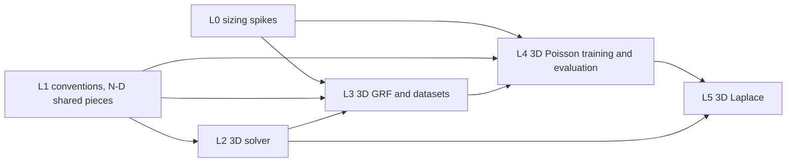

# Learning the 3D Poisson and Laplace solution operators on a Chebyshev grid: design proposal

Draft 0.2, 2026-11-11. A proposal for review, not a plan: nothing here is signed off, and no
convention changes. It carries the 2D objective
(`docs/design/2d-chebyshev-poisson-fno.md`, "the 2D design") to three dimensions: first
3D Poisson with homogeneous Dirichlet data, the direct extension, then 3D Laplace with
boundary data. Section 12 lists the decisions the proposal needs from the author.
Appendix A keeps the revision history; draft 0.2 answers the review of 0.1 (Appendix A).

> `docs/CONVENTIONS.md` takes precedence over this document. The 3D quantities need
> additions to CONVENTIONS §12 (proposed in Section 4); nothing existing changes.

Recommendation in one paragraph: reuse the 2D pipeline axis by axis. Every Chebyshev
operator in it (nodes, D2 and its eigendecomposition, Clenshaw–Curtis weights, T_cu and
T_uc) is 1D and applied per axis, and the FNO, trainer, Gauss–Newton optimiser, run
directory and normalisers are already rank-generic (`FNO<5>` is the 3D model). Generalise
the pieces that apply those operators (transfers, quadrature norms, errors 2–5) to any rank
with rank 2 routed to the existing 2D code unchanged, and test that in process (D2), rather
than copying them. Raise the GRF smoothness to α = 3 in 3D: at α = 2 the truncated energy
decays only as 1/K and misses the 2D tolerance by 20× at K = 32 (Section 3.3). Solve 3D
Poisson by fast diagonalisation (one eigendecomposition per axis, O(n⁴)), as the 2D design
anticipated (its §9, "3D carry-over"). Start at n = 33 and 65 only: storage, model size and
activation memory grow by one to two orders of magnitude (Section 7). Then reach 3D Laplace
by the discrete lifting with face sine-series data, which keeps spectral accuracy and gives
closed-form solutions (Section 3.4).

## 1. Purpose, scope and non-goals

### 1.1 Purpose

Learn the solution operator of an elliptic problem on [−1, 1]³ on a Chebyshev grid, with
the 2D objective's error decomposition (transfer floor, coarse error, fine-grid error),
and find what changes in 3D: cost, accuracy against the floor, and which pieces of the
pipeline scale.

### 1.2 In scope

- **Milestones L0–L4: 3D Poisson.** −Δu = f in Ω = [−1, 1]³, u = 0 on ∂Ω, GRF forcings in
  the Dirichlet sine basis, the operator f ↦ u.
- **Milestone L5: 3D Laplace.** Δu = 0 in Ω, u = g on ∂Ω, the operator g ↦ u.
- The 2D error set (2D design §7, errors 2–5) in 3D, with error 5 defined for six faces
  (Section 3.5).

### 1.3 Non-goals

- Gauss–Newton, PyTorch parity and multi-GPU on 3D: possible later milestones, not this
  plan. The optimiser is generic and needs no change to run on `FNO<5>`.
- New architectures (factorised FNO, spectral-basis layers) unless D4 calls for one.
- Navier–Stokes or any time-dependent problem.
- n = 129 and above for training (Section 7).
- MLflow export of 3D runs: `tracking/` reads the 2D `PoissonConfig` and
  `PoissonErrorsRecord`; a 3D export is a later task if wanted.

### 1.4 Guiding principle

**Constraint 1:** every 2D output stays bit for bit identical. What counts as an output and
how it is checked is D2 (Section 9): the 2D numerical outputs, checked in process against
the existing 2D code, not against stored bit patterns.

## 2. Constraints from the existing code

- **Rank-generic already:** `FNO<R>` (its grid channels follow CONVENTIONS §2 at any rank;
  `grid_controls_3d`) and `SpectralConv<R>` (rfft on the last axis, cfft on any other; 3D
  tests `forward_3d_matches_numpy_reference` and the `FNO<5>` checkpoint test), `LpLoss`,
  `train_fno`, `predict_host`, `optim/gauss_newton/`, `runs`, `device_loader`, the
  normalisers.
- **1D and reusable as they are:** `chebyshev::transfer` (`nodes`, `uniform_nodes`,
  `cheb_to_uniform`, `uniform_to_cheb`), `chebyshev::clencurt` (`clencurt`). The interior
  D2 and its eigendecomposition (`interior_d2`, `real_eig`) are private to
  `pde/poisson/collocation` and work on RLST 2D arrays: reusable inside that module, or
  made `pub(crate)` by CL2.1.
- **2D-only (`Array2`, `Array3` of 2D samples), to generalise or extend:**
  `transfer::apply`, `Transfers` (including `to_uniform_all`), `clencurt::cc_norm_sq`,
  `cc_rel_l2_error`, `cc_rel_l2_error_weighted`, `pde/poisson/{collocation, grf, dataset,
  manufactured, sparse}`, `metrics/poisson`, `data/loaders/poisson`, `data/catalogue`
  (`PoissonSet` names), `tracking/` (2D record types), the Poisson examples
  (`train_poisson` is `FNO<4>`).
- **Already separable:** the 2D GRF is evaluated as S_x C S_yᵀ, O(K n² + K² n) per sample
  (`grf::evaluate`); the 3D form is three mode products (Section 3.3). The 2D design's
  "O(K² n²)" text is stale.

## 3. Problem

### 3.1 Equations and domain

```math
-\Delta u = f \ \text{in}\ \Omega = [-1, 1]^3, \qquad u = 0 \ \text{on}\ \partial\Omega
\qquad \text{(L0–L4)}
```

```math
\Delta u = 0 \ \text{in}\ \Omega, \qquad u = g \ \text{on}\ \partial\Omega
\qquad \text{(L5)}
```

### 3.2 Nodes and storage

CGL nodes as in the 2D design §3.2, ascending, n = 2^k + 1 per axis. A field is stored as
`F[i, j, k] = f(x_i, y_j, z_k)` (the 'ijk' convention extending CONVENTIONS §12's 'ij').
Boundary nodes are included. The FNO's grid channels need no addition: CONVENTIONS §2
appends them in reverse axis order at any rank, `[data, z, y, x]` for `FNO<5>`.

### 3.3 Forcing family (Poisson)

The 2D Karhunen–Loève expansion with a third sine factor:

```math
f_K(x, y, z) = \frac{1}{\sqrt{S_K}} \sum_{k, l, m = 1}^{K} \xi_{klm}\, \lambda_{klm}^{1/2}\,
\phi_k(x)\, \phi_l(y)\, \phi_m(z), \qquad
\phi_k(x) = \sin\Big(\frac{k\pi(x+1)}{2}\Big)
```

```math
\lambda_{klm} = \big(\mu_{klm} + \tau^2\big)^{-\alpha}, \qquad
\mu_{klm} = \frac{\pi^2}{4}\,(k^2 + l^2 + m^2), \qquad
S_K = \frac{1}{8}\sum_{k, l, m = 1}^{K} \lambda_{klm}
```

- S_K makes the expected mean square of f_K over Ω equal to 1, as in 2D: each
  φ_k φ_l φ_m has mean square 1/8 on Ω. It is part of this design (the GRF is not in
  CONVENTIONS), recorded in each dataset's sidecar.
- **Smoothness and truncation.** A sample of f lies in H^s for s < α − d/2 (1 in 2D,
  0.5 in 3D at α = 2), and the expected energy outside the truncation decays as
  ε_K ~ K^(d − 2α): K⁻² in 2D but only K⁻¹ in 3D at α = 2. With τ = 3, summing λ to
  K = 160 and adding an integral tail (checked independently twice for this draft):

  | α | K = 8 | K = 16 | K = 32 | K = 64 |
  | --- | --- | --- | --- | --- |
  | 2 (2D, for reference) | – | 1.9e-2 | 4.9e-3 | 1.3e-3 |
  | 2 (3D) | 3.5e-1 | 1.9e-1 | 9.9e-2 | 5.0e-2 |
  | 2.5 (3D) | 1.0e-1 | 2.9e-2 | 7.9e-3 | 2.0e-3 |
  | 3 (3D) | 2.7e-2 | 4.3e-3 | 5.9e-4 | 7.7e-5 |

  At α = 2 the 2D tolerance ε_K ≤ 5e-3 would need K ≈ 2000. **Proposed (D3): τ = 3, α = 3,
  K(n) = (n − 1)/2 as in 2D** (K = 16 at n = 33, 32 at n = 65), which meets the tolerance at
  every stage including n = 33. The alternative is α = 2 with the tolerance measured on u,
  whose tail is damped by 1/μ²; it keeps the 2D family's form but leaves f's truncation
  error at 10–20 %. Either way the 3D and 2D input families differ, so CL4.2 compares
  against 2D Phase 5 as context, not as a like-for-like result.
- **Draw order (nested):** each sample draws K_max³ normals from its own ChaCha8 seed,
  row-major over (k, l, m) with m fastest, at K_max = 64; a smaller K keeps the leading
  block. The 3D seeds come from a stream distinct from the 2D sets' (CL3.1 fixes the
  scheme and records it in the sidecar).
- **S_∞ in 3D** cannot be brute-forced as in 2D (k ≤ 3000 would be 2.7e10 terms): sum by
  lattice shells to K = 160 and extrapolate the K^(d − 2α) tail.
- **Separable evaluation:** f = (S_x ⊗ S_y ⊗ S_z) applied to the K³ coefficient block, as
  three mode products, O(K n³ + K² n² + K³ n) per sample, exact (no FFT, no interpolation).
- **Exact solution:** u has coefficients ξ_klm λ_klm^{1/2} / (√S_K μ_klm) in the same
  basis, so every 3D sample has a closed-form u.
- The sine basis keeps f = 0 on ∂Ω, so there are no edge or corner singularities and the
  Chebyshev solve stays spectrally accurate (the 2D design's "Why sine and not cosine").

### 3.4 Boundary data (Laplace)

Designed in detail at the L4 gate (D6, D7). This draft fixes the approach:

- **Why not a smooth continuous lifting.** With G a smooth extension of g, u = w + G and
  −Δw = ΔG, w = 0 on ∂Ω. ΔG is in general nonzero on the cube's edges, which is the edge and
  corner singularity the sine basis avoids in Poisson: smoothness or continuity of g is not
  enough, and the Chebyshev solve would converge algebraically.
- **Discrete lifting (proposed for the solver).** Put g on the boundary nodes and move the
  boundary columns of the 3D collocation Laplacian to the right-hand side; the interior
  solve is A3 unchanged. No continuous G is needed.
- **Face sine series (proposed for D7).** Draw g on each face as a 2D sine series in the
  face's two coordinates, e.g. on z = 1:
  g = Σ c_kl φ_k(x) φ_l(y). It vanishes on every edge, so the data are compatible, and each
  term has the exact harmonic extension φ_k(x) φ_l(y) sinh(κ(z + 1)) / sinh(2κ),
  κ = (π/2)√(k² + l²): a closed-form oracle like Section 3.3's. Data that do not vanish on
  the edges are a later extension.
- **Input representation for the FNO:** g on the boundary nodes with zeros inside; a
  harmonic or simple extension of g as the input field; six face channels. D6.

### 3.5 Norms, quadrature and errors

- Relative L² errors on the CGL grid with tensor-product Clenshaw–Curtis weights
  w_i w_j w_k, extending the 2D design §3.4.
- **Error 5 (boundary) in 3D.** In 2D it is the boundary integral over four edges with 1D
  CC weights, normalised by ∮/8 against ∫∫/4 (`metrics/poisson`). In 3D: the sum over the
  six faces of the face integral with 2D tensor CC weights, normalised by the total face
  area 24 against the volume 8. A node on an edge or corner belongs to every face that
  contains it and is counted once per face (each face's quadrature is complete on its
  own). For Laplace (L5) error 5 is ‖û − g‖ on ∂Ω in the same norm.

## 4. Proposed CONVENTIONS additions (for separate review)

Only §12 needs additions; §1 and §2 are already rank-generic (Section 3.2).

- §12: the 'ijk' storage; 3D transfers as the 1D T applied along x, then y, then z; the 3D
  Clenshaw–Curtis norm (tensor weights over three axes); the 3D boundary norm of
  Section 3.5.
- `CONVENTION_VERSION` 2 → 3, since §12 changes. Every 2D dataset file stays valid, as at
  version 2; the version a 2D sidecar records is metadata, outside D2's bit identity.

## 5. Reference solver

- **A3 (labels):** fast diagonalisation. With the interior D2 = V Λ V⁻¹ (Λ negative),
  u = −(V ⊗ V ⊗ V)(Λ ⊕ Λ ⊕ Λ)⁻¹(V⁻¹ ⊗ V⁻¹ ⊗ V⁻¹) f on the interior nodes, by six mode
  products, about 12 (n − 2)⁴ flops: the 2D solver's −1/(λ_i + μ_j) with a third index.
  f64, spectrally accurate.
- **Verification:** manufactured solutions (sin(πx) sin(πy) sin(πz) and products of
  low sine modes), the closed-form u of Section 3.3, and convergence to the f64 floor in n,
  measured in the max norm and in the 3D CC norm.
- A finite-element oracle (the 2D solver C in 3D) is not needed while closed forms exist.

## 6. Software architecture

- **Generalise (constraint 1):** `transfer::apply`/`Transfers`, `cc_norm_sq`,
  `cc_rel_l2_error` and `metrics/poisson` take rank 2 or 3. Rank 2 calls the existing 2D
  code unchanged; rank 3 uses an apply-along-an-axis helper. Each has an in-process test
  that the 2D path's output equals the existing function's bit for bit (D1, D2).
- **Extend:** the collocation solver and GRF get 3D entry points sharing the 1D pieces;
  the dataset writer and `data/catalogue` get 3D set names carrying the dimension
  (`poisson3d_n{n}_K{K}_{split}`, so no 3D set takes a 2D name); the Poisson loader gets 3D
  shapes. New fields go on new 3D types, not on `PoissonConfig` or `PoissonErrorsRecord`,
  so 2D run files keep their JSON.
- **New:** a 3D training example `train_poisson3d` (`FNO<5>`; not a rank switch in
  `train_poisson`, which stays as it is), 3D predict and evaluation examples.

## 7. Cost and memory model (initial estimates)

| Quantity | 2D (measured or stated) | 3D, n = 33 (s = 32) | 3D, n = 65 (s = 64) | 3D, n = 129 |
| --- | --- | --- | --- | --- |
| Points per sample | 65² = 4225 | 35 937 | 274 625 | 2.15 M |
| Storage, f + u, f64, 1200 samples | about 80 MB (n = 65) | about 0.69 GB | about 5.3 GB | about 41 GB |
| Spectral parameters, width 32, 4 layers, modes 12 per axis | 2 359 296 (2 corners) | about 56.6 M (4 corners) | about 56.6 M | – |
| Same, modes 8 per axis | – | about 16.8 M | about 16.8 M | – |
| Parameters in total (fc0, w, fc1, fc2 added), modes 12 / 8 | 2 368 001 (Phase 5) | 56 631 841 / 16 785 953 | same | – |
| Activations kept for backward, f32, per sample | about 30 MB (s = 64) | about 0.25 GB | about 1.6–2 GB | – |
| Same at the 2D batch of 20 | 1128 MiB peak in all (Phase 5, s = 64) | about 5 GB | about 35–40 GB | – |
| Train split on the device, f32 | – | about 0.3 GB | about 2.1 GB | – |
| Solver A3 per sample | – | 12 (n − 2)⁴ ≈ 1.1e7 flops | ≈ 1.9e8 | ≈ 3.1e9 |

- Estimates from the formulas, not measured; L0 measures memory and time per epoch on
  metal and cuda. The activation figures scale the 2D measurement by the 64× point count
  and are the ones that decide R1, D4 and D8.
- The VM's GPUs are A100 80 GB (checked 2026-11-11) and it has about 500 GB of host memory,
  so s = 64 at batch 20 fits one GPU on these estimates; D4 fixes the batch with the
  model size. Loading n = 65 needs over 10 GB of host memory (f64 raw and transferred
  copies), more than is comfortable on the Mac.
- Time per epoch is not estimated: 2D at s = 64 is 1.7 s and host-bound, and 3D has 64×
  the points. CL0.1 measures it.
- The n = 65 set (about 5.3 GB, train held in memory while written) is generated on the VM
  (`datagen` needs FFTW and OpenBLAS there). Files above 4 GiB need zip64 in the npz
  writer and reader: CL0.1 checks it, or the split is stored in several files.
- n = 129 is out of scope for training; a test-only set at 129 may serve a resolution study
  (D5).

## 8. Risks

- **R1:** GPU memory or epoch time at s = 64 with modes 12³ too large; mitigations: modes
  8³, a smaller batch or width, factorised spectral weights (D4; the library objective's
  CM2.1, `docs/operators/roadmap.md`).
- **R2:** generalising the 2D pieces changes a 2D output (constraint 1); caught by the
  in-process bit-identity tests of D2, with rank 2 routed to the existing code.
- **R3:** Burn backend bugs at rank 5 (the Metal cat and fusion bugs seen in 2D);
  `tests/gpu_parity.rs` gains 3D cases (CL0.2) before 3D trains on metal.
- **R4:** the GRF truncation (Section 3.3); with α = 3 every stage meets ε_K ≤ 5e-3. If
  the author keeps α = 2 (D3), the tolerance moves to u and f's truncation error stays at
  10–20 %.
- **R5 (L5):** boundary data that do not vanish on the edges bring edge singularities
  (Section 3.4); the face sine series avoids them.
- **R6:** a 3D n = 65 split above 4 GiB meets a zip64 limit in the npz path (Section 7).

## 9. Validation

- Solver: manufactured and closed-form solutions to the f64 floor.
- Transfers: error 2 (the floor) per s in 3D, against the 2D floor at the same s.
- Model: errors 2–5 in 3D, mean and max over the test split, seeds as in 2D Phase 5.
- **Constraint 1 (D2):** the 2D outputs are the numerical results: the arrays in the 2D
  `.npz` files, the values in `errors.json`, `metrics.csv` and `costs.json` apart from
  timings, and the run configs. Metadata is outside it: `convention_version`, `git_commit`,
  wall times. The check is in process, old against new, on fixed 2D inputs: the existing 2D
  function stays the oracle (or rank 2 is routed to it unchanged), so the test holds on
  every machine. Stored bit patterns are not used: ndarray's `matrixmultiply` takes
  different kernels on x86 and aarch64, so bits captured on the Mac do not match CI. The
  whole 2D test suite passes unchanged as well.

## 10. Phased plan

Milestones L0–L5, each ending at a gate (`docs/laplace3d/gates/L<n>.md`). The tasks, their
*Done when* and *Needs* are in `docs/laplace3d/roadmap.md`.



L0 feeds L3 through D5 (sizes, storage precision, zip64) and L4 through D4 and the metal
parity cases; L1 feeds L4 through the 3D errors (CL1.3).

## 11. Alternatives considered

- **Copy the 2D modules into 3D ones:** keeps 2D frozen by construction but duplicates the
  transfer, quadrature and error code; rejected in favour of generalising with rank 2
  routed to the existing code (D1, D2).
- **Start with true Laplace:** new input representation and boundary data family before
  any 3D pipeline exists; rejected for Poisson first (the author, 2026-11-11).
- **Keep α = 2 in 3D:** the same family form as 2D, but f's truncation error at K = 32 is
  20× the 2D tolerance and decays only as 1/K (Section 3.3); kept as D3's alternative.
- **A continuous lifting for Laplace:** simple, but ΔG on the edges costs spectral
  accuracy (Section 3.4).

## 12. Decisions needed

| ID | Decision | Recommendation |
| --- | --- | --- |
| D0 | This proposal as the plan of record | draft 0.2, after the author's review |
| D1 | Generalise the 2D pieces or copy them | generalise, rank 2 routed to the existing code |
| D2 | What "bit for bit unchanged" covers for 2D, and how it is checked | the numerical outputs of Section 9, not metadata; in-process old-against-new tests on fixed 2D inputs, plus the whole 2D suite |
| D3 | GRF parameters and K in 3D | τ = 3, α = 3, K(n) = (n − 1)/2, ε_K ≤ 5e-3 on f; alternative α = 2 with the tolerance on u |
| D4 | Model size and batch at s = 32 and 64 | from L0: width 32, 4 layers, modes 8³ unless 12³ fits; batch 20 unless memory says less |
| D5 | Stages, sizes, names and storage | n = 33 (tests), 65 (training); 129 test-only if the resolution study needs it; 1000/200 split; names `poisson3d_n{n}_K{K}_{split}`; storage precision and file split (zip64) from L0 |
| D6 | Laplace input representation | after L4 |
| D7 | Laplace boundary data family | after L4; face sine series proposed (Section 3.4) |
| D8 | Where runs happen | n = 33 on the Mac, n = 65 generation and training on one A100 80 GB |

## 13. References

The 2D design and its references; `docs/CONVENTIONS.md`.

## Appendix A. Revision history

- **Draft 0.1 (2026-11-11).** First draft: scope (Poisson first, then Laplace, the author's
  choice of 2026-11-11), reuse map, cost estimates, milestones L0–L5, decisions D0–D8.
- **Draft 0.2 (2026-11-11).** After an independent review of 0.1 against the code and
  CONVENTIONS:
  - **GRF (blocking):** the 3D ε_K table, the corrected smoothness statement, α = 3
    proposed (D3), S_K stated, the draw order and S_∞ method; the 3D/2D comparison
    qualified.
  - **Constraint 1 (blocking):** D2 now says which outputs count, excludes metadata
    (the version bump changes 2D sidecars' `convention_version`), and requires in-process
    checks, since stored bits differ between x86 and aarch64.
  - Section 4: the §1 and §2 additions dropped (already rank-generic; the proposed
    (x, y, z) grid order contradicted CONVENTIONS §2).
  - Error 5 defined in 3D (Section 3.5); the solver's sign and cost corrected (Section 5);
    the Laplace approach changed to the discrete lifting with face sine series
    (Section 3.4).
  - Section 7: totals, activation memory, device and host memory, the VM's GPUs, where
    n = 65 is generated, zip64. R6 added.
  - Section 2's lists corrected; 3D dataset names carry the dimension; a separate 3D
    training example; 3D MLflow export a non-goal.
  - Roadmap dependencies added (CL2.1 and CL3.2 need CL1.2, CL3.2 needs D5, CL4.1 needs
    CL0.2; L0 → L3 and L1 → L4 in Section 10).
