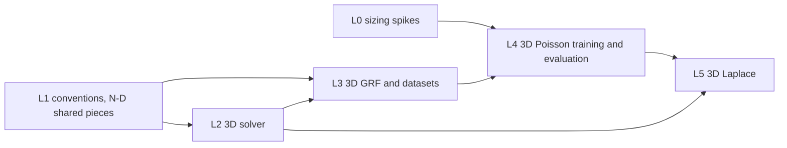

# Learning the 3D Poisson and Laplace solution operators on a Chebyshev grid: design proposal

Draft 0.1, 2026-11-11. A proposal for review, not a plan: nothing here is signed off, and no
convention changes. It carries the 2D objective
(`docs/design/2d-chebyshev-poisson-fno.md`, "the 2D design") to three dimensions: first
3D Poisson with homogeneous Dirichlet data, the direct extension, then 3D Laplace with
boundary data. Section 12 lists the decisions the proposal needs from the author.
Appendix A keeps the revision history.

> `docs/CONVENTIONS.md` takes precedence over this document. The 3D quantities need
> additions to CONVENTIONS (proposed in Section 4); nothing existing changes.

Recommendation in one paragraph: reuse the 2D pipeline axis by axis. Every Chebyshev
operator in it (nodes, D2 and its eigendecomposition, Clenshaw–Curtis weights, T_cu and
T_uc) is 1D and applied per axis, and the FNO, trainer, Gauss–Newton optimiser, run
directory and tracking are already rank-generic (`FNO<5>` is the 3D model). Generalise the
pieces that apply those operators (transfers, quadrature norms, errors 2–5) to any rank
behind a bit-identity test on the 2D outputs, rather than copying them. Solve 3D Poisson
by fast diagonalisation (one eigendecomposition per axis, O(n⁴)), as the 2D design
anticipated (its §9, "3D carry-over"). Start at n = 33 and 65 only: storage and model size
grow by one to two orders of magnitude (Section 7). Then reach 3D Laplace by lifting, which
reduces it to the same Poisson solver.

## 1. Purpose, scope and non-goals

### 1.1 Purpose

Learn the solution operator of an elliptic problem on [−1, 1]³ on a Chebyshev grid, with
the 2D objective's error decomposition (transfer floor, coarse error, fine-grid error),
and find what changes in 3D: cost, accuracy against the floor, and which pieces of the
pipeline scale.

### 1.2 In scope

- **Milestones L0–L4: 3D Poisson.** −Δu = f in Ω = [−1, 1]³, u = 0 on ∂Ω, GRF forcings in
  the Dirichlet sine basis, the operator f ↦ u.
- **Milestone L5: 3D Laplace.** Δu = 0 in Ω, u = g on ∂Ω, the operator g ↦ u.
- The 2D error set (2D design §7, errors 2–5) in 3D.

### 1.3 Non-goals

- Gauss–Newton, PyTorch parity and multi-GPU on 3D: possible later milestones, not this
  plan. The optimiser is generic and needs no change to run on `FNO<5>`.
- New architectures (factorised FNO, spectral-basis layers) unless D4 calls for one.
- Navier–Stokes or any time-dependent problem.
- n = 129 and above for training (Section 7).

### 1.4 Guiding principle

**Constraint 1:** every 2D output stays bit for bit identical. The generalised pieces are
tested against the 2D values they replace before 3D uses them.

## 2. Constraints from the existing code

- **Rank-generic already:** `FNO<R>` and `SpectralConv<R>` (3D tests:
  `forward_3d_matches_numpy_reference`, the `FNO<5>` checkpoint test), `LpLoss`,
  `train_fno`, `predict_host`, `optim/gauss_newton/`, `runs`, `tracking/`,
  `device_loader`, the normalisers.
- **1D and reusable as they are:** `chebyshev::transfer` (`nodes`, `uniform_nodes`,
  `cheb_to_uniform`, `uniform_to_cheb`), `chebyshev::clencurt` (`clencurt`), the interior
  D2 and its eigendecomposition in `pde/poisson/collocation`.
- **2D-only (`Array2`), to generalise or extend:** `transfer::apply` and `Transfers`,
  `clencurt::cc_rel_l2_error`, `pde/poisson/{collocation, grf, dataset, manufactured,
  sparse}`, `metrics/poisson`, `data/loaders/poisson`, the Poisson examples.
- **To check before L1:** that the 2D GRF evaluation is direct, O(K² n²) per sample; in 3D a
  direct sum is O(K³ n³), about 9e9 terms at K = 32, n = 65, so the 3D GRF must be
  evaluated by separable mode products (O(K n³), Section 3.3).

## 3. Problem

### 3.1 Equations and domain

```math
-\Delta u = f \ \text{in}\ \Omega = [-1, 1]^3, \qquad u = 0 \ \text{on}\ \partial\Omega
\qquad \text{(L0–L4)}
```

```math
\Delta u = 0 \ \text{in}\ \Omega, \qquad u = g \ \text{on}\ \partial\Omega
\qquad \text{(L5)}
```

### 3.2 Nodes and storage

CGL nodes as in the 2D design §3.2, ascending, n = 2^k + 1 per axis. A field is stored as
`F[i, j, k] = f(x_i, y_j, z_k)` (the 'ijk' convention extending 'ij'). Boundary nodes are
included.

### 3.3 Forcing family (Poisson)

The 2D Karhunen–Loève expansion with a third sine factor:

```math
f_K(x, y, z) = \frac{1}{\sqrt{S_K}} \sum_{k, l, m = 1}^{K} \xi_{klm}\, \lambda_{klm}^{1/2}\,
\phi_k(x)\, \phi_l(y)\, \phi_m(z), \qquad
\phi_k(x) = \sin\Big(\frac{k\pi(x+1)}{2}\Big)
```

```math
\lambda_{klm} = \big(\mu_{klm} + \tau^2\big)^{-\alpha}, \qquad
\mu_{klm} = \frac{\pi^2}{4}\,(k^2 + l^2 + m^2)
```

- S_K normalises the expected RMS to 1, as in 2D; its 3D form is fixed in the CONVENTIONS
  addition (Section 4).
- τ = 3 and α = 2 as in 2D (D3). A sample's smoothness falls with dimension (about 2α − d/2
  Sobolev orders, 2.5 in 3D against 3 in 2D), so ε_K is larger at the same K and must be
  recomputed (task CL3.1).
- **Separable evaluation:** f = (S_x ⊗ S_y ⊗ S_z) applied to the K³ coefficient block, as
  three mode products, O(K n³ + K² n² + K³ n) per sample, exact (no FFT, no interpolation).
- **Exact solution:** u has coefficients ξ_klm λ_klm^{1/2} / μ_klm in the same basis, so
  every 3D sample has a closed-form u, an oracle the 2D sine basis already gave.
- The sine basis keeps f = 0 on ∂Ω, so there are no edge or corner singularities and the
  Chebyshev solve stays spectrally accurate (the 2D design's "Why sine and not cosine").

### 3.4 Boundary data (Laplace)

To be designed in L5 (D6, D7). The constraints known now:

- **Compatibility:** g must be continuous across the 12 edges and 8 corners of the cube, and
  smooth enough there, or u has edge and corner singularities and the Chebyshev solve drops
  from spectral to algebraic convergence.
- **Lifting:** with G any smooth extension of g into Ω, u = w + G where −Δw = ΔG, w = 0 on
  ∂Ω. The L2 solver then solves Laplace unchanged.
- **Input representation for the FNO:** g lives on the six faces, the FNO on the volume.
  Options: the lifting G as the input field; g on the boundary nodes with zeros inside;
  six face channels. D6.

### 3.5 Norms and quadrature

Relative L² errors on the CGL grid with tensor-product Clenshaw–Curtis weights
w_i w_j w_k, extending the 2D design §3.4.

## 4. Proposed CONVENTIONS additions (for separate review)

- §1: the rank-5 layout `[B, C, X, Y, Z]` (channels-first) and its channels-last form.
- §2: three coordinate grid channels on [0, 1]³, the order (x, y, z).
- §12: the 'ijk' storage, 3D transfers as T applied along each axis in a fixed order, the
  3D Clenshaw–Curtis norm.
- §10: the 3D GRF normalisation S_K.
- `CONVENTION_VERSION` bump.

## 5. Reference solver

- **A3 (labels):** fast diagonalisation. With D2 = V Λ V⁻¹ on the interior nodes,
  u = (V ⊗ V ⊗ V)(Λ ⊕ Λ ⊕ Λ)⁻¹(V⁻¹ ⊗ V⁻¹ ⊗ V⁻¹) f, by mode products, O(n⁴). f64,
  spectrally accurate.
- **Verification:** manufactured solutions (sin(πx) sin(πy) sin(πz) and products of
  low sine modes), the closed-form u of Section 3.3, and convergence to the f64 floor in n.
- A finite-element oracle (the 2D solver C in 3D) is not needed while closed forms exist.

## 6. Software architecture

- **Generalise (constraint 1):** `transfer::apply`/`Transfers`, `cc_rel_l2_error` and
  `metrics/poisson` take any rank (one helper that applies a 1D matrix along an axis), each
  with a test that the 2D output is bit for bit unchanged. D1.
- **Extend:** the collocation solver and GRF get 3D entry points sharing the 1D pieces;
  the dataset writer and `data/catalogue` get 3D set names; the Poisson loader gets 3D
  shapes.
- **New:** a 3D training example (or a rank switch in `train_poisson`), 3D predict and
  evaluation examples.

## 7. Cost and memory model (initial estimates)

| Quantity | 2D (measured or stated) | 3D, n = 33 | 3D, n = 65 | 3D, n = 129 |
| --- | --- | --- | --- | --- |
| Points per sample | 65² = 4225 | 35 937 | 274 625 | 2.15 M |
| Storage, f + u, f64, 1200 samples | about 80 MB (n = 65) | about 0.69 GB | about 5.3 GB | about 41 GB |
| Spectral parameters, width 32, 4 layers, modes 12 per axis | 2 359 296 (2 corners) | – | about 56.6 M (4 corners) | – |
| Same, modes 8 per axis | – | about 16.8 M | about 16.8 M | – |
| Solver A3 per sample | – | O(n⁴) ≈ 1.2e6 | ≈ 1.8e7 | ≈ 2.8e8 |

Estimates from the formulas, not measured; L0 measures memory and time per epoch on
metal and cuda. n = 129 is out of scope for training (storage and memory); a test-only set
at 129 may serve a resolution study (D5).

## 8. Risks

- **R1:** GPU memory or epoch time at s = 64 with modes 12³ too large; mitigations: modes
  8³, smaller width, factorised spectral weights (D4; the library objective's CM2.1,
  `docs/operators/roadmap.md`).
- **R2:** generalising the 2D pieces changes a 2D output (constraint 1); caught by the
  bit-identity tests.
- **R3:** Burn backend bugs at rank 5 (the Metal cat and fusion bugs seen in 2D);
  `tests/gpu_parity.rs` gains 3D cases.
- **R4:** ε_K at K = 16 and 32 may be too large for the 5e-3 tolerance of 2D; D3.
- **R5 (L5):** incompatible boundary data brings edge singularities (Section 3.4).

## 9. Validation

- Solver: manufactured and closed-form solutions to the f64 floor.
- Transfers: error 2 (the floor) per s in 3D, against the 2D floor at the same s.
- Model: errors 2–5 in 3D, mean and max over the test split, seeds as in 2D Phase 5.
- Constraint 1: the 2D test suite and bit-identity tests on every generalised piece.

## 10. Phased plan

Milestones L0–L5, each ending at a gate (`docs/laplace3d/gates/L<n>.md`). The tasks, their
*Done when* and *Needs* are in `docs/laplace3d/roadmap.md`.



## 11. Alternatives considered

- **Copy the 2D modules into 3D ones:** keeps 2D frozen by construction but duplicates the
  transfer, quadrature and error code; rejected in favour of generalising under
  constraint 1 (D1).
- **Start with true Laplace:** new input representation and boundary data family before
  any 3D pipeline exists; rejected for Poisson first (the author, 2026-11-11).

## 12. Decisions needed

| ID | Decision | Recommendation |
| --- | --- | --- |
| D0 | This proposal as the plan of record | after review |
| D1 | Generalise the 2D pieces or copy them | generalise, under constraint 1 |
| D2 | What "bit for bit unchanged" covers for 2D | every 2D test, plus a regression test per generalised function on fixed 2D inputs |
| D3 | GRF parameters and K in 3D | τ = 3, α = 2, K(n) as in 2D; re-examine after CL3.1's ε_K |
| D4 | Model size at s = 32 and 64 | from L0: width 32, 4 layers, modes 8³ unless 12³ fits |
| D5 | Stages and sizes | n = 33 (tests), 65 (training); 129 test-only if the resolution study needs it; 1000/200 split, storage precision from L0 |
| D6 | Laplace input representation | after L4 |
| D7 | Laplace boundary data family | after L4 |
| D8 | Where runs happen | n = 33 on the Mac, n = 65 on one A100 |

## 13. References

The 2D design and its references; `docs/CONVENTIONS.md`.

## Appendix A. Revision history

- **Draft 0.1 (2026-11-11).** First draft: scope (Poisson first, then Laplace, the author's
  choice of 2026-11-11), reuse map, cost estimates, milestones L0–L5, decisions D0–D8.
