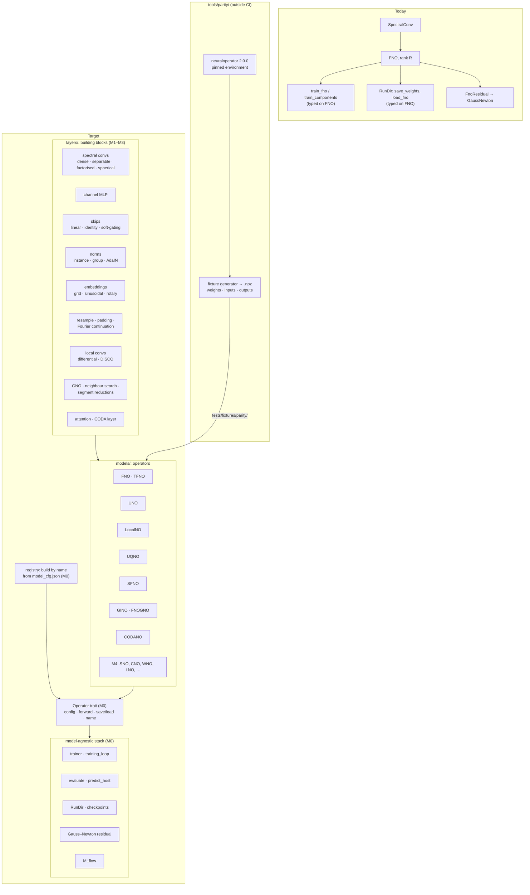
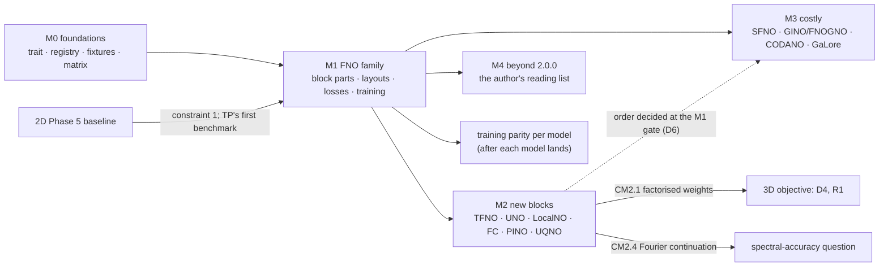
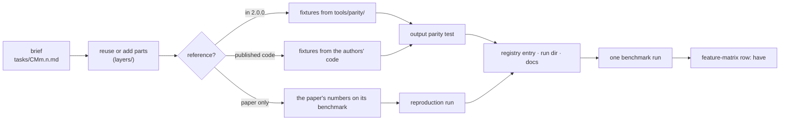

# A neural operator library in Rust: design proposal

Draft 0.1, 2026-11-11. A proposal for review, not a plan: nothing here is signed off, and no
convention changes. It turns the discussion of 2026-11-11 (parity with the PyTorch
`neuraloperator` toolbox, release 2.0.0, and operators from the author's reading) into an
architecture, a development wireframe, a validation rule and a phased plan with gates.
Section 12 lists the decisions the proposal needs from the author. Appendix A keeps the
revision history.

> `docs/CONVENTIONS.md` takes precedence over this document. New operators add
> CONVENTIONS sections when they fix a layout or normalisation; nothing existing changes.

Recommendation in one paragraph: grow sciml-rs from one model (the FNO) into a library of
neural operators, in tiers. First make the training stack model-agnostic: today
`train_components`, `RunDir::save_weights`, `RunDir::load_fno`, checkpoints and the epoch
observer are typed on `FNO<R>`, so every new model would otherwise copy them. Then break
the FNO into the parts `neuraloperator` builds every model from (spectral convolution,
channel MLP, skip, normalisation, embedding, resampling), reach output parity with
`neuraloperator` 2.0.0 on the full FNO family, and add the other 2.0.0 operators on those
parts, cheapest first. Every operator is checked against a reference: fixtures written by
a pinned Python environment for the 2.0.0 operators, published code or the paper's
numbers for the others. Operators from the author's reading list follow under the same
recipe.

## 1. Purpose, scope and non-goals

### 1.1 Purpose

A Rust-native neural operator library with the model range of `neuraloperator` 2.0.0
(`github.com/neuraloperator/neuraloperator`, tag `2.0.0`, commit `b307030`, released
2025-10-22), each model checked against it, plus operators beyond it. It serves the
umbrella aim (Rust-native viability and HPC) and the other objectives: the 3D objective
needs factorised spectral weights (its D4 and R1), the spectral-accuracy question needs
Fourier continuation and Sobolev losses.

### 1.2 In scope

- The 2.0.0 models: FNO, TFNO, UNO, LocalNO, UQNO, SFNO, GINO, FNOGNO, CODANO.
- Their building blocks: spectral convolutions (dense, separable, factorised), channel
  MLPs, skips, normalisations, embeddings, resampling, Fourier continuation, differential
  and DISCO convolutions, GNO blocks, attention.
- Losses (Lp, H1, Hdiv, quantile, MSE, weighted and adaptive aggregators, equation losses),
  training features (incremental, patching, AdamW, GaLore, mixed precision), building a
  model by name from a config (`get_model`).
- Training and performance parity: the same data and hardware, both libraries scored by
  this crate's evaluators.
- Operators from the literature not in 2.0.0 (M4).

### 1.3 Non-goals

- Bit-identical weights to PyTorch after training: RNGs differ; parity is of outputs for
  the same weights, and of trained accuracy and cost in distribution.
- Running PyTorch from Rust: the Python side writes fixtures and runs comparisons outside
  CI; the crate never depends on it.
- Changing the existing FNO's behaviour (constraint 1).

### 1.4 Guiding principles

- **Constraint 1:** every existing FNO output stays bit for bit identical, the 2D Phase 5
  baseline above all. A part made configurable defaults to today's behaviour.
- **Conventions stay put:** the corner layout of spectral weights (CONVENTIONS §5) and
  `norm="backward"` (§4) remain the internal form. `neuraloperator`'s centred layout is
  converted when fixtures are loaded, not adopted.
- **One recipe per operator** (Section 6.4), so the twentieth operator costs no more than
  the third.

## 2. Constraints from the existing code

- **Rank-generic:** `FNO<R>`, `SpectralConv<R>`, `LpLoss`, the loaders, `device_loader`.
- **FNO-typed, to generalise in M0:** `training::trainer` (`train_components` returns
  `FNO<R>`; `EpochObserver<R>`; `print_epoch(&FNO<R>)`), `training::gn::FnoResidual`,
  `runs` (`save_weights(&FNO<R>)`, `load_fno`, `model_config() -> FNOConfig`,
  `Checkpoint<R>`), `models::predict::predict_host`, the MLflow export of the model config.
- **Already model-agnostic:** `optim::gauss_newton` (any Burn `Module`), the metrics, the
  run-file writers other than the weights.
- **Burn fork:** reverse-mode autodiff only; `rfft`, `irfft`, forward `cfft`, and the
  crate's `icfft_full_spectrum`; complex numbers are pairs of real tensors. Complex-valued
  data (2.0.0's `complex_data`) needs complex arithmetic written on that pairing.
- **Grid-bound inputs:** `Tensor<R>` on a grid fits FNO, TFNO, UNO, LocalNO, UQNO and SFNO
  (on a lat-lon grid). GINO and FNOGNO take point clouds and need a second input type.

## 3. The 2.0.0 reference (read from the tag)

| Area | 2.0.0 (files under `neuralop/`) | sciml-rs today |
| --- | --- | --- |
| Models | `models/`: `fno` (FNO, TFNO), `uno`, `local_no`, `uqno`, `sfno`, `gino`, `fnogno`, `codano`, `base_model` (`get_model`) | FNO |
| Spectral layers | `spectral_convolution` (centred weights after `fftshift`, `fft_norm="forward"`, dense or Tucker / CP / TT, separable, `max_n_modes`), `legacy_spectral_convolution` (corner weights, `fft_norm="backward"`), `spherical_convolution` | `SpectralConv` (corner weights, `backward`) |
| Block parts | `fno_block`, `channel_mlp`, `skip_connections`, `normalization_layers`, `embeddings` (`GridEmbedding2D`, `GridEmbeddingND`, `SinusoidalEmbedding`, `RotaryEmbedding2D`), `padding`, `resample`, `complex` | grid channels, domain padding |
| Other layers | `fourier_continuation` (`FCLegendre`, `FCGram`), `differential_conv`, `discrete_continuous_convolution`, `local_no_block`, `gno_block`, `neighbor_search`, `segment_csr`, `integral_transform`, `attention_kernel_integral`, `coda_layer`, `spectral_projection` | – |
| Losses | `data_losses` (LpLoss, H1Loss, HdivLoss, PointwiseQuantileLoss, MSELoss), `meta_losses` (FieldwiseAggregatorLoss, WeightedSumLoss, SoftAdapt, Relobralo), `equation_losses`, `differentiation` | LpLoss |
| Training | `trainer`, `training_state`, `incremental`, `patching`, `adamw`, `tensor_galore_projector` | trainer, checkpoint and resume, multi-GPU, MLflow, Gauss–Newton |
| Data | `datasets/`: Burgers, Darcy, Navier–Stokes, nonlinear Poisson, spherical SWE, car CFD, The Well; HDF5, Zarr, `.pt` readers | Burgers, Darcy, Chebyshev Poisson (`.mat`, `.npz`) |

The FNO defaults differ from this crate's (Li et al.'s) architecture: lifting and
projection are channel MLPs of ratio 2; each block has a channel MLP (expansion 0.5,
soft-gating skip) beside the linear skip; weights are complex normal, std
√(2 / (in + out)). SFNO and LocalNO import only when `torch_harmonics` is installed.
Every row is to be verified and completed by CM0.1 (`docs/operators/feature-matrix.md`).

## 4. Development wireframe

### 4.1 Architecture: today and target



### 4.2 Milestones and their links to the other objectives



### 4.3 The per-operator recipe



### 4.4 Module layout, target

```
src/neural_operators/
  layers/          spectral_convolution (dense corners, as today), spectral_factorised,
                   spectral_separable, spherical, channel_mlp, skip, norm, embedding,
                   resample, fourier_continuation, local_conv, gno, attention
  models/          operator.rs (the trait), registry.rs, fno/ (block options), tfno/,
                   uno/, local_no/, uqno/, sfno/, gino/, codano/, …
  losses/          LpLoss, H1, Hdiv, quantile, aggregators, equation losses
  training/        generic over the operator trait
tools/parity/      pinned Python environment, fixture generator, comparison runs
tests/fixtures/parity/   small .npz fixtures, one per operator and configuration
```

## 5. Validation

- **Output parity:** for a fixture (weights, input, output written by 2.0.0 on the CPU in
  f32 and f64), the Rust operator loaded with the same weights gives the same output,
  within a tolerance relative to the reference (D3; CONVENTIONS §7's rule for fast paths).
- **Gradient parity** for the parts with custom backward work (factorised contractions,
  spherical transforms, segment reductions): the gradient of a fixed scalar loss against
  the fixture's.
- **Training parity** (after each model, on its benchmark): the same data, architecture,
  optimiser, schedule, epochs and seeds, on the A100; both libraries' predictions scored
  by this crate's evaluator (for Poisson, `poisson_errors`); compared: error, seconds per
  epoch, peak memory, time to a target error, spread over seeds.
- **Constraint 1:** every existing FNO test, plus bit-identity tests on a fixed FNO
  forward and on one Phase 5 training epoch with the default options.

## 6. Software architecture

### 6.1 The operator trait (M0)

A trait over Burn modules with an associated config type: build from config, forward on
the input type, a name for the registry, and the run directory's save and load. The
trainer, `evaluate`, `predict_host`, checkpoints, the epoch observer and the Gauss–Newton
residual become generic over it. `FNO<R>` implements it first, unchanged.

### 6.2 The registry (M0)

`model_cfg.json` gains a `kind` field; a missing `kind` reads as the FNO, so every existing
run directory loads unchanged. The registry maps a kind to its config and constructor,
the analogue of 2.0.0's `get_model`. Rank stays a compile-time parameter.

### 6.3 Weight conversion (M1)

A fixture loader maps 2.0.0's parameter names and shapes onto this crate's modules: the
centred spectral tensor to the 2^(D−1) corners (and `n_modes` counted over both signs to
modes per corner), complex tensors to real and imaginary pairs. The legacy layer maps
corner to corner, so it is the first test (CM1.1).

### 6.4 Adding an operator

The recipe of Section 4.3: a brief; parts reused or added in `layers/`; a reference
(fixtures from 2.0.0 or the authors' code, else the paper's numbers); an output parity
test or a reproduction run; a registry entry; one benchmark run; its feature-matrix row.
A dataset loader is added with the first operator that needs it.

## 7. Cost and size (initial)

The 2.0.0 tree has 9 model files, 30 layer files, 4 loss files and 7 training files. M0
and M1 are of the order of 2D Phases 9 and 10 together; each M2 operator about one task to
three; SFNO and GINO each a milestone's worth of their own. Estimates only, revised at
each gate.

## 8. Risks

- **R1:** generalising the trainer changes an FNO output (constraint 1); caught by the
  bit-identity tests.
- **R2:** Burn's reverse-mode-only autodiff and its FFT set make some 2.0.0 parts costly
  (complex data, spherical transforms); each such part gets a spike first.
- **R3:** 2.0.0's defaults or code move after 2.0.0; the pin is the tag, and a later
  release is a new decision.
- **R4:** GINO's point-cloud inputs strain the grid-typed trait; CM3.3 may extend the trait
  with an input type parameter.
- **R5:** Python environment drift (torch, tensorly, tltorch, torch_harmonics versions);
  pinned in `tools/parity/` with a lock file.

## 9. Relation to the other objectives

- **2D:** the FNO and its Phase 5 baseline are the fixed point (constraint 1) and the first
  training-parity benchmark.
- **3D:** CM2.1's factorised weights answer its D4 and R1 if modes 12³ do not fit.
- **Spectral accuracy:** CM2.4 (Fourier continuation) and CM1.6 (H1 loss) are the 2.0.0
  parts most relevant to it; M4's Spectral Neural Operator (Chebyshev basis) is the
  closest operator.

## 10. Phased plan

Milestones M0–M4, each ending at a gate (`docs/operators/gates/M<n>.md`). The tasks, their
*Done when* and *Needs* are in `docs/operators/roadmap.md`. The order of M2 and M3 is set
at the M1 gate (D6); M4 entries are added as the author names them.

## 11. Alternatives considered

- **Adopt 2.0.0's centred weight layout internally:** one layout fewer to convert, but it
  changes CONVENTIONS §5 and every FNO weight file; rejected (Section 1.4).
- **Feature parity only, as a matrix:** cheaper, but names without checked outputs are not
  parity; rejected for the fixture rule.
- **Parity limited to the FNO family plus TFNO and UNO:** the first recommendation of
  2026-11-11; widened by the author the same day to every 2.0.0 operator and beyond.

## 12. Decisions needed

| ID | Decision | Recommendation |
| --- | --- | --- |
| D0 | This proposal as the plan of record | after review |
| D1 | Reference version | `neuraloperator` 2.0.0, tag `2.0.0` (the author, 2026-11-11) |
| D2 | Where the Python side lives | `tools/parity/` in this repository, outside CI, with a lock file; fixtures in `tests/fixtures/parity/` |
| D3 | Output parity tolerance | relative max error ≤ 1e-5 in f32 and ≤ 1e-12 in f64 on the CPU, against the fixture |
| D4 | Shape of the operator trait | a trait with an associated config and input type, generic, no trait objects |
| D5 | Spectral weight layout | keep corners internally (CONVENTIONS §5); convert at fixture load |
| D6 | Order of M2 and M3 | at the M1 gate; default M2 first |
| D7 | Training-parity hardware | one A100 on the VM, as 2D Phase 10 |
| D8 | Fixture size | tiny models only (P ≲ 10⁴), so fixtures stay under about 1 MB each |

## 13. References

`neuraloperator` 2.0.0 (tag `2.0.0`); Li et al. (2021), FNO; the 2D design and
`docs/CONVENTIONS.md`. Further operators for M4, verified 2026-11-11 against arXiv:
Fanaskov and Oseledets, Spectral Neural Operators, arXiv:2205.10573; Raonić et al.,
Convolutional Neural Operators, arXiv:2302.01178; Tripura and Chakraborty, Wavelet Neural
Operator, arXiv:2205.02191; Cao, Goswami and Karniadakis, Laplace Neural Operator,
arXiv:2303.10528; Du, Chalapathi and Krishnapriyan, Neural Spectral Methods,
arXiv:2312.05225.

## Appendix A. Revision history

- **Draft 0.1 (2026-11-11).** First draft: scope (every 2.0.0 operator and operators
  beyond it, the author's choice of 2026-11-11), the wireframes of Section 4, milestones
  M0–M4, decisions D0–D8.
