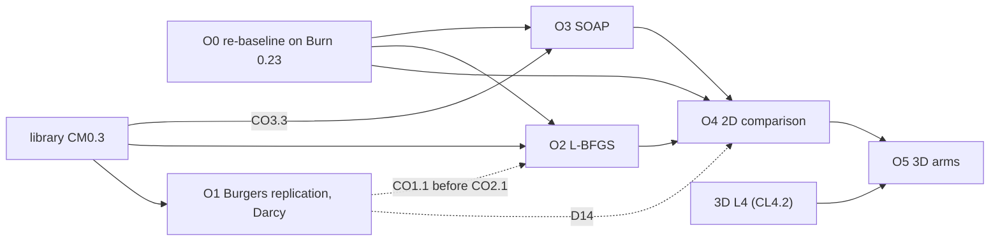

# Optimiser benchmarks for the neural operators: L-BFGS and SOAP against Adam and Gauss–Newton: design proposal

Draft 0.2, 2026-11-24. A proposal for review, not a plan: nothing here is signed off, and no
convention changes. It adds two optimisers to the comparison the 2D objective's Phase 10
began (`docs/poisson2d/phase10/results.md`), on the 2D Poisson baseline first and on the 3D
objective's Poisson baseline later, and, since draft 0.2, replicates the one published
Gauss–Newton training of an FNO (Zampini et al. 2024, PETScML) on 1D Burgers, with Darcy as
an extension. Section 12 lists the decisions the proposal needs from the author. The
reference notes behind Sections 5 and 13 are in `docs/optimisers/references.md`; the
literature search behind Section 3.1 is in `paper/literature-search.md` (git-ignored).

> `docs/CONVENTIONS.md` takes precedence over this document. Nothing here changes a
> convention.

Recommendation in one paragraph: Phase 10 found that matrix-free Gauss–Newton, without
weight decay, reaches lower fine-grid errors than Adam, but at about 100 Adam updates' worth
of passes per update, and that at equal wall-clock the margin over three seeds is not
settled. The open question is whether the gain comes from *exact* curvature products or
from curvature information at all. Two cheaper curvature-aware optimisers answer it: L-BFGS,
which infers curvature from its gradient history (Burn 0.23 ships one), and SOAP, Adam run
in the eigenbasis of a Kronecker-factored preconditioner (to be written). First rerun the
Phase 10 reference arms on Burn 0.23 with five seeds, because every Phase 10 run was on the
old Burn fork (O0). Add L-BFGS as a full-batch arm minimising Gauss–Newton's objective, with
every closure evaluation counted as passes (O2). Write SOAP as a per-parameter Burn
`Optimizer`, so it reuses Adam's training path unchanged, with one Kronecker factor per
tensor dimension, the reference implementation's default (O3). Compare all four at equal wall-clock and at
a long budget of 5,400 s (O4; about 1.83× the equal-time budget on Burn 0.23, 2,952 s;
6.3× was Phase 10's 859.4 s on the fork), then carry the arms that hold up into 3D (O5).

Draft 0.2 adds a replication (O1). Zampini et al. (2024, arXiv 2403.12188, §4.1.1) trained
the FNO paper's 1D Burgers model with trust-region Gauss–Newton and found it "almost two
orders of magnitude" better in test error than the reference AdamW, but that AdamW carried
weight decay 1e-4, while their Gauss–Newton minimises eq. 6 with no regulariser stated. Phase 10 found weight decay helps Adam and
traps Gauss–Newton, so part of that gap may be the weight decay, not the curvature. O1
reruns their setting as a 2 × 2: {AdamW, Gauss–Newton} × {weight decay 0, 1e-4}, five seeds,
then the same on Darcy. It needs only Adam and Gauss–Newton, with its own settings (D12), so it can run beside O0. Draft
0.2 also proposes weight decay as a factor in every arm of O4 (D13). The hypothesis it
tests: an optimiser that reaches the penalised minimiser within the budget (full-batch
Gauss–Newton, full-batch L-BFGS on Φ + ½μ‖θ‖²) is hurt by the penalty, while a stochastic
first-order one is helped, whether its decay is coupled (our Adam, helped in Phase 10) or
decoupled (AdamW, SOAP). O1's optional coupled-Adam cells beside AdamW tell "reaches the
minimiser" apart from "coupled or decoupled".

## 1. Purpose, scope and non-goals

### 1.1 Purpose

Measure whether cheaper curvature-aware optimisers match Gauss–Newton's advantage over Adam
on the Poisson FNO, at equal A100 wall-clock and at equal passes, with enough seeds to
separate the arms; and settle Phase 10's open equal-time question on the same Burn. Test
whether the published Gauss–Newton advantage on Burgers survives once both arms are run
with and without weight decay, and whether weight decay's effect on an optimiser follows
from whether that optimiser minimises the penalised objective.

### 1.2 In scope

- **O0, re-baseline on Burn 0.23:** Adam and the reference Gauss–Newton arm, five seeds;
  Adam at the long budget; a cost profile of one Gauss–Newton step.
- **O1, the Burgers replication and the Darcy extension:** PETScML's Burgers setting
  (Section 3.1) with an AdamW arm and Burn's step schedule wired into the trainer, Gauss–Newton
  wired into `train_burgers` and `train_darcy`; the 2 × 2 on each.
- **O2, L-BFGS:** Burn's `LBFGS` as a training arm.
- **O3, SOAP:** a new optimiser, `optim/soap/`, and its training arm.
- **O4, the 2D comparison:** four arms, five seeds, two budgets; results.
- **O5, the 3D arms:** the arms O4 keeps, on the 3D objective's Poisson baseline.

### 1.3 Non-goals

- f64 (blocked upstream on cuda, and unnecessary at 5–7 digits: decision 31's amendment of
  2026-11-24), and low precision (FP16, FP8): a later paper.
- New architectures, PyTorch parity (the library objective), multi-GPU training with the new
  optimisers.
- Tuning Adam beyond its Phase 5 settings, and changing Gauss–Newton's algorithm (an exact
  JVP, new preconditioners). O0's profile may propose such work; it is not part of this
  objective.
- Mini-batch L-BFGS variants (stochastic quasi-Newton).
- Replicating PETScML's *solver* (trust region, Steihaug–Toint CG, an L-BFGS
  preconditioner) or its f64 arithmetic: O1 replicates their *setting and baseline* with
  our Levenberg–Marquardt Gauss–Newton in f32 (D10). Their 2D Navier–Stokes FNO case and
  their DeepONet cases are not rerun.
- Phase 10 T6's conditioning study (H10b) on Burgers or Darcy: a later task if O1's results
  call for it.

### 1.4 Guiding principle

**Constraint 1:** every existing output stays bit for bit identical: the Adam and
Gauss–Newton paths, their run files, and every 2D and 3D result. The new optimisers are
additive: a new `OptimizerConfig` variant each, new modules, and no edit to the existing
branches of the trainer. Enabling Burn's `linalg` feature (Section 5.4) must not change any
existing output either; O3's first task checks it.

## 2. Constraints from the existing code

- **The trainer** (`training/`): `TrainingConfig.optimizer` is an `Option<OptimizerConfig>`
  (`None` = Adam) with variants `Adam` and `GaussNewton(GaussNewtonConfig)`
  (`training/config.rs`); the Hybrid arm is set by `adam_epochs`, not a variant. Adam is built
  as a `ModuleOptimizer` with coupled L2 weight decay and the cosine schedule
  (`trainer.rs`, `build_training_components`) and stepped per batch by `train_epoch`; Gauss–Newton
  runs `train_epoch_gn` (`training/gn.rs`) with `FnoResidual`, Φ = (1/2B) Σᵢ ‖rᵢ‖².
  Everything in `training/` is typed to `FNO<R>`, any rank.
- **Burn's per-parameter `Optimizer` trait** (`burn-optim/src/optim/module/base.rs`): one
  tensor of any rank at a time, with a recordable per-tensor state; any implementation wraps
  into the same `ModuleOptimizer` Adam uses. A new optimiser written this way reuses
  `train_epoch`, the scheduler, checkpoints and the run directory unchanged.
- **Burn's L-BFGS** (`burn-optim/src/optim/lbfgs.rs`, a port of PyTorch's): `LBFGSConfig`
  derives `Config` (`max_iter` 20, `history_size` 100, tolerances, `max_eval`,
  `line_search_fn` `None` or `StrongWolfe`); `LBFGS::step(lr, module, closure)` runs up to
  `max_iter` inner iterations, each calling `closure(module) -> (loss, grads)`; state saves
  through `into_bytes` / `from_bytes` (or `to_record` / `load_record`). It is not a per-parameter `Optimizer`: it needs its
  own epoch function, as Gauss–Newton has.
- **Run files:** `costs.json` records `optimisation_steps`, `forward_passes` and
  `backward_passes` (Phase 10 T3); `checkpoint.bin` has an optional optimiser section;
  `poisson_matrix --by-optimizer` tabulates arms. The new arms need passes counted by the
  same rule, and their own checkpoint section where the state is not a `ModuleOptimizer`'s.
- **Burn 0.23 (`burn-linalg`, feature `linalg`, not enabled in this crate today):** `qr`
  (Householder, written in tensor ops), `svd` (host), `cholesky`, `lu`, `solve`; `argsort`
  and `select` are in the core. There is **no `eigh`**.
- **Phase 10's runs are on the Burn fork `ddfa9af`, commit `9dbeb91`**: not bit-comparable
  with runs on 0.23 (#119). Every arm of this objective is run on the same Burn.
- `cubek.toml` disables TF32 on cuda (#119); every run here is f32 without TF32.

## 3. Experimental protocol

The Poisson protocol (O0, O2–O5), inherited from Phase 10 (2D design §13.17, G4) unless a
decision below changes it. O1's Burgers and Darcy protocol is Section 3.1.

- **Problem:** stage 3 (n = 129, K = 64), s = 64, p = 0, modes [12, 12], width 32, 4 layers,
  N = 1000, the 200 test samples; one A100 per run (the VM has two, so two runs at once).
- **Seeds (D2, amended 2026-11-25):** 42–46 at the equal-time budget, 42–44 at the long one. Phase 10's seed 42 at μ = 0 lay outside Adam's range on the other
  side from seeds 43 and 44, so three seeds cannot separate the arms.
- **Budgets (D2):** *equal time*, the mean training time of O0's Adam reruns (Phase 10's
  was 859.4 s); and *long*, 5,400 s, where Phase 10's best Gauss–Newton run was measured.
  Every arm runs at both, so the long budget also answers whether Adam improves with
  about 1.83× the time (5,400 s against O0's 2,952 s on Burn 0.23; 6.3× against Phase 10's
  859.4 s on the fork, amended 2026-11-27); three seeds there, since Adam's spread is small (1.04–1.10e-2 in Phase
  10) and the long budget asks how far each arm goes, not the close equal-time question.
- **Arms (D1, D3, D6):** Adam (Phase 5 settings, μ = 1e-4, batch 20); Gauss–Newton (GN200-D
  at μ = 0, the CG cap from O0); L-BFGS (full batch, Φ at μ = 0); SOAP (batch 20).
- **Reported per run:** error 4 (fine grid) and error 3, final train and test L² and the
  gap, updates, forward and backward passes, training time, peak memory, and the
  optimiser's own diagnostics.
- **Passes (D7):** one pass is one forward or one backward of the FNO on one batch, as in
  Phase 10. SOAP: one each per step, its preconditioner work reported as time, not passes.
  L-BFGS: one each per closure evaluation, on the closure's batch.
- **Tuning budget:** the new arms get a fixed pilot (one seed, the equal-time budget, a
  short grid named in D5 and D6) before the matrix; Adam keeps its untuned Phase 5 settings
  and Gauss–Newton its Phase 10 ones. Stated in the results as a limitation either way.

### 3.1 The Burgers replication and the Darcy extension (O1)

**What is replicated.** Zampini, Zerbinati, Turkiyyah, Keyes (2024), "PETScML: Second-order
solvers for training regression problems in Scientific Machine Learning", arXiv 2403.12188
(PASC '24), §4 and §4.1.1, read 2026-11-24 from the arXiv HTML:

| | PETScML §4.1.1 | O1 |
| --- | --- | --- |
| Data | Li et al.'s `burgers_data_R10.mat`, 8192 points subsampled to **s = 128**, "following" Lu et al. 2022 (their [44]); 1,000 train, 100 test pairs | the same file (`BurgersFiles::DATA`), subsample rate 64; **n_train = 1,000** (`train_burgers` uses 1,024 today); s = 128 and the 1,000/100 split checked against Lu et al. 2022 and PETScML's public scripts in CO1.1 (Li et al. start at s = 256 with 200 test samples) |
| Model | dense 64, 4 Fourier layers, 16 modes, width 64, dense 128, GELU: **549,569** parameters | `FNOConfig` modes [16], width 64, 4 layers (`train_burgers`'s model): the same shapes, the count (549,569, computed from the layer shapes) asserted in a test; but our FNO's activation is **ReLU**, so GELU is added in CO1.1 as an `FNOConfig` option whose default stays ReLU (D10) |
| Loss | mean squared relative L² (eq. 6) | Gauss–Newton's Φ = (1/2B) Σ eᵢ² (`FnoResidual`) is eq. 6 up to the ½. The Adam path's `LpLoss` is **not**: it sums the unsquared relative L² (Li et al.'s convention, eq. 7's quantity), so CO1.1 adds a squared option for the Adam path, default unchanged (D10). Phase 10's Adam and Gauss–Newton arms trained on these two different objectives |
| Metric | mean relative L² on the 100 test pairs (eq. 7); reference **0.0014**; the legends show "the minimum value attained throughout the minimization process" (§4), a best-so-far test error, from **one run per solver** (one shared initialisation) | the run's final test L², and the best-so-far minimum as PETScML report it; also error at every 100 epochs; five seeds |
| Reference | AdamW ("the solver used in" Li et al.), weight decay 1e-4, batch 20, lr 1e-3 halved every 100 epochs; the epoch count is not stated (Li et al.'s paper, §5: 500 epochs, with **Adam**, coupled L2 in PyTorch); first-order solvers run in Optax/JAX (§4) | an `AdamW` arm with Burn's `AdamWConfig` (ε set to 1e-8, Optax's default; Burn's is 1e-5; Burn's decay is lr-scaled, as Optax's) and Burn's step schedule (`StepLrSchedulerConfig`) |
| Second-order | TR-GN, Steihaug–Toint CG ≤ 100 iterations, L-BFGS preconditioner (5 vectors), full batch, **f64** | our Gauss–Newton (D12), full batch, CG cap 100, **f32** (D10) |
| Cost | oracle calls: a gradient 2, a GN product 2; "training times are always strongly correlated" with them; no timings | passes by Phase 10's rule (one forward or one backward on one batch; our central-difference JVP is two forwards where theirs is one), their oracle calls computed alongside, plus training time and updates |

**The 2 × 2 (D11, D12).** Seeds 42–46 at equal time and 42–44 at the long budget (D2), every cell:

| | weight decay 0 | weight decay 1e-4 |
| --- | --- | --- |
| AdamW, the reference recipe | **A0** | **A1** (PETScML's reference) |
| Gauss–Newton (D12) | **G0** (PETScML's TR-GN, on our solver) | **G1** (the Tikhonov term, ½μ‖θ‖², μ = 1e-4) |

The question the cells answer: PETScML's gap is A1 against G0. If A0 closes most of it, the
gap was the weight decay; if G0 still wins by an order of magnitude over A0, Gauss–Newton's
advantage on Burgers is real. G1 against G0 tests Phase 10's trap on a second problem.
A fifth cell, **G0-200** (D12): G0 at batch 200 instead of the full batch, the batch behind
Phase 10's best results (batch 200; its best, 3.03e-3, had CG cap 150); there full batch
lost to batch 200 at μ = 0 (2.12e-2 against 5.58e-3 at 5,400 s, seed 42 only,
`docs/poisson2d/phase10/results.md`). G0 is the faithful cell,
G0-200 our method at its best; both are reported, and the verdict on PETScML's gap uses
G0.
Recommended extra cells (D11): our Adam (coupled L2, cosine) at weight decay 0 and 1e-4.
They link the replication to the Poisson arms, and beside A0 and A1 they tell whether
weight decay helps a stochastic first-order method whether coupled or decoupled (D13's
hypothesis).

**Acceptance (D10).** A1's mean test L² over seeds 42–46 within a factor 2 of PETScML's
0.0014 counts as reproducing their reference. Outside that band, O1 reports the gap, checks
the data split and the parameter count first, and goes on: the 2 × 2 is internally
comparable either way.

**Budgets.** Every cell at A1's mean training time (equal time, seeds 42–46) and at 6 × that
(long, seeds 42–44), as Poisson's D2; AdamW's step schedule spans its epochs, so at the long budget AdamW runs
6 × the epochs with the halving every 6 × 100 (D11).

**Darcy (extension, not a replication).** PETScML has no Darcy case. The same 2 × 2 on Li et
al.'s 2D Darcy data at `train_darcy`'s resolution and model, seeds 42–46, at equal time
only. Its role: a second elliptic problem whose solution depends nonlinearly on the input,
to see whether the Burgers and Poisson findings carry over.

**Machines.** Code and smoke runs on the Mac; the cells on one A100 each on the VM, as
Poisson's, so that times compare.

## 4. L-BFGS

- **Objective (D3):** Φ at μ = 0, the residual Gauss–Newton minimises (`FnoResidual`), so
  that L-BFGS against Gauss–Newton isolates history-based against exact curvature on one
  objective. Alternative: the baseline loss L that Adam minimises. Burn's L-BFGS has no
  weight decay, so μ = 0 is also the natural setting; a μ > 0 arm would add ½μ‖θ‖² inside
  the closure.
- **Batch (D4): full batch**, one closure evaluation over all 1,000 training samples.
  L-BFGS's curvature pairs (s, y) assume the same function at every step; mini-batch noise
  corrupts y. Two ways to evaluate it: one batch of 1,000 (Phase 10's full-batch GN ran at
  12,619–17,195 MiB with its CG vectors, so the FNO alone fits an A100 80 GB), or the sum of 50
  batches of 20 with gradients accumulated (no memory risk, but 50× the per-batch overhead
  at batch 20). Recommended: one batch of 1,000, falling back to accumulation if memory
  says so.
- **Settings (D5):** `line_search_fn = StrongWolfe` (without it the step length is a fixed
  learning rate), lr 1, `history_size` and `max_iter` from a pilot: history ∈ {10, 100},
  max_iter ∈ {1, 20}. An "update" is one inner iteration that moves θ; the epoch is one
  `step` call.
- **Code:** `OptimizerConfig::Lbfgs(LbfgsArm)` (the Burn config plus the batch and objective
  choices), `train_epoch_lbfgs` beside `train_epoch_gn`, closure evaluations counted into
  `costs.json`, the state as a checkpoint section, `OPTIMIZER=lbfgs` and the `_lbfgs` run
  name in `train_poisson`.

## 5. SOAP

Vyas et al. 2024 (arXiv 2409.11321, Algorithm 3), with the reference implementation's
handling of tensors (nikhilvyas/SOAP @a1e5535); details and citations in
`docs/optimisers/references.md` §1.

### 5.1 The algorithm

For each tensor G (the gradient) with dimensions d₁ … d_k: one factor per dimension
Lⱼ ∈ ℝ^{dⱼ×dⱼ}, a moving average (rate β₂, `shampoo_beta`) of G's mode-j Gram matrix;
an eigenbasis Qⱼ of each Lⱼ. Each step projects G into the basis (mode products with Qⱼᵀ),
runs Adam's moment updates and normalisation there, and projects the update back. The
bases are recomputed every f steps (default 10): the first by a full symmetric
eigendecomposition, later ones by one step of power iteration and QR (Algorithm 4), which
the paper finds as good as a full one. On a refresh the first moment is rotated into the
new basis and the second only permuted to follow the eigenvalue order (reference code; the
paper's Algorithm 3 keeps M in the original space, equivalent for M). The first step
updates no parameters (reference code). The paper runs the optimiser in f32 (its models in bf16 mixed precision).

### 5.2 Our tensors

16 spectral tensors [32, 32, 12, 12] (4 layers × 2 corners × re, im) hold 99.6 % of the
2,368,001 parameters; the rest are small matrices ([3, 32], [32, 32, 1] ×4, [32, 128],
[128, 1]) and biases. In 3D, 32 tensors [32, 32, m, m, m].

| Handling of a 2D spectral tensor (D8) | Factors | Factors + bases / tensor | 3D, m = 8 |
| --- | --- | --- | --- |
| **A. One factor per dimension** (reference default, `merge_dims` off) | 32, 32, 12, 12 | 3.2 % | 0.85 % |
| B. Mode dimensions merged | 32, 32, 144 | 31 % | 1.0× |
| C. Reference `merge_dims` on | 1024, 144 | 14.5× | 256× |
| D. Mode dimensions not preconditioned | 32, 32 | 2.8 % | 0.78 % |

Recommended: **A**, the reference code's default. The only SOAP-on-FNO use found (one
search; Khodakarami et al. 2026, a Tucker-factorised FNO) ran the code's defaults
(`merge_dims` off) with the complex weights viewed as real, adding a 2 × 2 re/im factor. B lets the 144 modes mix, at 10×
A's memory; D is a cheap ablation (channel rotation only). C is impractical in 3D. Biases
take plain Adam, as in the reference code.

**re and im separately.** Burn's per-parameter `Optimizer` sees one tensor at a time, and
the FNO stores `weights_re` and `weights_im` as separate parameters, so each gets its own
factors (block-diagonal over tensors). Stacking them into one [32, 32, 12, 12, 2] tensor
with a 2 × 2 factor, as Khodakarami et al.'s code does with complex weights, would need a
change to the model's parameter layout: out of scope under constraint 1.

### 5.3 Hyperparameters (D6)

Reference defaults: lr 3e-3, β = (0.95, 0.95), shampoo_beta = β₂, ε 1e-8, decoupled weight
decay 0.01, f = 10, `max_precond_dim` 10,000 (never reached under A), `normalize_grads`
off. The paper's small-batch runs used β₂ 0.99 and weight decay 1e-4; Khodakarami et al.
used lr 1e-3, weight decay 1e-4. Recommended starting point: our Adam's lr 1e-3 with the
cosine schedule and weight decay 1e-4, β = (0.95, 0.95), f = 10; the pilot tries
lr ∈ {1e-3, 3e-3} and f ∈ {10, 50}, on seed 42 at the equal-time budget.

### 5.4 What it needs from Burn (D9)

| Operation | When | In Burn 0.23 |
| --- | --- | --- |
| Mode products (permute, reshape, `matmul`) | every step | yes |
| Moving averages, `sqrt`, division | every step | yes |
| `argsort`, `select` (eigenvalue order, permuting V) | every refresh | yes |
| QR of the 12 × 12, 32 × 32 and 128 × 128 factors | every f steps | `linalg::qr`, written in tensor ops; on-device behaviour not verified |
| Symmetric eigendecomposition (first basis) | once per tensor | no `eigh`; `linalg::svd` (host) of the symmetric PSD factor gives its eigenvectors |

Recommended: enable `linalg`; the first basis by `svd` on the host (sizes ≤ 128, once per
tensor), the refreshes by `qr` on the device if O3's first task shows it correct and fast
on cuda, metal and flex, else on the host. Precision f32, as the paper's optimiser; O3's first task
checks the refresh against an f64 host reference at our sizes.

### 5.5 Code

`optim/soap/` (generic over any Burn tensor rank, imports nothing from `models/` or
`training/`, like `optim/gauss_newton/`): `SoapConfig` (derives `Config`), `Soap`
implementing Burn's `Optimizer` with a recordable per-tensor state. In the trainer, an
`OptimizerConfig::Soap(SoapConfig)` variant builds `Soap` where Adam's `ModuleOptimizer` is
built; nothing else in the Adam path changes. `OPTIMIZER=soap` and the `_soap` run name in
`train_poisson`.

## 6. Software architecture

| Module | Change | Milestone |
| --- | --- | --- |
| `training/config.rs` | `OptimizerConfig::AdamW`; `TrainingConfig.lr_schedule`, an `Option` whose `None` is today's cosine (old configs load unchanged) and whose step variant halves every k epochs | O1 |
| `training/trainer.rs` | the AdamW arm's construction and the step schedule; the Adam and GN branches untouched | O1 |
| `models/fno/mod.rs` | an activation option in `FNOConfig` (`Option`, `None` = ReLU, so saved configs load and every output is unchanged), GELU for O1 | O1 |
| `training/step.rs` | a squared relative-L² option for the Adam path's loss (PETScML's eq. 6), off by default | O1 |
| `examples/train/burgers.rs`, `examples/train/darcy.rs` | `OPTIMIZER=adamw|gauss-newton`, `WEIGHT_DECAY`, `GN_*` as in `train_poisson`; `BURGERS_S` (subsample rate); `costs.json` (passes, time); unset, every output as today | O1 |
| `training/config.rs` | `OptimizerConfig::Lbfgs`, `OptimizerConfig::Soap` | O2, O3 |
| `training/lbfgs.rs` (new) | `train_epoch_lbfgs`, the closure over Φ | O2 |
| `training/trainer.rs` | the new variants' construction and dispatch; Adam and GN branches untouched | O2, O3 |
| `optim/soap/` (new) | `SoapConfig`, `Soap` | O3 |
| `runs/` | the L-BFGS checkpoint section; passes for the new arms | O2 |
| `examples/train/poisson.rs` | `OPTIMIZER=lbfgs|soap`, the new literals | O2, O3 |
| `examples/predict/poisson_matrix.rs` | the new arms in `--by-optimizer` | O4 |
| `Cargo.toml` | Burn's `linalg` feature | O3 |

## 7. Cost and memory model (initial estimates)

- **SOAP (A):** factors and bases 0.3 MB for all spectral tensors; per step about 880·N flops
  per spectral tensor (four projections plus the factor updates; not measured), about
  2·10⁹ in all, small beside the FNO's forward and backward. Expected per-step time close to
  Adam's at batch 20, which is overhead-bound (Phase 10: 58 passes per second); O3 measures it.
- **L-BFGS (full batch):** 2 × 100 history vectors of 9.5 MB = 1.9 GB at the default
  history; the full-batch forward and backward at N = 1,000 below Phase 10's full-batch GN
  peak (12,619–17,195 MiB); Phase 10's full-batch GN ran about 0.26 s per pass of 1,000 samples (5,413 s for 20,614
  passes), so about 0.5 s per closure evaluation, about 1,700 at the equal-time budget.
- **The matrix (O4):** four arms × five seeds at about 900 s, and × three seeds at 5,400 s
  (D2): about 5 h and 18 h of A100 time, half that on the VM's two A100s. With weight decay
  as a factor (D13), twice that: about 10 h and 36 h.
- **O1 (Burgers):** not estimated. The model has 549,569 parameters (a quarter of the 2D
  FNO's) on 128 points; A1's 500 epochs set the equal-time budget, measured in CO1.3. Five
  cells (A0, A1, G0, G1, G0-200) × (five seeds at equal time + three at the long budget) = 40 runs, 56 with the two
  coupled-Adam cells; Darcy adds 20 at equal time.

## 8. Risks

- **R1, L-BFGS in f32 stalls** near convergence (the curvature pairs lose precision); seen
  in second-order PINN work. Report where it stalls; f64 is out of scope.
- **R2, the full batch does not fit** with the history at large `history_size`; fall back to
  accumulation (D4).
- **R3, SOAP's QR on the device is wrong or slow** on some backend (the repo has met GPU
  kernel bugs before: `upstream/`); fall back to the host (D9).
- **R4, unequal tuning** favours whichever arm was tuned most; the tuning budget is fixed
  and stated (Section 3).
- **R5, the equal-time result stays unsettled** at five seeds; report it as such, with the
  spread.
- **R6, 3D cost:** O5 waits on the 3D objective's baseline (CL4.2) and its memory (D4 there).
- **R7, the reference is not reproduced** (A1 outside D10's band): f32 against their f64, a
  different data split or schedule length, or a GELU or squared-loss option not matching
  theirs. Check the split, the parameter count and the
  epoch count; report the gap; the 2 × 2 stays internally comparable.
- **R8, f32 limits Gauss–Newton** where PETScML's f64 did not, so G0 falls short of their
  TR-GN for reasons of precision, not of the method. If G0 stalls, a flex f64 run of G0 on
  seed 42 tells the two apart, provided flex's f64 FFT is correct on Burn 0.23 (not checked;
  on the old fork its f64 rfft used f32 twiddles).

## 9. Validation

- **SOAP:** with every basis fixed at the identity, it equals Adam with the same moments to
  f32 round-off; a quadratic with a known Kronecker-structured Hessian; tensors of rank 1 to
  5; the refresh against a host f64 eigendecomposition; the state's record round trip and a
  resumed run bit for bit equal to an uninterrupted one; small fixtures from the reference
  implementation (Python, outside CI, as in the library objective).
- **L-BFGS:** the trainer integration on a small least-squares problem (it converges, the
  passes add up, resume is exact); Burn's own tests cover the algorithm.
- **O1:** the Burgers model's parameter count is 549,569; `FnoResidual` on a rank-3 batch
  gives ½‖r‖² = (1/2B) Σ eᵢ², half the mean squared relative error, as its 2D test does; the AdamW arm
  with weight decay 0 equals Adam with weight decay 0 under the same schedule to f32
  round-off; the GELU and squared-loss options off reproduce today's outputs bit for bit; the step schedule halves at the stated epochs; a Gauss–Newton Burgers smoke run
  on flex and its resume.
- **Constraint 1:** the existing suite unedited, `train_burgers` and `train_darcy` with no
  new variable set bit for bit equal before and after, the Adam replay check of Phase 10 T3, and an
  Adam and a Gauss–Newton run on flex bit for bit equal before and after each change.

## 10. Phased plan

Milestones O0–O5, each ending at a gate (`docs/optimisers/gates/O<n>.md`). The tasks, their
*Done when* and *Needs* are in `docs/optimisers/roadmap.md`.

CO0.1, CO0.2 and CO3.1 can start at once (code on the Mac; the runs and CO3.1's cuda check
on the VM); CO3.2 follows CO3.1; the pilots CO2.2 and CO3.3 need CO0.1's equal-time budget. O1 needs
nothing from O0 and can run beside it, but its code (CO1.1, CO1.2) touches `training/`, as
CO2.1 does, so both wait for the library objective's CM0.3 (the generic trainer) and run
one after the other, never at once: CO1.1 first, then CO2.1; CO3.3, which adds the SOAP arm to `training/`, also waits for CM0.3 and runs apart from them. O5 also needs the 3D objective's Poisson baseline.

## 11. Alternatives considered

- **Muon** (in Burn 0.23, a per-parameter `Optimizer`): cheap to add, but a first-order
  orthogonalised update, not curvature-aware in the sense compared here; an optional arm if
  O4's results call for it.
- **Shampoo:** SOAP's parent, with the same factors (as moving averages in SOAP) and a
  matrix root instead of Adam in the basis; SOAP adds one hyperparameter (f) over AdamW and
  degrades more slowly than Shampoo as f grows.
- **K-FAC:** curvature from layer activations and gradients; needs per-layer hooks that the
  FNO's spectral layers do not have in Burn.
- **Mini-batch L-BFGS:** out of scope (Section 1.3).
- **SOAP's `merge_dims`:** 14.5× to 256× the tensor's memory for our shapes (Section 5.2).
- **Replicating with PETScML's own code** (Python, JAX and PETSc): it would reproduce their
  solver exactly, but the 2 × 2 would then compare two code bases; and constraint 1 keeps
  Python outside the crate. Their solver, in Rust, is a non-goal (Section 1.3).
- **Replicating their 2D Navier–Stokes FNO case** instead of, or as well as, Burgers: a
  6.6 M-parameter 3D-convolution FNO on a time series, far costlier per run; Burgers is the
  case with their headline gap.

## 12. Decisions needed

| ID | Decision | Recommendation |
| --- | --- | --- |
| D0 | This proposal as the plan of record | draft 0.2, after the author's review |
| D1 | The reference Gauss–Newton arm | GN200-D at μ = 0; the CG cap (50 or 150) chosen from O0's seed-42 runs at both budgets |
| D2 | Seeds and budgets | seeds 42–46 at equal time (O0's Adam mean), 42–44 at 5,400 s; every arm at both (amended 2026-11-25) |
| D3 | L-BFGS's objective and weight decay | Φ at μ = 0, Gauss–Newton's objective |
| D4 | L-BFGS's batch | full batch, one batch of 1,000; accumulation over batches of 20 if memory requires |
| D5 | L-BFGS's settings | strong Wolfe, lr 1; history and `max_iter` from the pilot |
| D6 | SOAP's hyperparameters | lr 1e-3 cosine, weight decay 1e-4, β (0.95, 0.95), f = 10; pilot lr ∈ {1e-3, 3e-3}, f ∈ {10, 50} |
| D7 | Pass accounting for the new arms | one forward and one backward per SOAP step and per L-BFGS closure evaluation; SOAP's preconditioner work as time |
| D8 | SOAP's handling of the spectral tensors | A, one factor per dimension; re and im separate; biases on Adam |
| D9 | Where SOAP's linear algebra runs | `linalg` enabled; first basis by host `svd`, refreshes by device `qr` if O3's first task passes, else host |
| D10 | O1's fidelity to PETScML | their data, model (GELU, an `FNOConfig` option added in CO1.1), loss (eq. 6: a squared-loss option for the Adam path, added in CO1.1), metric and reference recipe (Section 3.1); f32 on cuda, not their f64; our Levenberg–Marquardt Gauss–Newton, not their trust region; reproduced if A1's mean over seeds 42–46 is within a factor 2 of 0.0014 |
| D11 | O1's Adam arms | AdamW (decoupled), lr 1e-3 halved every 100 epochs, batch 20, 500 epochs, ε 1e-8, at weight decay 1e-4 (A1) and 0 (A0); at the long budget the epochs and the halving period scaled by 6; our Adam (coupled L2, cosine) at 0 and 1e-4 as two more cells (recommended: they separate coupled from decoupled decay) |
| D12 | O1's Gauss–Newton arm | full batch (1,000), CG cap 100 (PETScML's), Phase 10's damping and backtracking, the Hutchinson diagonal (Phase 10's `-D`, fixed here so that O1 does not wait for D1), μ = 0 (G0) and 1e-4 (G1); and G0-200, G0 at batch 200 (Phase 10's GN200-D batch); seeds 42–46 at equal time and 42–44 at the long budget (D2), as Section 3.1 |
| D13 | Weight decay as a factor in O4 | every arm at weight decay 0 and 1e-4: L-BFGS with ½μ‖θ‖² in its closure (D3 becomes μ ∈ {0, 1e-4}), SOAP with decoupled decay at 0 and 1e-4 (D6's 1e-4 plus 0), Adam and Gauss–Newton at both; doubles O4's cost (Section 7) |
| D14 | Burgers in O4 | the four arms of O4 also on O1's Burgers setting, at the equal-time budget only, seeds 42–46; PETScML ran L-BFGS there too (30 history vectors, Armijo backtracking), so L-BFGS's Burgers cell is a comparison point, a replication point only if that cell uses their settings |

## 13. References

- Vyas, N. et al. (2024). SOAP: Improving and stabilizing Shampoo using Adam. arXiv
  2409.11321. Reference code: github.com/nikhilvyas/SOAP (@a1e5535).
- Gupta, V., Koren, T., Singer, Y. (2018). Shampoo: Preconditioned stochastic tensor
  optimization. arXiv 1802.09568.
- Khodakarami, S. et al. (2026). Spectral bias in physics-informed and operator learning: Analysis and mitigation guidelines.
  arXiv 2602.19265 (SOAP on DeepONet, DeepOKAN, FNO and CNO; its Appendix D on second-order
  methods for neural operators).
- Liu, D. C., Nocedal, J. (1989). On the limited memory BFGS method for large scale
  optimization. Mathematical Programming 45; Burn's `burn-optim/src/optim/lbfgs.rs`.
- Zampini, S., Zerbinati, U., Turkiyyah, G., Keyes, D. (2024). PETScML: Second-order solvers
  for training regression problems in Scientific Machine Learning. PASC '24,
  DOI 10.1145/3659914.3659931; arXiv 2403.12188 (§4, §4.1.1: the Burgers setting O1
  replicates).
- Li, Z. et al. (2021). Fourier neural operator for parametric partial differential
  equations. ICLR 2021, arXiv 2010.08895 (the Burgers and Darcy data and `fourier_1d.py`).
- Zhang, G., Wang, C., Xu, B., Grosse, R. (2019). Three mechanisms of weight decay
  regularization. ICLR 2019, arXiv 1810.12281 (weight decay and K-FAC's damping; the
  contrast for D13).
- Lu, L. et al. (2022). A comprehensive and fair comparison of two neural operators (with
  practical extensions) based on FAIR data. CMAME 393 (PETScML's [44]; their s = 128 Burgers
  setting).
- Loshchilov, I., Hutter, F. (2019). Decoupled weight decay regularization. ICLR 2019,
  arXiv 1711.05101 (AdamW).
- The 2D design §13.17 and `docs/poisson2d/phase10/` (Gauss–Newton, the protocol, the
  results); `docs/optimisers/references.md` (the reading notes).

## Appendix A. Revision history

- **Draft 0.1 (2026-11-24).** First draft: scope (L-BFGS and SOAP against Adam and
  Gauss–Newton, 2D then 3D, the author's choice of 2026-11-24), protocol, SOAP's tensor
  handling from the reading notes, milestones O0–O4, decisions D0–D9.
- **Draft 0.2 (2026-11-24).** The Burgers replication of Zampini et al. 2024 (PETScML) and
  the Darcy extension as a new milestone O1 (Section 3.1); the former O1–O4 renumbered
  O2–O5 and their tasks CO1.x–CO4.x renumbered CO2.x–CO5.x (no task had started); weight
  decay as a factor in the 2D comparison proposed (D13) and Burgers in it (D14); decisions
  D10–D14; risks R7–R8. The author's request of 2026-11-24.
- **Draft 0.2, corrections (2026-11-24).** After an independent check against PETScML
  (arXiv 2403.12188), the code and Burn 0.23: their Gauss–Newton's lack of a regulariser
  stated as not stated, not as none; the s = 128 split attributed to Lu et al. 2022 and
  n_train = 1,000 added to CO1.1; Li et al.'s Adam (coupled) and 500 epochs cited from the
  paper; ε justified by Optax; PETScML's best-so-far, single-run metric recorded; Phase 10's
  best result and seed stated; Burn's step schedule reused; D14's L-BFGS cell a comparison
  point; CM0.3 added to CO3.3's Needs.
- **D2 amended (2026-11-25).** Three seeds (42–44) instead of five at the 5,400 s budget, for
  every arm (O0, O1's Burgers cells, O4); five stay at the equal-time budget. Section 3,
  Section 3.1's budgets and Section 7's costs updated (O4's long budget 30 h → 18 h).
