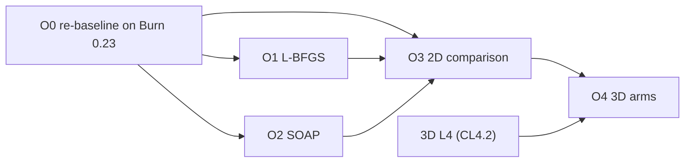

# Optimiser benchmarks for the neural operators: L-BFGS and SOAP against Adam and Gauss–Newton: design proposal

Draft 0.1, 2026-11-24. A proposal for review, not a plan: nothing here is signed off, and no
convention changes. It adds two optimisers to the comparison the 2D objective's Phase 10
began (`docs/poisson2d/phase10/results.md`), on the 2D Poisson baseline first and on the 3D
objective's Poisson baseline later. Section 12 lists the decisions the proposal needs from
the author. The reference notes behind Sections 5 and 13 are in
`docs/optimisers/references.md`.

> `docs/CONVENTIONS.md` takes precedence over this document. Nothing here changes a
> convention.

Recommendation in one paragraph: Phase 10 found that matrix-free Gauss–Newton, without
weight decay, reaches lower fine-grid errors than Adam, but at about 100 Adam updates' worth
of passes per update, and that at equal wall-clock the margin over three seeds is not
settled. The open question is whether the gain comes from *exact* curvature products or
from curvature information at all. Two cheaper curvature-aware optimisers answer it: L-BFGS,
which infers curvature from its gradient history (Burn 0.23 ships one), and SOAP, Adam run
in the eigenbasis of a Kronecker-factored preconditioner (to be written). First rerun the
Phase 10 reference arms on Burn 0.23 with five seeds, because every Phase 10 run was on the
old Burn fork (O0). Add L-BFGS as a full-batch arm minimising Gauss–Newton's objective, with
every closure evaluation counted as passes (O1). Write SOAP as a per-parameter Burn
`Optimizer`, so it reuses Adam's training path unchanged, with one Kronecker factor per
tensor dimension, the reference implementation's default (O2). Compare all four at equal wall-clock and at
a 6.3× longer budget (O3), then carry the arms that hold up into 3D (O4).

## 1. Purpose, scope and non-goals

### 1.1 Purpose

Measure whether cheaper curvature-aware optimisers match Gauss–Newton's advantage over Adam
on the Poisson FNO, at equal A100 wall-clock and at equal passes, with enough seeds to
separate the arms; and settle Phase 10's open equal-time question on the same Burn.

### 1.2 In scope

- **O0, re-baseline on Burn 0.23:** Adam and the reference Gauss–Newton arm, five seeds;
  Adam at the long budget; a cost profile of one Gauss–Newton step.
- **O1, L-BFGS:** Burn's `LBFGS` as a training arm.
- **O2, SOAP:** a new optimiser, `optim/soap/`, and its training arm.
- **O3, the 2D comparison:** four arms, five seeds, two budgets; results.
- **O4, the 3D arms:** the arms O3 keeps, on the 3D objective's Poisson baseline.

### 1.3 Non-goals

- f64 (blocked upstream on cuda, and unnecessary at 5–7 digits: decision 31's amendment of
  2026-11-24), and low precision (FP16, FP8): a later paper.
- New architectures, PyTorch parity (the library objective), multi-GPU training with the new
  optimisers.
- Tuning Adam beyond its Phase 5 settings, and changing Gauss–Newton's algorithm (an exact
  JVP, new preconditioners). O0's profile may propose such work; it is not part of this
  objective.
- Mini-batch L-BFGS variants (stochastic quasi-Newton).

### 1.4 Guiding principle

**Constraint 1:** every existing output stays bit for bit identical: the Adam and
Gauss–Newton paths, their run files, and every 2D and 3D result. The new optimisers are
additive: a new `OptimizerConfig` variant each, new modules, and no edit to the existing
branches of the trainer. Enabling Burn's `linalg` feature (Section 5.4) must not change any
existing output either; O2's first task checks it.

## 2. Constraints from the existing code

- **The trainer** (`training/`): `TrainingConfig.optimizer` is an `Option<OptimizerConfig>`
  (`None` = Adam) with variants `Adam` and `GaussNewton(GaussNewtonConfig)`
  (`training/config.rs`); the Hybrid arm is set by `adam_epochs`, not a variant. Adam is built
  as a `ModuleOptimizer` with coupled L2 weight decay and the cosine schedule
  (`trainer.rs`, `build_training_components`) and stepped per batch by `train_epoch`; Gauss–Newton
  runs `train_epoch_gn` (`training/gn.rs`) with `FnoResidual`, Φ = (1/2B) Σᵢ ‖rᵢ‖².
  Everything in `training/` is typed to `FNO<R>`, any rank.
- **Burn's per-parameter `Optimizer` trait** (`burn-optim/src/optim/module/base.rs`): one
  tensor of any rank at a time, with a recordable per-tensor state; any implementation wraps
  into the same `ModuleOptimizer` Adam uses. A new optimiser written this way reuses
  `train_epoch`, the scheduler, checkpoints and the run directory unchanged.
- **Burn's L-BFGS** (`burn-optim/src/optim/lbfgs.rs`, a port of PyTorch's): `LBFGSConfig`
  derives `Config` (`max_iter` 20, `history_size` 100, tolerances, `max_eval`,
  `line_search_fn` `None` or `StrongWolfe`); `LBFGS::step(lr, module, closure)` runs up to
  `max_iter` inner iterations, each calling `closure(module) -> (loss, grads)`; state saves
  through `into_bytes` / `from_bytes` (or `to_record` / `load_record`). It is not a per-parameter `Optimizer`: it needs its
  own epoch function, as Gauss–Newton has.
- **Run files:** `costs.json` records `optimisation_steps`, `forward_passes` and
  `backward_passes` (Phase 10 T3); `checkpoint.bin` has an optional optimiser section;
  `poisson_matrix --by-optimizer` tabulates arms. The new arms need passes counted by the
  same rule, and their own checkpoint section where the state is not a `ModuleOptimizer`'s.
- **Burn 0.23 (`burn-linalg`, feature `linalg`, not enabled in this crate today):** `qr`
  (Householder, written in tensor ops), `svd` (host), `cholesky`, `lu`, `solve`; `argsort`
  and `select` are in the core. There is **no `eigh`**.
- **Phase 10's runs are on the Burn fork `ddfa9af`, commit `9dbeb91`**: not bit-comparable
  with runs on 0.23 (#119). Every arm of this objective is run on the same Burn.
- `cubek.toml` disables TF32 on cuda (#119); every run here is f32 without TF32.

## 3. Experimental protocol

Inherited from Phase 10 (2D design §13.17, G4) unless a decision below changes it.

- **Problem:** stage 3 (n = 129, K = 64), s = 64, p = 0, modes [12, 12], width 32, 4 layers,
  N = 1000, the 200 test samples; one A100 per run (the VM has two, so two runs at once).
- **Seeds:** 42–46 (D2). Phase 10's seed 42 at μ = 0 lay outside Adam's range on the other
  side from seeds 43 and 44, so three seeds cannot separate the arms.
- **Budgets (D2):** *equal time*, the mean training time of O0's Adam reruns (Phase 10's
  was 859.4 s); and *long*, 5,400 s, where Phase 10's best Gauss–Newton run was measured.
  Every arm runs at both, so the long budget also answers whether Adam improves with
  6.3× the time.
- **Arms (D1, D3, D6):** Adam (Phase 5 settings, μ = 1e-4, batch 20); Gauss–Newton (GN200-D
  at μ = 0, the CG cap from O0); L-BFGS (full batch, Φ at μ = 0); SOAP (batch 20).
- **Reported per run:** error 4 (fine grid) and error 3, final train and test L² and the
  gap, updates, forward and backward passes, training time, peak memory, and the
  optimiser's own diagnostics.
- **Passes (D7):** one pass is one forward or one backward of the FNO on one batch, as in
  Phase 10. SOAP: one each per step, its preconditioner work reported as time, not passes.
  L-BFGS: one each per closure evaluation, on the closure's batch.
- **Tuning budget:** the new arms get a fixed pilot (one seed, the equal-time budget, a
  short grid named in D5 and D6) before the matrix; Adam keeps its untuned Phase 5 settings
  and Gauss–Newton its Phase 10 ones. Stated in the results as a limitation either way.

## 4. L-BFGS

- **Objective (D3):** Φ at μ = 0, the residual Gauss–Newton minimises (`FnoResidual`), so
  that L-BFGS against Gauss–Newton isolates history-based against exact curvature on one
  objective. Alternative: the baseline loss L that Adam minimises. Burn's L-BFGS has no
  weight decay, so μ = 0 is also the natural setting; a μ > 0 arm would add ½μ‖θ‖² inside
  the closure.
- **Batch (D4): full batch**, one closure evaluation over all 1,000 training samples.
  L-BFGS's curvature pairs (s, y) assume the same function at every step; mini-batch noise
  corrupts y. Two ways to evaluate it: one batch of 1,000 (Phase 10's full-batch GN ran at
  12,619–17,195 MiB with its CG vectors, so the FNO alone fits an A100 80 GB), or the sum of 50
  batches of 20 with gradients accumulated (no memory risk, but 50× the per-batch overhead
  at batch 20). Recommended: one batch of 1,000, falling back to accumulation if memory
  says so.
- **Settings (D5):** `line_search_fn = StrongWolfe` (without it the step length is a fixed
  learning rate), lr 1, `history_size` and `max_iter` from a pilot: history ∈ {10, 100},
  max_iter ∈ {1, 20}. An "update" is one inner iteration that moves θ; the epoch is one
  `step` call.
- **Code:** `OptimizerConfig::Lbfgs(LbfgsArm)` (the Burn config plus the batch and objective
  choices), `train_epoch_lbfgs` beside `train_epoch_gn`, closure evaluations counted into
  `costs.json`, the state as a checkpoint section, `OPTIMIZER=lbfgs` and the `_lbfgs` run
  name in `train_poisson`.

## 5. SOAP

Vyas et al. 2024 (arXiv 2409.11321, Algorithm 3), with the reference implementation's
handling of tensors (nikhilvyas/SOAP @a1e5535); details and citations in
`docs/optimisers/references.md` §1.

### 5.1 The algorithm

For each tensor G (the gradient) with dimensions d₁ … d_k: one factor per dimension
Lⱼ ∈ ℝ^{dⱼ×dⱼ}, a moving average (rate β₂, `shampoo_beta`) of G's mode-j Gram matrix;
an eigenbasis Qⱼ of each Lⱼ. Each step projects G into the basis (mode products with Qⱼᵀ),
runs Adam's moment updates and normalisation there, and projects the update back. The
bases are recomputed every f steps (default 10): the first by a full symmetric
eigendecomposition, later ones by one step of power iteration and QR (Algorithm 4), which
the paper finds as good as a full one. On a refresh the first moment is rotated into the
new basis and the second only permuted to follow the eigenvalue order (reference code; the
paper's Algorithm 3 keeps M in the original space, equivalent for M). The first step
updates no parameters (reference code). The paper runs the optimiser in f32 (its models in bf16 mixed precision).

### 5.2 Our tensors

16 spectral tensors [32, 32, 12, 12] (4 layers × 2 corners × re, im) hold 99.6 % of the
2,368,001 parameters; the rest are small matrices ([3, 32], [32, 32, 1] ×4, [32, 128],
[128, 1]) and biases. In 3D, 32 tensors [32, 32, m, m, m].

| Handling of a 2D spectral tensor (D8) | Factors | Factors + bases / tensor | 3D, m = 8 |
| --- | --- | --- | --- |
| **A. One factor per dimension** (reference default, `merge_dims` off) | 32, 32, 12, 12 | 3.2 % | 0.85 % |
| B. Mode dimensions merged | 32, 32, 144 | 31 % | 1.0× |
| C. Reference `merge_dims` on | 1024, 144 | 14.5× | 256× |
| D. Mode dimensions not preconditioned | 32, 32 | 2.8 % | 0.78 % |

Recommended: **A**, the reference code's default. The only SOAP-on-FNO use found (one
search; Khodakarami et al. 2026, a Tucker-factorised FNO) ran the code's defaults
(`merge_dims` off) with the complex weights viewed as real, adding a 2 × 2 re/im factor. B lets the 144 modes mix, at 10×
A's memory; D is a cheap ablation (channel rotation only). C is impractical in 3D. Biases
take plain Adam, as in the reference code.

**re and im separately.** Burn's per-parameter `Optimizer` sees one tensor at a time, and
the FNO stores `weights_re` and `weights_im` as separate parameters, so each gets its own
factors (block-diagonal over tensors). Stacking them into one [32, 32, 12, 12, 2] tensor
with a 2 × 2 factor, as Khodakarami et al.'s code does with complex weights, would need a
change to the model's parameter layout: out of scope under constraint 1.

### 5.3 Hyperparameters (D6)

Reference defaults: lr 3e-3, β = (0.95, 0.95), shampoo_beta = β₂, ε 1e-8, decoupled weight
decay 0.01, f = 10, `max_precond_dim` 10,000 (never reached under A), `normalize_grads`
off. The paper's small-batch runs used β₂ 0.99 and weight decay 1e-4; Khodakarami et al.
used lr 1e-3, weight decay 1e-4. Recommended starting point: our Adam's lr 1e-3 with the
cosine schedule and weight decay 1e-4, β = (0.95, 0.95), f = 10; the pilot tries
lr ∈ {1e-3, 3e-3} and f ∈ {10, 50}, on seed 42 at the equal-time budget.

### 5.4 What it needs from Burn (D9)

| Operation | When | In Burn 0.23 |
| --- | --- | --- |
| Mode products (permute, reshape, `matmul`) | every step | yes |
| Moving averages, `sqrt`, division | every step | yes |
| `argsort`, `select` (eigenvalue order, permuting V) | every refresh | yes |
| QR of the 12 × 12, 32 × 32 and 128 × 128 factors | every f steps | `linalg::qr`, written in tensor ops; on-device behaviour not verified |
| Symmetric eigendecomposition (first basis) | once per tensor | no `eigh`; `linalg::svd` (host) of the symmetric PSD factor gives its eigenvectors |

Recommended: enable `linalg`; the first basis by `svd` on the host (sizes ≤ 128, once per
tensor), the refreshes by `qr` on the device if O2's first task shows it correct and fast
on cuda, metal and flex, else on the host. Precision f32, as the paper's optimiser; O2's first task
checks the refresh against an f64 host reference at our sizes.

### 5.5 Code

`optim/soap/` (generic over any Burn tensor rank, imports nothing from `models/` or
`training/`, like `optim/gauss_newton/`): `SoapConfig` (derives `Config`), `Soap`
implementing Burn's `Optimizer` with a recordable per-tensor state. In the trainer, an
`OptimizerConfig::Soap(SoapConfig)` variant builds `Soap` where Adam's `ModuleOptimizer` is
built; nothing else in the Adam path changes. `OPTIMIZER=soap` and the `_soap` run name in
`train_poisson`.

## 6. Software architecture

| Module | Change | Milestone |
| --- | --- | --- |
| `training/config.rs` | `OptimizerConfig::Lbfgs`, `OptimizerConfig::Soap` | O1, O2 |
| `training/lbfgs.rs` (new) | `train_epoch_lbfgs`, the closure over Φ | O1 |
| `training/trainer.rs` | the new variants' construction and dispatch; Adam and GN branches untouched | O1, O2 |
| `optim/soap/` (new) | `SoapConfig`, `Soap` | O2 |
| `runs/` | the L-BFGS checkpoint section; passes for the new arms | O1 |
| `examples/train/poisson.rs` | `OPTIMIZER=lbfgs|soap`, the new literals | O1, O2 |
| `examples/predict/poisson_matrix.rs` | the new arms in `--by-optimizer` | O3 |
| `Cargo.toml` | Burn's `linalg` feature | O2 |

## 7. Cost and memory model (initial estimates)

- **SOAP (A):** factors and bases 0.3 MB for all spectral tensors; per step about 880·N flops
  per spectral tensor (four projections plus the factor updates; not measured), about
  2·10⁹ in all, small beside the FNO's forward and backward. Expected per-step time close to
  Adam's at batch 20, which is overhead-bound (Phase 10: 58 passes per second); O2 measures it.
- **L-BFGS (full batch):** 2 × 100 history vectors of 9.5 MB = 1.9 GB at the default
  history; the full-batch forward and backward at N = 1,000 below Phase 10's full-batch GN
  peak (12,619–17,195 MiB); Phase 10's full-batch GN ran about 0.26 s per pass of 1,000 samples (5,413 s for 20,614
  passes), so about 0.5 s per closure evaluation, about 1,700 at the equal-time budget.
- **The matrix (O3):** four arms × five seeds at about 900 s, and at 5,400 s (D2): about
  5 h and 30 h of A100 time, half that on the VM's two A100s.

## 8. Risks

- **R1, L-BFGS in f32 stalls** near convergence (the curvature pairs lose precision); seen
  in second-order PINN work. Report where it stalls; f64 is out of scope.
- **R2, the full batch does not fit** with the history at large `history_size`; fall back to
  accumulation (D4).
- **R3, SOAP's QR on the device is wrong or slow** on some backend (the repo has met GPU
  kernel bugs before: `upstream/`); fall back to the host (D9).
- **R4, unequal tuning** favours whichever arm was tuned most; the tuning budget is fixed
  and stated (Section 3).
- **R5, the equal-time result stays unsettled** at five seeds; report it as such, with the
  spread.
- **R6, 3D cost:** O4 waits on the 3D objective's baseline (CL4.2) and its memory (D4 there).

## 9. Validation

- **SOAP:** with every basis fixed at the identity, it equals Adam with the same moments to
  f32 round-off; a quadratic with a known Kronecker-structured Hessian; tensors of rank 1 to
  5; the refresh against a host f64 eigendecomposition; the state's record round trip and a
  resumed run bit for bit equal to an uninterrupted one; small fixtures from the reference
  implementation (Python, outside CI, as in the library objective).
- **L-BFGS:** the trainer integration on a small least-squares problem (it converges, the
  passes add up, resume is exact); Burn's own tests cover the algorithm.
- **Constraint 1:** the existing suite unedited, the Adam replay check of Phase 10 T3, and an
  Adam and a Gauss–Newton run on flex bit for bit equal before and after each change.

## 10. Phased plan

Milestones O0–O4, each ending at a gate (`docs/optimisers/gates/O<n>.md`). The tasks, their
*Done when* and *Needs* are in `docs/optimisers/roadmap.md`.

CO0.1, CO0.2, CO1.1, CO2.1 and CO2.2 can start at once (code on the Mac; the runs and CO2.1's
cuda check on the VM); the pilots CO1.2 and CO2.3 need CO0.1's equal-time budget.
O4 also needs the 3D objective's Poisson baseline.

## 11. Alternatives considered

- **Muon** (in Burn 0.23, a per-parameter `Optimizer`): cheap to add, but a first-order
  orthogonalised update, not curvature-aware in the sense compared here; an optional arm if
  O3's results call for it.
- **Shampoo:** SOAP's parent, with the same factors (as moving averages in SOAP) and a
  matrix root instead of Adam in the basis; SOAP adds one hyperparameter (f) over AdamW and
  degrades more slowly than Shampoo as f grows.
- **K-FAC:** curvature from layer activations and gradients; needs per-layer hooks that the
  FNO's spectral layers do not have in Burn.
- **Mini-batch L-BFGS:** out of scope (Section 1.3).
- **SOAP's `merge_dims`:** 14.5× to 256× the tensor's memory for our shapes (Section 5.2).

## 12. Decisions needed

| ID | Decision | Recommendation |
| --- | --- | --- |
| D0 | This proposal as the plan of record | draft 0.1, after the author's review |
| D1 | The reference Gauss–Newton arm | GN200-D at μ = 0; the CG cap (50 or 150) chosen from O0's seed-42 runs at both budgets |
| D2 | Seeds and budgets | seeds 42–46; equal time (O0's Adam mean) and 5,400 s, every arm at both |
| D3 | L-BFGS's objective and weight decay | Φ at μ = 0, Gauss–Newton's objective |
| D4 | L-BFGS's batch | full batch, one batch of 1,000; accumulation over batches of 20 if memory requires |
| D5 | L-BFGS's settings | strong Wolfe, lr 1; history and `max_iter` from the pilot |
| D6 | SOAP's hyperparameters | lr 1e-3 cosine, weight decay 1e-4, β (0.95, 0.95), f = 10; pilot lr ∈ {1e-3, 3e-3}, f ∈ {10, 50} |
| D7 | Pass accounting for the new arms | one forward and one backward per SOAP step and per L-BFGS closure evaluation; SOAP's preconditioner work as time |
| D8 | SOAP's handling of the spectral tensors | A, one factor per dimension; re and im separate; biases on Adam |
| D9 | Where SOAP's linear algebra runs | `linalg` enabled; first basis by host `svd`, refreshes by device `qr` if O2's first task passes, else host |

## 13. References

- Vyas, N. et al. (2024). SOAP: Improving and stabilizing Shampoo using Adam. arXiv
  2409.11321. Reference code: github.com/nikhilvyas/SOAP (@a1e5535).
- Gupta, V., Koren, T., Singer, Y. (2018). Shampoo: Preconditioned stochastic tensor
  optimization. arXiv 1802.09568.
- Khodakarami, S. et al. (2026). Spectral bias in physics-informed and operator learning: Analysis and mitigation guidelines.
  arXiv 2602.19265 (SOAP on DeepONet, DeepOKAN, FNO and CNO; its Appendix D on second-order
  methods for neural operators).
- Liu, D. C., Nocedal, J. (1989). On the limited memory BFGS method for large scale
  optimization. Mathematical Programming 45; Burn's `burn-optim/src/optim/lbfgs.rs`.
- The 2D design §13.17 and `docs/poisson2d/phase10/` (Gauss–Newton, the protocol, the
  results); `docs/optimisers/references.md` (the reading notes).

## Appendix A. Revision history

- **Draft 0.1 (2026-11-24).** First draft: scope (L-BFGS and SOAP against Adam and
  Gauss–Newton, 2D then 3D, the author's choice of 2026-11-24), protocol, SOAP's tensor
  handling from the reading notes, milestones O0–O4, decisions D0–D9.
